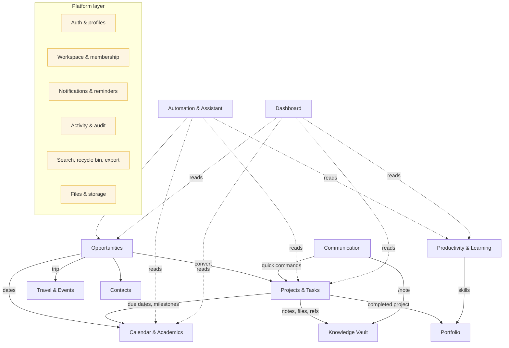

## How to read this document

This Product Requirements Document (PRD) defines **what** Luna Space must do and **why**. It is the authority on scope, priority and release assignment for the whole planning package. The other five documents implement the decisions made here:

| Document | Answers | Depends on |
|---|---|---|
| 01 PRD (this document) | What is built, for whom, in which release, and how success is judged | — |
| 02 Application Flow | How users move through the product and how data moves between modules | 01 |
| 03 Implementation Plan | In which order the product is built and verified | 01, 02, 04, 06 |
| 04 TRD | Which technologies and runtime architecture deliver the requirements | 01 |
| 05 UI/UX Specification | How every screen looks and behaves | 01, 02 |
| 06 Backend Schema | How data is stored, related and protected | 01, 04 |

**Conventions used throughout the package**

- **Release tags:** R1 = MVP, R2, R3, R4. A feature tagged R1 is required for the first usable release.
- **Priority tags (MoSCoW within a release):** Must Should Could.
- **Requirement identifiers:** `FR-<MODULE>-<nn>` for functional requirements, `NFR-<AREA>-<nn>` for non-functional requirements, `US-<nn>` for user stories, `AC-<nn>` for acceptance criteria. The same identifiers are referenced from documents 02–06.
- **Module codes:** PLAT (platform), DASH, OPP, PRJ, CAL, ACAD, PROD, CHAT, VAULT, AUTO, TRIP, PORT, CONT.
- **"Member"** means one of the (at most) two people in a workspace. **"Partner"** means the other member, from the point of view of the current user.
- **Shared / Private:** every record that can be either is labelled with a `visibility` of `shared` (both members can see it) or `private` (only its owner can see it).

> **Proposed:** Everything in this package is a proposal for review. Nothing here describes software that already exists. Where a decision has not been made, it is marked **Unresolved** and a recommended default is given.

## 1. Executive summary

Luna Space is a private, installable web workspace for **exactly two collaborators** — typically two students who enter hackathons, apply for internships and scholarships, and build projects together. Today their work is scattered across group chats, browser bookmarks, spreadsheets, calendar apps, note apps, Git hosting and memory. Deadlines are missed, opportunity details go stale, project decisions are lost in chat history, and neither person has a reliable record of what they achieved.

Luna Space replaces that scatter with one connected workspace:

- An **Opportunity Tracker** that captures hackathons, competitions, internships, scholarships, fellowships and other programmes — including **automatic extraction** of details from a pasted URL, with every extracted field marked *confirmed, inferred, missing* or *conflicting* and reviewed by a person before it is saved.
- **Project Rooms** for each hackathon or major project, with a five-column task board, notes, files, checklists, decisions and (later) pitch and demo preparation.
- A **shared and personal Calendar** in which opportunity deadlines, task due dates and milestones appear automatically, plus academic timetables and exams.
- **Real-time Chat** between the two members, with replies, reactions, read receipts, attachments and (later) quick commands, voice notes and calls.
- A **Knowledge Vault** of notes, files, bookmarks and snippets, searchable in one place.
- **Personal productivity** tools: goals, habits, focus timer, skills and course tracking, and expenses.
- **Travel coordination** for offline events, with strictly opt-in, time-limited location sharing.
- An individually owned **Portfolio** generated only from verified records, and a **Contacts** directory for mentors and professional connections.
- **Rule-based automation** (reminders, conflict detection, weekly summaries) that works with no AI service. AI features are optional and arrive last.

The product targets **₹0 running cost** using free tiers (Supabase Free plan, a free static host, browser-native Web Push). Every feature that could exceed a free tier or require payment is identified in section 16 and in the TRD.

Delivery is staged across four releases. **R1 (MVP)** delivers the platform foundation, opportunities with URL extraction, project rooms and tasks, calendar with reminders, text chat, the Knowledge Vault, notifications, recycle bin and export. R2 adds academics, productivity, comparison and eligibility tools and automation. R3 adds travel, portfolio, contacts, expenses, GitHub integration and voice messages. R4 adds audio/video calls, screen sharing and optional AI.

## 2. Product vision

> **Vision statement:** For two people who build and compete together, Luna Space is a private operating system for their shared ambitions — one place where every opportunity, deadline, project, conversation and achievement is connected, trustworthy and easy to act on.

### 2.1 Product principles

| # | Principle | What it means in practice |
|---|---|---|
| P1 | **Connected, not collected** | Records link to each other. An opportunity becomes a project; a project's deadline appears on the calendar; a finished project becomes a portfolio entry. Users never re-type information that already exists. |
| P2 | **Truthful by design** | The product never invents data. Extracted information shows its evidence and status. Portfolio text is generated only from recorded facts. Unknown values are shown as unknown. |
| P3 | **Private by default for personal data, shared by default for collaboration** | Project and opportunity records default to *shared*; habits, focus sessions, personal notes and academic records default to *private*. Location sharing is off until explicitly started. |
| P4 | **Two people, equal power** | Both members have the same permissions over shared data. The workspace creator has no extra power over the partner's content. |
| P5 | **Works without paid services** | Core features run on free tiers with no AI key. Paid or limited features are optional and clearly labelled. |
| P6 | **Fast capture, calm review** | Capturing something (a URL, a task, a note) takes seconds; organising it can happen later. |
| P7 | **Mobile-ready, desktop-strong** | Every R1 feature works on an Android phone; dense planning views (board, calendar week, comparison) are optimised for the laptop. |

### 2.2 Positioning

Luna Space is not a general team tool (no unlimited seats, no organisation hierarchy), not a public social network, and not a job board. It sits between a personal productivity app and a small-team project tool, specialised for the hackathon-and-opportunity lifecycle.

## 3. Problem statement

### 3.1 Current situation (assumed, to be validated with the two intended users)

| Problem | Evidence / symptom | Consequence |
|---|---|---|
| Opportunity information is scattered | Links saved in chat, bookmarks and screenshots; details re-read from the source every time | Missed registration deadlines; ineligible applications discovered late |
| Opportunity pages change | Organizers extend or move deadlines, add tracks, change rules | Decisions made on stale information |
| Manual data entry is tedious | Copying dates, prizes and eligibility from long pages | Fields left blank; low adoption of any tracker |
| Project coordination happens in chat | Tasks and decisions are buried in message history | Duplicate work, forgotten decisions, last-minute submission panic |
| Academic and hackathon calendars are separate | Exams and hackathon deadlines live in different tools | Conflicts are discovered too late |
| Achievements are not recorded when they happen | Portfolio and résumé written from memory months later | Lost detail, understated outcomes, or accidental exaggeration |
| Paid tools are not an option | Student budget of ₹0 | Users accept fragmented free tools |

### 3.2 Problem to solve

How might two collaborators keep every opportunity, deadline, project task, conversation, document and achievement in one trustworthy place, at no cost, on both laptop and phone?

## 4. Goals and non-goals

### 4.1 Goals

| ID | Goal | Measured by (see section 15) |
|---|---|---|
| G1 | No missed deadline for any tracked opportunity or task | Missed-deadline count; reminder delivery rate |
| G2 | Capturing an opportunity from a URL takes under 2 minutes including review | Median capture time |
| G3 | Every saved opportunity field is traceable to a source or a person | Share of fields with provenance = 100 % |
| G4 | All project work for a hackathon lives in its project room | Share of project tasks created in Luna Space vs. outside |
| G5 | Both members can see shared status at a glance on any device | Dashboard load time; weekly active use on both devices |
| G6 | Each member ends a project with a verified portfolio entry | Portfolio entries per completed project |
| G7 | Running cost stays at ₹0 for normal two-person use | Monthly bill; free-tier usage headroom |

### 4.2 Non-goals

The following are explicitly **out of scope** for all four planned releases unless the PRD is revised:

- More than two members in a workspace, guest access, public sharing links or organisations.
- Multiple workspaces per user (a user belongs to at most one workspace at a time).
- A public opportunity marketplace, scraping of whole websites, or crawling sites the user did not paste.
- Automated submission of applications or registrations on third-party sites.
- Native Android (Play Store) or Windows (Microsoft Store) applications. The product is a PWA.
- iOS-specific support (it should work in Safari where web standards allow, but iOS is not tested).
- Payments, invoicing or splitting money through payment providers. Expenses are records only.
- Any feature that requires a paid AI API to function.
- Group calls with more than two participants, call recording, or live transcription.
- Continuous background location tracking.

## 5. Target users and personas

### 5.1 User model

Luna Space has exactly one type of human user — a **workspace member** — and the workspace holds at most two. The person who creates the workspace is recorded as its creator for audit purposes only; both members have identical permissions once the second member joins.

### 5.2 Personas

> **Assumption:** The personas below are illustrative composites. Names are placeholders. Validate them with the two real users before R1 is finalised.

| | Persona A — "The Organizer" | Persona B — "The Builder" |
|---|---|---|
| Role | Undergraduate student, team lead for hackathons | Undergraduate student, lead developer |
| Primary device | Android phone during the day, Windows laptop at night | Windows laptop most of the day |
| Goals | Find good opportunities early; never miss a deadline; keep the team on track | Spend time building, not coordinating; know exactly what to do next |
| Frustrations | Re-reading long event pages; chasing the partner on chat about status | Requirements and decisions scattered across messages |
| Key features | Opportunity tracker, URL extraction, calendar, reminders, dashboard | Project room, kanban, GitHub links, snippets, focus timer |
| Privacy expectations | Keeps academic grades and expenses private | Keeps personal notes and habit tracking private |

### 5.3 Contexts of use

- **Discovery moments** (phone, short sessions): a friend shares a hackathon link; the user pastes it into Luna Space in under a minute.
- **Planning sessions** (laptop, 30–60 minutes): weekly review, comparing opportunities, breaking a project into tasks.
- **Hackathon crunch** (laptop, many hours, often at night): board, chat, checklist and files used together under time pressure.
- **Travel days** (phone, intermittent connectivity): itinerary, tickets, emergency contacts and optional location sharing.

## 6. User needs and use cases

### 6.1 Needs

| ID | Need | Module(s) |
|---|---|---|
| N1 | Know every relevant deadline and be reminded in time | OPP, CAL, AUTO |
| N2 | Capture opportunity details quickly and trust them | OPP |
| N3 | Decide which opportunities to pursue | OPP (comparison, eligibility, matching) |
| N4 | Coordinate project work without long chat threads | PRJ, CHAT |
| N5 | Keep academic obligations visible next to hackathons | CAL, ACAD |
| N6 | Keep personal growth and routines on track | PROD |
| N7 | Find any note, file, link or message quickly | VAULT, PLAT search |
| N8 | Organise travel for offline events safely | TRIP |
| N9 | Build an honest portfolio and résumé from real records | PORT |
| N10 | Remember people met at events and follow up | CONT |
| N11 | Own and export personal data; leave cleanly if needed | PLAT |

### 6.2 Primary use cases

| ID | Use case | Actor | Release |
|---|---|---|---|
| UC-01 | Create a workspace and invite the partner | Member | R1 |
| UC-02 | Add an opportunity by pasting a URL, review extracted fields, save | Member | R1 |
| UC-03 | Add an opportunity manually | Member | R1 |
| UC-04 | Move an opportunity through its status pipeline | Member | R1 |
| UC-05 | Convert an opportunity into a project room | Member | R1 |
| UC-06 | Plan and track project tasks on the board | Member | R1 |
| UC-07 | Complete a submission checklist from a template | Member | R1 |
| UC-08 | See all deadlines and events on a calendar; receive reminders | Member | R1 |
| UC-09 | Chat with the partner, share files, react and reply | Member | R1 |
| UC-10 | Save notes, files and bookmarks to the Vault and search them | Member | R1 |
| UC-11 | Restore something deleted by mistake | Member | R1 |
| UC-12 | Export personal data | Member | R1 |
| UC-13 | Check eligibility for an opportunity | Member | R2 |
| UC-14 | Compare two to four opportunities side by side | Member | R2 |
| UC-15 | Be alerted when a tracked opportunity page changes | System → Member | R2 |
| UC-16 | Record a project decision and request the partner's approval | Member | R2 |
| UC-17 | Plan the week and complete a weekly review | Member | R2 |
| UC-18 | Maintain an academic timetable and exam list | Member | R2 |
| UC-19 | Plan a trip to an offline hackathon and share location temporarily | Member | R3 |
| UC-20 | Generate a portfolio entry and résumé bullets from a completed project | Member | R3 |
| UC-21 | Record a contact met at an event and schedule a follow-up | Member | R3 |
| UC-22 | Leave the workspace and take personal data along | Member | R3 |
| UC-23 | Hold an audio/video call with screen sharing | Member | R4 |
| UC-24 | Ask an optional AI assistant to summarise or brainstorm | Member | R4 |

## 7. Functional requirements

Requirements are grouped by module. Each requirement is testable; acceptance criteria for the most important ones are in section 14.

### 7.1 Platform (PLAT)

| ID | Requirement | Rel. | Pri. |
|---|---|---|---|
| FR-PLAT-01 | Users can sign up and sign in with email + password and with an email magic link. Email ownership must be confirmed before workspace access. | R1 | Must |
| FR-PLAT-02 | A signed-in user without a workspace can create one (name required, 1–60 characters). The creator becomes member 1. | R1 | Must |
| FR-PLAT-03 | A member can create an invitation link valid for 7 days and single use. Only one active invitation may exist per workspace. The link can be revoked. | R1 | Must |
| FR-PLAT-04 | Accepting an invitation adds the user as member 2. The database must reject any third member, even if the API is called directly. | R1 | Must |
| FR-PLAT-05 | Each user has a profile: display name, avatar, time zone (default Asia/Kolkata), availability status and notification preferences. | R1 | Must |
| FR-PLAT-06 | Every record that supports it has a visibility of *shared* or *private*. Private records are never returned to the partner by any API. | R1 | Must |
| FR-PLAT-07 | In-app notification centre with unread count, mark-read, mark-all-read and deep links. | R1 | Must |
| FR-PLAT-08 | Web Push notifications on Windows (Chrome/Edge) and Android (Chrome) after explicit opt-in per device. | R1 | Should |
| FR-PLAT-09 | Activity history: important create/update/delete/status actions on shared records are recorded with actor and time and shown in context. | R1 | Must |
| FR-PLAT-10 | Recycle bin: deleted items are recoverable by either member (shared) or the owner (private) for 30 days, then purged automatically. | R1 | Must |
| FR-PLAT-11 | Global search across opportunities, tasks, notes, bookmarks, files (by name) and messages, respecting visibility. | R1 | Must |
| FR-PLAT-12 | Command palette (Ctrl+K) for navigation and quick creation. | R1 | Should |
| FR-PLAT-13 | Personal data export as a machine-readable JSON file containing everything the user owns plus shared records. | R1 | Must |
| FR-PLAT-14 | Full workspace backup export (ZIP with JSON + files). | R3 | Should |
| FR-PLAT-15 | Installable PWA with app icon, splash screen and offline app shell. | R1 | Must |
| FR-PLAT-16 | Offline drafts and a queued outbox: notes, tasks and chat messages created offline are synchronised in order when connectivity returns, without duplicates. | R2 | Should |
| FR-PLAT-17 | Leave workspace: a member can leave; their private data leaves with them (export, then deletion); shared data stays with the workspace with authorship preserved. | R3 | Must |
| FR-PLAT-18 | Account deletion removes the user's private data and anonymises authorship on shared data that remains. | R3 | Must |
| FR-PLAT-19 | Light and dark themes, following the system setting by default. | R1 | Should |

### 7.2 Dashboard (DASH)

| ID | Requirement | Rel. | Pri. |
|---|---|---|---|
| FR-DASH-01 | Dashboard has a **Shared** view and a **Me** view, switchable with one tap; the choice is remembered per device. | R1 | Must |
| FR-DASH-02 | "Upcoming deadlines" widget lists the next 14 days of opportunity dates, task due dates and calendar deadlines, sorted by date, with days-remaining. | R1 | Must |
| FR-DASH-03 | "Active projects" widget shows non-archived projects with stage, open-task count and next milestone. | R1 | Must |
| FR-DASH-04 | "Recent activity" widget shows the last 20 shared activity entries. | R1 | Must |
| FR-DASH-05 | Quick actions: add opportunity from URL, new task, new event, new note, open chat. | R1 | Must |
| FR-DASH-06 | Notifications summary (unread count and latest three). | R1 | Should |
| FR-DASH-07 | Shared and individual goals widget for the current week. | R2 | Should |
| FR-DASH-08 | Warnings widget: missing information, conflicts and overdue tasks. | R2 | Should |

### 7.3 Opportunities (OPP)

| ID | Requirement | Rel. | Pri. |
|---|---|---|---|
| FR-OPP-01 | Track opportunities of type: hackathon, coding competition, innovation challenge, internship, scholarship, fellowship, research programme, conference, workshop, summer school, student ambassador programme, open-source programme, exchange programme, technical event, other. | R1 | Must |
| FR-OPP-02 | Each opportunity stores: name, organizer, description, official website, registration link, rules link and/or text, registration deadline, submission deadline, event start/end, mode (online/offline/hybrid/unknown), location, eligibility text, team size min/max, registration fee (amount + currency, or free), prizes and benefits, required documents (list), tracks/categories (list), status, tags, visibility. | R1 | Must |
| FR-OPP-03 | Deadlines can be **date-only** (e.g. "15 Dec 2026") or **date-time with time zone** (e.g. "15 Dec 2026, 23:59 IST"). The product never invents a time for a date-only deadline. | R1 | Must |
| FR-OPP-04 | Status pipeline: saved → interested → planning → registered → in progress → submitted → awaiting result → won / not selected; plus withdrawn, missed and archived. | R1 | Must |
| FR-OPP-05 | List view with filters (type, status, mode, deadline range, tag) and sort (nearest deadline, recently added, name). | R1 | Must |
| FR-OPP-06 | **URL extraction:** pasting a URL starts an extraction run that returns proposed values for the fields in FR-OPP-02. | R1 | Must |
| FR-OPP-07 | Every extracted field carries a status: **Confirmed** (explicitly stated on the page, with evidence), **Inferred** (derived by a stated rule, e.g. the year assumed from context), **Missing** (not found) or **Conflicting** (two or more different values found). | R1 | Must |
| FR-OPP-08 | Extraction results are shown on a **review screen**; nothing is saved until a member confirms. Each field can be accepted, edited or cleared. Conflicting fields require a choice. | R1 | Must |
| FR-OPP-09 | The product never fabricates values: a field with no evidence is *Missing* and saved empty. | R1 | Must |
| FR-OPP-10 | The original source URL, the final URL after redirects, the extraction time and a content fingerprint are preserved. "Last checked" is visible on the detail page. | R1 | Must |
| FR-OPP-11 | Field-level provenance: for every saved field, the product records whether it came from extraction (status + evidence snippet) or manual entry, and who last verified it. | R1 | Must |
| FR-OPP-12 | Change history for important fields (all dates, fees, eligibility, team size, mode, location, status) with old value, new value, who/what changed it, and when. | R1 | Must |
| FR-OPP-13 | If extraction fails (blocked, timeout, unsupported page, JavaScript-only page), the user is taken to a manual-entry form with the URL pre-filled and a clear reason. | R1 | Must |
| FR-OPP-14 | Missing-information warnings on the detail page and card for missing critical fields (registration deadline, eligibility, team size, mode). | R1 | Should |
| FR-OPP-15 | Convert an opportunity into a project room in one action, carrying over name, dates, links and team-size constraint. | R1 | Must |
| FR-OPP-16 | **Source credibility indicator** per source URL: *Official organizer*, *Known platform*, *Unverified* or *Caution*, computed by documented rules and overridable by a member. | R2 | Should |
| FR-OPP-17 | **Eligibility checker** compares structured eligibility criteria with each member's private eligibility profile and returns per-criterion results: meets / does not meet / unknown. | R2 | Should |
| FR-OPP-18 | **Comparison** of 2–4 opportunities in a side-by-side table with differences highlighted. | R2 | Should |
| FR-OPP-19 | **Deadline-change monitoring**: tracked (non-closed) opportunities are re-checked automatically at most once per day; changes to important fields create a pending change for review and an alert. Changes are never applied silently. | R2 | Should |
| FR-OPP-20 | **Participation history** per member: which opportunities they took part in, their role, result and linked project. | R2 | Should |
| FR-OPP-21 | **Personalized matching**: a rule-based score (0–100) explaining why an opportunity fits each member (eligibility, interests, skills, timing, mode). | R3 | Could |
| FR-OPP-22 | **Discovery**: members subscribe to RSS/Atom feeds they choose (e.g. a university notice board); new items appear in a Discovery inbox to import via the URL extraction flow. | R3 | Could |

### 7.4 Projects and tasks (PRJ)

| ID | Requirement | Rel. | Pri. |
|---|---|---|---|
| FR-PRJ-01 | Create a project room manually or from an opportunity. Fields: name, category (hackathon, competition, academic, practice, personal, research, other), summary, stage, start/end dates, linked opportunity, repository URLs, visibility. | R1 | Must |
| FR-PRJ-02 | Project stages: idea → planning → building → testing → submitting → presenting → completed; plus archived. | R1 | Must |
| FR-PRJ-03 | Project overview tab: summary, stage, team members and roles, key dates, links, progress (done/total tasks), next deadlines. | R1 | Must |
| FR-PRJ-04 | Kanban board with columns Backlog, To do, In progress, Review, Done; drag-and-drop between and within columns; keyboard alternative to drag. | R1 | Must |
| FR-PRJ-05 | Tasks support title, description (Markdown), assignee, priority (low/medium/high/urgent), due date (date-only or date-time), status, subtasks (one level), comments, attachments, tags and project association. Tasks without a project are personal or shared "loose" tasks. | R1 | Must |
| FR-PRJ-06 | "My tasks" view across all projects, grouped by due date. | R1 | Must |
| FR-PRJ-07 | Project notes, file library, research references (bookmarks) and meeting notes live in the Vault and are filtered to the project inside the room. | R1 | Must |
| FR-PRJ-08 | Submission checklist created from a reusable template (built-in: "Generic hackathon submission", "Devpost-style submission", "Pitch deck checklist", "Demo video checklist"), editable per project; items can have due dates and owners. | R1 | Must |
| FR-PRJ-09 | Users can save any checklist as a new workspace template. | R1 | Should |
| FR-PRJ-10 | Project activity history tab. | R1 | Must |
| FR-PRJ-11 | Brainstorming board: ideas with description and up/down votes from each member; promote an idea to a task or decision. | R2 | Should |
| FR-PRJ-12 | Decision log: title, context, options considered, decision, status (proposed / approved / rejected / superseded), decided by, date. | R2 | Should |
| FR-PRJ-13 | Approval/confirmation requests: a member can request the partner's approval on a decision, a checklist item (e.g. "final submission ready") or an expense; the partner approves or declines with a comment. | R2 | Should |
| FR-PRJ-14 | Shared polls inside a project or chat (single or multiple choice, optional close time). | R2 | Could |
| FR-PRJ-15 | Meeting notes template (agenda, notes, decisions, action items → tasks). | R2 | Should |
| FR-PRJ-16 | Pitch preparation, presentation planning, demo preparation (script + checklist) and judge-question bank (question, prepared answer, owner, confidence). | R3 | Should |
| FR-PRJ-17 | Project retrospective: what went well, what to improve, action items; available when stage is completed. | R3 | Should |
| FR-PRJ-18 | Skills-to-project mapping: tag which skills each member applied in the project; feeds Productivity and Portfolio. | R3 | Should |
| FR-PRJ-19 | GitHub integration: link repositories via OAuth and show recent commits, open issues and pull requests (read-only). | R3 | Could |

### 7.5 Calendar (CAL) and Academics (ACAD)

| ID | Requirement | Rel. | Pri. |
|---|---|---|---|
| FR-CAL-01 | Calendar with month, week, day and agenda (list) views. | R1 | Must |
| FR-CAL-02 | Layers: Shared and Personal (toggle each), plus derived layers: Opportunity dates, Task due dates, Project milestones. | R1 | Must |
| FR-CAL-03 | Opportunity dates and task due dates appear automatically; editing them on the calendar edits the source record (no duplicate copies). | R1 | Must |
| FR-CAL-04 | Events: title, kind (meeting, deadline, milestone, assignment, exam, class, lab, travel, focus, personal, other), all-day or timed with time zone, location, description, linked project/opportunity, visibility. | R1 | Must |
| FR-CAL-05 | Reminders on events, tasks and opportunity dates with presets (at time, 1 h, 1 day, 3 days, 1 week before) and custom offsets; delivered in-app and via Web Push. | R1 | Must |
| FR-CAL-06 | Recurring events (daily, weekly on chosen days, monthly) with exceptions. | R2 | Should |
| FR-CAL-07 | Deadline conflict detection: warn when two deadlines owned by the same member fall within 24 h of each other, or when a deadline overlaps an exam day. | R2 | Should |
| FR-ACAD-01 | Subjects (name, code, instructor, credits, term, colour). | R2 | Should |
| FR-ACAD-02 | Weekly timetable of lectures, labs and tutorials with location, valid between term dates; shown on the calendar. | R2 | Should |
| FR-ACAD-03 | Assessments: assignments, exams, quizzes, lab reports and academic projects, with due date, weight, status and score. | R2 | Should |
| FR-ACAD-04 | Learning resources linked to subjects (bookmarks and files). | R2 | Could |
| FR-ACAD-05 | Academic progress: per-subject completion of assessments and weighted score so far. Private by default. | R2 | Could |

### 7.6 Productivity and learning (PROD)

| ID | Requirement | Rel. | Pri. |
|---|---|---|---|
| FR-PROD-01 | Weekly goals: individual (private or shared) and shared team goals, with optional numeric target and progress. | R2 | Should |
| FR-PROD-02 | Habit tracker: habits with a schedule (daily or selected weekdays), daily check-ins, current and longest streak. Private by default. | R2 | Could |
| FR-PROD-03 | Focus timer with Pomodoro mode (default 25/5, long break 15 after 4) and free focus mode; sessions optionally linked to a task; status shown as "Focus" to the partner. | R2 | Should |
| FR-PROD-04 | Skills with stages: Not started → Learning → Practicing → Applied in project → Confident; stage history recorded. | R2 | Should |
| FR-PROD-05 | Course tracking: title, provider, URL, status, progress %, linked skill, certificate file. | R2 | Should |
| FR-PROD-06 | Learning log entries (date, minutes, note, skill/course) as progress records; practice projects are projects with category "practice". | R2 | Could |
| FR-PROD-07 | Expense tracker: amount, currency (default INR), category, date, paid by, split (personal / shared equally / custom), linked trip, project or opportunity, receipt file; balance between members. | R3 | Should |
| FR-PROD-08 | Weekly review: guided page summarising last week (completed tasks, missed deadlines, focus time, goals) and planning next week. | R2 | Should |

### 7.7 Communication (CHAT)

| ID | Requirement | Rel. | Pri. |
|---|---|---|---|
| FR-CHAT-01 | Real-time one-to-one chat between the two members; messages delivered to an open client within 2 s at the 95th percentile. | R1 | Must |
| FR-CHAT-02 | Text messages with Markdown-lite formatting (bold, italic, code, links). | R1 | Must |
| FR-CHAT-03 | Reply to a specific message (quoted preview). | R1 | Must |
| FR-CHAT-04 | Emoji reactions (multiple per user per message). | R1 | Should |
| FR-CHAT-05 | Edit own message (shows "edited") and delete own message (shows "message deleted"; content removed). | R1 | Must |
| FR-CHAT-06 | Read receipts (seen / not seen by partner). | R1 | Should |
| FR-CHAT-07 | File attachments (images, PDFs, documents, archives; limits in NFR-SEC-08). | R1 | Must |
| FR-CHAT-08 | Availability status: available, busy, focus, away (manual) plus online/offline presence (automatic). | R1 | Should |
| FR-CHAT-09 | Project threads: messages can be tagged to a project and viewed inside the project room. | R1 | Could |
| FR-CHAT-10 | Quick commands: `/task`, `/event`, `/note`, `/remind`, `/poll`, `/opportunity` create the corresponding record from chat with a preview before saving. | R2 | Should |
| FR-CHAT-11 | Voice messages up to 2 minutes (recorded in the browser, stored as audio files). | R3 | Could |
| FR-CHAT-12 | One-to-one audio and video calls using WebRTC. | R4 | Could |
| FR-CHAT-13 | Screen sharing during a call (desktop browsers). | R4 | Could |

### 7.8 Documents and Knowledge Vault (VAULT)

| ID | Requirement | Rel. | Pri. |
|---|---|---|---|
| FR-VAULT-01 | Folders (nested up to 4 levels) containing notes, files and bookmarks; each folder shared or private. | R1 | Must |
| FR-VAULT-02 | Notes in Markdown with live preview; kinds: note, meeting note, research note. | R1 | Must |
| FR-VAULT-03 | File library: upload, preview (images, PDF), download, rename, move, delete. | R1 | Must |
| FR-VAULT-04 | Bookmarks and research references: URL, title, description, tags, optional project or subject. | R1 | Must |
| FR-VAULT-05 | Tags on notes, files, bookmarks, snippets and opportunities; filter by tag. | R1 | Must |
| FR-VAULT-06 | Full-text search within the Vault (title and body) with highlighted matches. | R1 | Must |
| FR-VAULT-07 | Code snippets with language, syntax highlighting and copy button. | R2 | Should |
| FR-VAULT-08 | Linked resources: link any note, file, bookmark or snippet to tasks, projects, opportunities and other notes; backlinks shown. | R2 | Should |

### 7.9 Smart assistant and automation (AUTO)

| ID | Requirement | Rel. | Pri. |
|---|---|---|---|
| FR-AUTO-01 | Deadline reminders generated automatically for registration and submission deadlines of opportunities with status interested or later (defaults: 7 days, 1 day, and on the day). | R1 | Must |
| FR-AUTO-02 | Missing-information warnings for opportunities (see FR-OPP-14). | R1 | Should |
| FR-AUTO-03 | Incomplete/overdue task alerts: daily digest at 08:00 local time of tasks due today and overdue. | R2 | Should |
| FR-AUTO-04 | Deadline conflict alerts (FR-CAL-07). | R2 | Should |
| FR-AUTO-05 | Weekly summary every Monday 08:00 local time: completed, overdue, upcoming, goals and focus time. | R2 | Should |
| FR-AUTO-06 | Opportunity change alerts (FR-OPP-19). | R2 | Should |
| FR-AUTO-07 | Rule-based task suggestions: e.g. "Registration deadline in 3 days and status is still *interested* — create a 'Register' task?" Suggestions are never auto-applied. | R2 | Could |
| FR-AUTO-08 | Automated checklists: when a project is created from a hackathon, offer the default submission template. | R1 | Should |
| FR-AUTO-09 | Progress reports per project (tasks by status over time, checklist completion) viewable and exportable as Markdown. | R2 | Could |
| FR-AUTO-10 | Personalized opportunity matching (FR-OPP-21). | R3 | Could |
| FR-AUTO-11 | Optional AI: summarisation, brainstorming, natural-language search, pitch preparation, meeting summaries and portfolio bullet suggestions — only when a member enables a provider in settings. Disabled by default. | R4 | Could |
| FR-AUTO-12 | All AI output is labelled "AI suggestion", must be accepted by a person before saving, and may only reference records the requesting member can see. | R4 | Must |

### 7.10 Travel and event coordination (TRIP)

| ID | Requirement | Rel. | Pri. |
|---|---|---|---|
| FR-TRIP-01 | Trips linked to an opportunity: destination, dates, venue name/address/map pin, notes. | R3 | Should |
| FR-TRIP-02 | Itinerary items: transport (mode, number, departure/arrival with time zones, booking reference), accommodation (address, check-in/out, booking reference) and event schedule items. | R3 | Should |
| FR-TRIP-03 | Packing checklist from a template, with per-member items. | R3 | Should |
| FR-TRIP-04 | Emergency contacts per trip (name, relation, phone) — visible to both members. | R3 | Must |
| FR-TRIP-05 | Travel expenses via the expense tracker, filtered to the trip. | R3 | Should |
| FR-TRIP-06 | Map of venue and saved places using OpenStreetMap tiles. | R3 | Could |
| FR-TRIP-07 | **Location sharing** is off by default; a member starts it explicitly, chooses a duration (15 min, 1 h, 4 h, 8 h; maximum 24 h), both members see a persistent banner while active, the sharer can stop at any time, and it expires automatically. Only the latest position is stored; it is erased at expiry. | R3 | Must |

### 7.11 Portfolio and achievements (PORT)

| ID | Requirement | Rel. | Pri. |
|---|---|---|---|
| FR-PORT-01 | Each member has an individual portfolio with entries of kind: project, hackathon, competition, award, certificate, internship, workshop, research, open-source contribution, leadership, volunteering. | R3 | Must |
| FR-PORT-02 | Entries are owned and editable only by their owner; the partner can view entries the owner marks shared. | R3 | Must |
| FR-PORT-03 | Create an entry from a completed project or a closed opportunity; facts (dates, role, result, skills, links) are pre-filled from the linked records and marked "verified from record". | R3 | Must |
| FR-PORT-04 | Achievement timeline view, filterable by kind and year. | R3 | Should |
| FR-PORT-05 | Résumé bullet generator: deterministic templates fill bullets only from recorded facts; any phrase not backed by a record is not produced. Bullets are drafts until accepted. | R3 | Should |
| FR-PORT-06 | Skills section derived from Productivity skills and project skill mappings. | R3 | Should |
| FR-PORT-07 | Export portfolio as Markdown and print-friendly HTML (save as PDF via browser). | R3 | Could |

### 7.12 Contacts and networking (CONT)

| ID | Requirement | Rel. | Pri. |
|---|---|---|---|
| FR-CONT-01 | Contacts with name, organization, role, public email/phone, website, social links, where met, related event/opportunity and project, notes, tags, mentor flag, visibility. | R3 | Should |
| FR-CONT-02 | Mentor directory view (contacts with the mentor flag, filterable by expertise tag). | R3 | Could |
| FR-CONT-03 | Follow-up reminders per contact (date + note), shown in the dashboard and calendar. | R3 | Should |
| FR-CONT-04 | Only details the contact has made public (or given with consent) should be stored; the form shows this guidance. | R3 | Must |

## 8. Non-functional requirements

### 8.1 Security (where each is enforced is detailed in TRD §17 and Schema §28–29)

| ID | Requirement |
|---|---|
| NFR-SEC-01 | Row Level Security (RLS) is enabled on **every** table in the exposed `public` schema; a CI check fails the build if any table lacks RLS. |
| NFR-SEC-02 | A workspace can never contain more than two members. Enforced by database constraints (seat number 1 or 2, unique per workspace) — not only by application code. |
| NFR-SEC-03 | Private records are filtered by RLS on the server; hiding them in the user interface is not sufficient. |
| NFR-SEC-04 | The Supabase service-role key exists only in Edge Function secrets; it never appears in frontend code, the repository or the browser. A CI secret scan enforces this. |
| NFR-SEC-05 | Invitation tokens: at least 32 bytes of cryptographic randomness, stored only as a SHA-256 hash, single use, expire after 7 days, revocable. |
| NFR-SEC-06 | All inputs validated on the client (for feedback) and again on the server by database constraints and Edge Function schema validation. |
| NFR-SEC-07 | Rate limits: URL extraction 20 runs per user per hour; invitation creation 5 per hour; export 3 per day; authentication limits per Supabase defaults. |
| NFR-SEC-08 | File uploads: maximum 25 MB per file (voice messages 5 MB); allow-listed MIME types; file names sanitised; stored in private buckets; served only via short-lived signed URLs (≤ 1 hour). |
| NFR-SEC-09 | URL extraction is protected against SSRF: only http/https on ports 80/443; host names resolving to private, loopback, link-local or metadata addresses are refused; every redirect hop is re-validated; at most 3 redirects; 10 s timeout; 2 MB response cap. |
| NFR-SEC-10 | GitHub tokens are stored encrypted (Supabase Vault) and used only inside Edge Functions; never sent to the browser. |
| NFR-SEC-11 | Camera, microphone and location are requested only at the moment of use, after an in-app explanation, and never in the background. |
| NFR-SEC-12 | Security-relevant actions (sign-in, invitation created/accepted/revoked, member left, export requested, integration connected, location sharing started/stopped) are written to the audit log. |
| NFR-SEC-13 | Content Security Policy forbids inline scripts and restricts connections to the Supabase project, the map tile server and the TURN/STUN servers. Rendered Markdown is sanitised. |

### 8.2 Performance and reliability

| ID | Requirement |
|---|---|
| NFR-PERF-01 | First load of the installed PWA on a mid-range Android phone over 4G: interactive in ≤ 3 s; repeat loads ≤ 1.5 s (app shell cached). |
| NFR-PERF-02 | Dashboard data visible within 1.5 s of navigation on a warm session (p75). |
| NFR-PERF-03 | Board drag-and-drop updates optimistically within 100 ms; server confirmation or rollback within 2 s. |
| NFR-PERF-04 | URL extraction completes or fails with a reason within 20 s (p95). |
| NFR-PERF-05 | Initial JavaScript bundle ≤ 300 KB gzipped; feature modules lazy-loaded per route. |
| NFR-REL-01 | No data loss for confirmed writes; offline drafts (R2) persist across browser restarts. |
| NFR-REL-02 | Reminders fire within 5 minutes of their scheduled time while the backend is reachable. |
| NFR-REL-03 | A weekly database backup exists outside Supabase (see TRD §22 and Implementation Plan §14). |

### 8.3 Usability, accessibility and compatibility

| ID | Requirement |
|---|---|
| NFR-UX-01 | WCAG 2.2 level AA for colour contrast, keyboard operation, focus visibility and screen-reader labels. |
| NFR-UX-02 | Every R1 flow is completable on a 360 × 740 px viewport. |
| NFR-UX-03 | Supported browsers: latest two versions of Chrome and Edge on Windows; Chrome on Android 10+. Firefox best-effort. |
| NFR-UX-04 | All dates displayed in the viewer's time zone, with the original time zone shown for timed deadlines that differ. |
| NFR-UX-05 | Interface language: English (India formats for numbers and ₹). Internationalisation-ready string handling. |

### 8.4 Cost and maintainability

| ID | Requirement |
|---|---|
| NFR-COST-01 | Normal use by two members stays within the Supabase Free plan and a free static host. A usage panel shows database size and storage use against limits. |
| NFR-COST-02 | No feature in R1–R3 requires a paid API. R4 calls need a TURN relay that may have a free tier with limits (see section 16). |
| NFR-MAINT-01 | Modular monolith: one frontend app and one Supabase project; database schema changes only via versioned migrations in Git. |
| NFR-MAINT-02 | TypeScript strict mode; generated database types; linting and tests run in CI on every pull request. |

## 9. Module descriptions

The product is a **modular monolith**: one application with clearly separated feature modules that share a platform layer. The diagram shows the modules and their main dependencies.

### 9.1 Platform

Authentication, profiles, the two-member workspace, invitations, visibility rules, notifications (in-app and Web Push), reminders, activity/audit log, global search, recycle bin, export and the PWA shell. Every other module depends on it.

### 9.2 Dashboard

The home screen. It does not own data; it reads from other modules. Two views: **Shared** (workspace-wide deadlines, projects, activity, shared goals) and **Me** (my tasks, my deadlines, my goals, my habits, my focus time).

### 9.3 Opportunities

The tracker for all 15 opportunity types. Central objects: *opportunity*, its *dates*, its *sources* (URLs with credibility and last-checked time), *extraction runs* with per-field results, *field provenance* and *change history*. Later: eligibility profiles and checking, comparison, monitoring, participation history, matching and discovery feeds.

### 9.4 Projects and tasks

Project rooms with tabs: Overview, Board, Notes, Files, Checklist, Chat thread, Activity (R1); Ideas, Decisions, Polls (R2); Pitch & Demo, Judge Q&A, Retrospective, GitHub (R3). Tasks may also exist outside projects.

### 9.5 Calendar and academics

A single calendar that combines native events with derived dates from opportunities, tasks and (R2) the academic timetable and assessments. Academics are personal by default and add subjects, timetable slots and assessments.

### 9.6 Productivity and learning

Personal growth tools: goals, habits, focus timer, skills with stages, courses, learning log, weekly review, and (R3) expenses.

### 9.7 Communication

One workspace conversation between the two members, with optional project tagging. R1 covers text, replies, reactions, edits, deletes, read receipts, attachments and availability. R2 adds quick commands and polls, R3 voice messages, R4 calls and screen sharing.

### 9.8 Knowledge Vault

The workspace's long-term memory: folders, Markdown notes (including meeting notes), files, bookmarks/research references, and (R2) snippets and resource links.

### 9.9 Automation and assistant

A scheduled rules engine that creates reminders, warnings, digests and suggestions from existing data. It runs without AI. The optional AI assistant (R4) uses a provider the member configures and never runs by default.

### 9.10 Travel and events

Trips for offline events: venue, itinerary, accommodation, transport, packing list, schedule, emergency contacts, expenses and opt-in location sharing.

### 9.11 Portfolio

Individually owned achievement records and timeline, built from verified project and opportunity records, with a deterministic résumé-bullet generator.

### 9.12 Contacts

Professional contacts and mentors with context (where met, related event) and follow-up reminders.

## 10. Feature prioritization

### 10.1 Prioritisation method

Features were scored on **user value** (V, 1–5), **dependency weight** (D, how many other features need it, 1–5), **effort** (E, 1–5, higher = harder) and **cost risk** (C, 1–5). Priority score = V + D − E − C. Features with high dependency weight are scheduled early even when their direct value is moderate (e.g. workspace membership, visibility, notifications).

| Feature group | V | D | E | C | Score | Release |
|---|---|---|---|---|---|---|
| Auth, workspace, invitations, visibility | 4 | 5 | 3 | 1 | 5 | R1 |
| Opportunity tracking (manual) | 5 | 4 | 2 | 1 | 6 | R1 |
| URL extraction with review & provenance | 5 | 2 | 4 | 1 | 2 | R1 |
| Project rooms, board, tasks, checklists | 5 | 4 | 3 | 1 | 5 | R1 |
| Calendar + reminders + Web Push | 5 | 3 | 3 | 1 | 4 | R1 |
| Text chat with attachments | 4 | 2 | 3 | 1 | 2 | R1 |
| Vault + search | 4 | 3 | 2 | 1 | 4 | R1 |
| Recycle bin, export, activity | 3 | 2 | 2 | 1 | 2 | R1 |
| Academics | 4 | 1 | 2 | 1 | 2 | R2 |
| Goals, habits, focus, skills, courses | 3 | 2 | 2 | 1 | 2 | R2 |
| Eligibility, comparison, monitoring, credibility | 4 | 1 | 3 | 2 | 0 | R2 |
| Automation digests, conflicts, suggestions | 4 | 1 | 2 | 1 | 2 | R2 |
| Quick commands, polls, decisions, approvals, ideas | 3 | 1 | 2 | 1 | 1 | R2 |
| Offline outbox | 3 | 1 | 4 | 1 | −1 | R2 |
| Travel + location sharing | 3 | 0 | 3 | 1 | −1 | R3 |
| Portfolio + résumé bullets | 4 | 0 | 3 | 1 | 0 | R3 |
| Contacts | 3 | 0 | 1 | 1 | 1 | R3 |
| Expenses | 2 | 0 | 2 | 1 | −1 | R3 |
| GitHub integration, voice messages | 3 | 0 | 3 | 1 | −1 | R3 |
| Leave workspace / full backup | 3 | 0 | 3 | 1 | −1 | R3 |
| Audio/video calls, screen sharing | 3 | 0 | 5 | 4 | −6 | R4 |
| Optional AI features | 3 | 0 | 3 | 3 | −3 | R4 |

## 11. MVP scope (Release 1)

### 11.1 MVP objective

> **R1 objective:** Two members can run a complete hackathon cycle in Luna Space — capture the opportunity from its URL, decide to participate, plan and track the project, never miss a deadline, talk and share files, keep notes and references, and recover from mistakes — on both a Windows laptop and an Android phone, at ₹0.

### 11.2 In scope for R1

| Area | Included |
|---|---|
| Platform | Email/password + magic-link auth; profile; workspace create; invitation link; two-member enforcement; shared/private visibility; in-app notifications; Web Push opt-in; activity log; recycle bin (30 days); global search; command palette; personal JSON export; PWA install + offline shell; light/dark theme |
| Dashboard | Shared/Me views; upcoming deadlines; active projects; recent activity; quick actions; notification summary |
| Opportunities | All 15 types; full field set; date-only and timed deadlines; status pipeline; list + filters; detail page; URL extraction; review screen; four field statuses; provenance; change history; manual fallback; missing-info warnings; convert to project |
| Projects | Project rooms; overview; stages; kanban (5 columns); tasks with subtasks, comments, attachments, priority, assignee, due; My tasks; notes/files/references tabs; submission checklists from templates; save as template; activity tab; optional project chat thread |
| Calendar | Month/week/day/agenda; shared & personal layers; derived opportunity/task/milestone dates; events; reminders with presets |
| Chat | Real-time text; replies; reactions; edit/delete; read receipts; attachments; availability & presence |
| Vault | Folders; Markdown notes (incl. meeting notes); files; bookmarks/references; tags; full-text search |
| Automation | Default deadline reminders; missing-information warnings; default submission checklist offer |

### 11.3 Explicitly deferred from R1

Academics, productivity tools, comparison, eligibility checker, monitoring, credibility indicators, quick commands, polls, decision log, ideas, offline outbox (R2); travel, location sharing, portfolio, contacts, expenses, GitHub API, voice messages, leave-workspace flow, full ZIP backup (R3); calls, screen sharing, AI (R4).

> **Assumption:** The R1 scope is large for a two-person, part-time team. The Implementation Plan splits it into eight phases with a usable internal milestone ("R1-alpha": platform + opportunities + projects) before the full R1.

## 12. Release 2, 3 and 4 scope

| Release | Theme | Scope |
|---|---|---|
| R2 | **Plan smarter** | Academics (subjects, timetable, labs, assessments, resources, progress); recurring events; conflict detection; goals (shared/individual), habits, focus/Pomodoro, skills with stages, courses, learning log, weekly review; eligibility profiles and checker; comparison; credibility indicators; deadline-change monitoring with review; participation history; automation digests, task suggestions, progress reports; chat quick commands; polls; brainstorming & idea voting; decision log; approval requests; meeting-notes template; code snippets; linked resources; offline drafts & queued sync; email notifications (optional, needs SMTP) |
| R3 | **Go further** | Travel & events (trips, itinerary, accommodation, transport, packing, schedule, emergency contacts, map); location sharing; expenses & balances; portfolio, timeline, résumé bullet generator; skills-to-project mapping; contacts, mentor directory, follow-ups; pitch/presentation/demo preparation; judge Q&A; retrospectives; GitHub integration; voice messages; personalised matching; discovery feeds; leave workspace & data separation; account deletion; full ZIP backup export |
| R4 | **Connect live, assist optionally** | One-to-one audio and video calls; screen sharing; optional AI provider settings; AI summarisation, brainstorming, natural-language search, pitch help, meeting summaries, portfolio bullet suggestions |

> **Unresolved:** Whether R3's travel and portfolio work should swap with R2's productivity tools depends on the users' calendar (e.g. an offline hackathon season). The release order may be changed in a PRD revision without changing the architecture.

## 13. User stories

Stories are written as *As a member, I want … so that …*. Each references the functional requirements it covers.

### 13.1 Platform and workspace

| ID | Story | Covers |
|---|---|---|
| US-01 | As a new user, I want to create a workspace and get an invitation link to send to my partner so that we can collaborate privately. | FR-PLAT-02, 03 |
| US-02 | As the invited partner, I want to open the link, sign up and land inside the shared workspace so that I can start immediately. | FR-PLAT-04 |
| US-03 | As a member, I want to mark a record private so that my partner cannot see it. | FR-PLAT-06 |
| US-04 | As a member, I want to restore a task my partner deleted by mistake within 30 days. | FR-PLAT-10 |
| US-05 | As a member, I want to install Luna Space on my phone's home screen and receive deadline notifications. | FR-PLAT-08, 15 |
| US-06 | As a member, I want to download all my data so that I am never locked in. | FR-PLAT-13 |

### 13.2 Opportunities

| ID | Story | Covers |
|---|---|---|
| US-10 | As a member, I want to paste a hackathon link and see its dates, eligibility, team size, fees and prizes filled in so that I do not have to copy them by hand. | FR-OPP-06 |
| US-11 | As a member, I want each extracted value to show whether it was confirmed, inferred, missing or conflicting and the text it came from, so that I know what to double-check. | FR-OPP-07, 11 |
| US-12 | As a member, I want to edit or reject extracted values before saving so that wrong data never enters the workspace. | FR-OPP-08 |
| US-13 | As a member, I want to enter an opportunity manually when extraction fails so that I am never blocked. | FR-OPP-13 |
| US-14 | As a member, I want to see what changed in an opportunity, when, and by whom. | FR-OPP-12 |
| US-15 | As a member, I want to turn a hackathon into a project room with one action. | FR-OPP-15 |
| US-16 | As a member, I want to know whether I am eligible before I spend time on an application. | FR-OPP-17 |
| US-17 | As a member, I want to compare three internships side by side to decide where to apply. | FR-OPP-18 |
| US-18 | As a member, I want to be alerted when a hackathon's deadline is extended, and approve the change. | FR-OPP-19 |

### 13.3 Projects, calendar, chat, vault

| ID | Story | Covers |
|---|---|---|
| US-20 | As a member, I want to drag tasks across Backlog → Done so that we both see progress in real time. | FR-PRJ-04 |
| US-21 | As a member, I want a submission checklist pre-filled from a template so that we do not forget the demo video or README. | FR-PRJ-08 |
| US-22 | As a member, I want all opportunity deadlines and task due dates on one calendar so that I can plan my week. | FR-CAL-02, 03 |
| US-23 | As a member, I want a reminder one day before every registration deadline. | FR-AUTO-01, FR-CAL-05 |
| US-24 | As a member, I want to reply to a specific message and attach a file. | FR-CHAT-03, 07 |
| US-25 | As a member, I want to type `/task Fix login by Friday @partner` in chat and get a task. | FR-CHAT-10 |
| US-26 | As a member, I want to search one box and find a note, a link or a message. | FR-PLAT-11, FR-VAULT-06 |
| US-27 | As a member, I want to record why we chose a tech stack and get my partner's approval. | FR-PRJ-12, 13 |

### 13.4 Personal growth, travel, portfolio, contacts

| ID | Story | Covers |
|---|---|---|
| US-30 | As a member, I want to see my exam dates next to hackathon deadlines and be warned about clashes. | FR-ACAD-03, FR-CAL-07 |
| US-31 | As a member, I want to run a Pomodoro timer on a task and see weekly focus time. | FR-PROD-03 |
| US-32 | As a member, I want to move a skill from Learning to Applied in project when I use it in a hackathon. | FR-PROD-04, FR-PRJ-18 |
| US-33 | As a member, I want all trip bookings and emergency contacts in one place for an offline hackathon. | FR-TRIP-01–04 |
| US-34 | As a member, I want to share my live location with my partner for 1 hour while I travel to the venue, and have it stop automatically. | FR-TRIP-07 |
| US-35 | As a member, I want résumé bullets generated only from what we actually recorded. | FR-PORT-05 |
| US-36 | As a member, I want a reminder to follow up with a mentor two weeks after an event. | FR-CONT-03 |
| US-37 | As a member, I want to leave the workspace and take my private data with me. | FR-PLAT-17 |
| US-38 | As a member, I want to video-call my partner and share my screen during a hackathon. | FR-CHAT-12, 13 |

## 14. Acceptance criteria

Criteria use *Given / When / Then*. Each is intended to become an automated test (unit, database, or end-to-end) as listed in the Implementation Plan §11.

| ID | Story | Criterion |
|---|---|---|
| AC-01 | US-01 | Given a signed-in user with no workspace, when they submit a valid name, then a workspace exists with them in seat 1, and an "Invite partner" action is shown. |
| AC-02 | US-01 | Given an active invitation exists, when a member creates another, then the old one is revoked and only the new link works. |
| AC-03 | US-02 | Given a valid, unexpired invitation, when a signed-in user without a workspace accepts it, then they occupy seat 2 and the invitation is marked accepted. |
| AC-04 | US-02 | Given a workspace with two members, when any user (including via a direct database/API call) attempts to add a third member, then the request fails with a constraint error and no row is created. |
| AC-05 | US-02 | Given an expired, revoked or already-used token, when it is opened, then the user sees "This invitation is no longer valid" and no membership changes. |
| AC-06 | US-03 | Given a private note owned by A, when B queries notes through the API with B's session, then the note is not returned (verified by a database test). |
| AC-07 | US-04 | Given a task deleted 29 days ago, when a member restores it from the recycle bin, then it reappears with its comments and attachments; given 31 days, it no longer exists. |
| AC-08 | US-10 | Given a public page containing "Registration closes on 15 December 2026", when extracted, then registration deadline = 2026-12-15 (date-only), status Confirmed, and the evidence snippet contains that sentence. |
| AC-09 | US-11 | Given a page stating "Deadline: 15 Dec" without a year, when extracted on 17 Nov 2026, then the value is 2026-12-15 with status Inferred and the reason "year assumed from extraction date". |
| AC-10 | US-11 | Given a page listing two different submission deadlines, then the field status is Conflicting and both candidates are shown with evidence; the Save button is disabled until one is chosen or the field is cleared. |
| AC-11 | US-11 | Given a page with no team-size information, then team size is Missing and empty; no default value appears. |
| AC-12 | US-12 | Given a review screen, when the user leaves without saving, then no opportunity is created (the extraction run remains for 7 days for audit). |
| AC-13 | US-13 | Given a URL that resolves to 127.0.0.1 or 169.254.169.254, when extraction is requested, then it is refused with "This address cannot be fetched" and the manual form opens. |
| AC-14 | US-13 | Given a page that times out or needs JavaScript to render content, then the user sees the reason and the manual form with the URL pre-filled within 20 s. |
| AC-15 | US-14 | Given a member changes the submission deadline, then the history shows old value, new value, member, time and source "manual". |
| AC-16 | US-15 | Given a hackathon with a submission deadline, when converted, then a project exists linked to it, its end date equals the submission deadline, and the default submission checklist is offered. |
| AC-17 | US-20 | Given both members have the board open, when A moves a task to Review, then B sees the move within 2 s without refreshing. |
| AC-18 | US-22 | Given an opportunity with a date-only registration deadline, then it appears as an all-day item on that date in every viewer's time zone (never shifted to the previous/next day). |
| AC-19 | US-23 | Given default reminders and a registration deadline on 15 Dec (date-only), then reminders are scheduled for 8 Dec, 14 Dec and 15 Dec at 09:00 in the member's time zone; each is delivered once (no duplicates even if the job runs twice). |
| AC-20 | US-24 | Given a 30 MB file, when attached, then the upload is refused before transfer with a size message; given an `.exe` file, it is refused by type. |
| AC-21 | US-24 | Given A deletes a message, then B sees "message deleted" and the original text is no longer stored. |
| AC-22 | US-26 | Given a shared note containing "pitch deck rubric", when either member searches "rubric", then the note is in the results with the term highlighted; a private note of A is never in B's results. |
| AC-23 | US-34 | Given location sharing started for 1 hour, then both members see the banner; after 1 hour the position is erased and the banner disappears for both, even if the sharer's phone is offline. |
| AC-24 | US-35 | Given a project with no recorded result, when bullets are generated, then no bullet mentions winning, ranking or prize. |
| AC-25 | US-37 | Given member B leaves, then B receives an export of their data, B's private records are deleted, shared records remain with author "B (former member)", and seat 2 becomes free. |

## 15. Success metrics

Metrics are collected **inside the user's own Supabase project** using aggregate queries; no third-party analytics are used (privacy requirement §18).

| Metric | Target | Measured from |
|---|---|---|
| Missed tracked deadlines | 0 per quarter caused by lack of awareness | Opportunities moved to *missed* with a survey reason |
| URL capture success | ≥ 60 % of pasted URLs produce ≥ 3 Confirmed fields | `extraction_runs`, `extraction_fields` |
| Capture time | Median ≤ 2 min from paste to save | Run start → opportunity created timestamps |
| Provenance coverage | 100 % of saved opportunity fields have a provenance row | `opportunity_field_provenance` |
| Reminder reliability | ≥ 99 % delivered within 5 min | `reminders.sent_at − remind_at` |
| Weekly active use | Both members active ≥ 4 days/week during hackathon periods | Sign-in/activity logs |
| Project adoption | ≥ 80 % of hackathon tasks tracked in Luna Space | Self-reported in retrospectives |
| Portfolio coverage | ≥ 1 verified portfolio entry per completed project per member (R3) | `portfolio_items` |
| Cost | ₹0 per month | Supabase and hosting dashboards |
| Free-tier headroom | ≤ 60 % of each free-tier limit used | Usage panel |

## 16. Product risks and assumptions

### 16.1 Risks

| Risk | Likelihood | Impact | Mitigation |
|---|---|---|---|
| Many opportunity sites render content with JavaScript, so server-side HTML extraction finds little | High | Medium | Use structured data (JSON-LD, OpenGraph) first; site adapters for common platforms; quick manual fallback; measure success rate; consider optional headless rendering later only if free |
| Sites block automated fetches or change layout | High | Medium | Respect robots/terms; identify the fetcher honestly; never bypass blocks; manual fallback |
| Free-tier limits change or the project pauses for inactivity | Medium | High | Usage panel; external weekly backups; documented migration path to a paid tier or self-hosting |
| Supabase built-in email has very low sending limits | High | Medium | Invitations shared as links (no email needed); configure a free SMTP provider for auth emails; magic link optional |
| Web Push unreliable on some Android power-saving modes | Medium | Medium | In-app notification centre is the source of truth; dashboard warnings; digest on open |
| WebRTC calls fail behind strict NAT without TURN | High (for calls) | Medium | Calls are R4 and optional; free TURN tier or self-hosted coturn evaluated; fallback to an external meeting link |
| Scope too large for part-time builders | High | High | Phased plan; R1-alpha milestone; strict deferral list |
| Extracted data wrong but accepted | Medium | High | Evidence snippets, statuses, mandatory review, history and re-check |
| Partner sees data the user believed private | Low | High | RLS on server; automated tests per table; visibility shown on every record |
| Location data misuse | Low | High | Opt-in, time-limited, latest point only, erased on expiry, visible banner, audit log |

### 16.2 Assumptions

| ID | Assumption | If false |
|---|---|---|
| AS-01 | Both members have a Google Chrome or Microsoft Edge browser on Windows and Chrome on Android | Test and adjust for other browsers |
| AS-02 | Both members can use the same Supabase project (owned by one member's account) | Choose a neutral owner account; see §18 |
| AS-03 | Normal two-person usage stays under ~200 MB of database and ~1 GB of files per year | Introduce archive export and file clean-up earlier |
| AS-04 | Default time zone is Asia/Kolkata; members may travel | Per-profile time zone already supported |
| AS-05 | Fetching a single public page that a user pasted, at human frequency, is acceptable use | Restrict to manual entry for sites that forbid it |
| AS-06 | The members are comfortable with an English-only interface | Add i18n later |

## 17. Dependencies

| Dependency | Used for | Release | Free? | Notes |
|---|---|---|---|---|
| Supabase (Postgres, Auth, Realtime, Storage, Edge Functions, Cron, Vault) | Entire backend | R1 | Free plan with limits | Limits in TRD §23 |
| Static hosting (Cloudflare Pages recommended; Vercel/Netlify alternatives) | Serving the PWA | R1 | Free tier | Decision in TRD §22 |
| GitHub | Code, issues, CI (Actions), backups | R1 | Free | Private repos include limited Actions minutes |
| SMTP provider (e.g. a free-tier transactional email service) | Auth emails, optional notification email | R1 (auth), R2 | Free tier with daily caps | Optional if password sign-in is used and invites are shared as links |
| Web Push (browser push services) | Notifications | R1 | Free | Requires VAPID keys |
| FullCalendar (MIT standard plugins) | Calendar views | R1 | Free | Premium plugins not used |
| OpenStreetMap tiles + Leaflet | Maps | R3 | Free with usage policy | Light use, attribution required |
| GitHub REST API | Repository info | R3 | Free | Rate limits per token |
| STUN (public) / TURN (free tier or self-hosted) | Calls | R4 | STUN free; TURN limited | Cost risk |
| AI provider (user-chosen) | Optional AI | R4 | Varies | Never required |

## 18. Privacy and data ownership requirements

| ID | Requirement |
|---|---|
| PRIV-01 | **Ownership.** Every record has an owner (`owner_id`/`created_by`). Private records belong to their owner alone. Shared records belong to the workspace; their author is preserved. |
| PRIV-02 | **Defaults.** Opportunities, projects, tasks, events and checklists default to *shared*. Notes default to *shared* inside project rooms and *private* in "My notes". Habits, focus sessions, academic records, eligibility profiles, learning logs, AI settings and push subscriptions are always private. |
| PRIV-03 | **No silent widening.** Changing a record from private to shared requires an explicit action and is logged. Shared → private is allowed only for the record's owner. |
| PRIV-04 | **Partner visibility of personal signals.** Only availability status and online presence are shared automatically. Focus status is shared only while a focus session runs. |
| PRIV-05 | **Location.** Off by default; time-limited (max 24 h); visible to both; revocable instantly; auto-expired; only the latest position stored; erased within 5 minutes of expiry or stop. |
| PRIV-06 | **Camera, microphone, screen.** Requested only when the member starts a call or voice message; never recorded or stored by the app except voice messages the member explicitly sends. |
| PRIV-07 | **Extraction data.** Only extracted values, short evidence snippets (≤ 500 characters each) and a content hash are stored — never full copies of third-party pages. |
| PRIV-08 | **Contacts.** Only store public or consented contact details; contacts can be private. |
| PRIV-09 | **No third-party tracking.** No advertising, analytics or tracking scripts. Error reporting, if added, must strip personal content. |
| PRIV-10 | **AI.** Off by default. When enabled, the member sees which data will be sent before each request; nothing private of the partner is ever included. |
| PRIV-11 | **Export.** Each member can export everything they own and all shared records at any time (JSON in R1, ZIP with files in R3). |
| PRIV-12 | **Separation.** When a member leaves, private data is exported to them and deleted; shared data remains for the remaining member; authorship is kept as display name with "(former member)". If both members leave, the workspace and all data are deleted after 30 days. |
| PRIV-13 | **Retention.** Recycle bin 30 days; read notifications 90 days; activity log 1 year; extraction runs not linked to a saved opportunity 7 days; exports 24 hours; location positions until expiry only. |
| PRIV-14 | **Project ownership.** The Supabase project and GitHub repository are owned by an account both members can access (or by one member with the other as collaborator). This is recorded in the repository README. |

> **Unresolved:** Which member's account owns the Supabase project and the hosting account. Recommended: create both under a shared project email that both members control, so that either can maintain the service if the other leaves.

## Glossary

| Term | Meaning |
|---|---|
| Workspace | The private space shared by the (at most) two members. |
| Member / Partner | A person in the workspace / the other person. |
| Seat | One of the two membership slots (1 or 2) in a workspace. |
| Visibility | `shared` (both members) or `private` (owner only). |
| Opportunity | Any hackathon, competition, internship, scholarship, programme or event tracked in Luna Space. |
| Extraction run | One attempt to read a pasted URL and propose field values. |
| Field status | Confirmed, Inferred, Missing or Conflicting — the trust level of an extracted value. |
| Provenance | The record of where a saved value came from and who verified it. |
| Project room | The dedicated space for one project or hackathon entry. |
| PWA | Progressive Web App — a website that can be installed and work offline like an app. |
| RLS | Row Level Security — PostgreSQL rules that decide which rows each user may read or change. |
| Edge Function | Server-side TypeScript function hosted by Supabase. |
| Web Push | Browser-native push notifications using the Push API and VAPID keys. |
| WebRTC | Browser technology for real-time audio, video and screen sharing. |
| STUN / TURN | Servers that help WebRTC peers connect; TURN relays media when direct connection fails. |
| SSRF | Server-Side Request Forgery — tricking a server into fetching internal addresses. |
| MVP / R1 | Minimum viable product, Release 1. |
