## How to read this document

This document describes **how people move through Luna Space** and **how information moves between modules**. It turns the requirements of the PRD (01) into screens, routes, journeys and data hand-offs. Screen layouts are specified in the UI/UX Specification (05); the tables behind each flow are in the Backend Schema (06).

- Requirement IDs (`FR-…`, `US-…`, `AC-…`) refer to the PRD.
- Route paths (e.g. `/opportunities/:id`) are proposed URLs for the single-page application.
- Release tags: <span class="tag r1">R1</span> MVP, <span class="tag r2">R2</span>, <span class="tag r3">R3</span>, <span class="tag r4">R4</span>.
- Flowchart shapes: rectangle = screen or step, diamond = decision, rounded = start/end, cylinder = stored data, dashed arrow = automatic/background step.

> **Proposed:** All flows describe intended behaviour, not an existing implementation.

## 1. Information architecture

### 1.1 Organising model

Luna Space is organised around **five object families** that every module reuses, so that the product behaves like one connected system rather than separate tools:

| Object family | Examples | Appears in |
|---|---|---|
| **Things to pursue** | Opportunities, goals | Dashboard, Opportunities, Calendar, Automation, Portfolio |
| **Things to do** | Projects, tasks, checklist items, assessments | Projects, My tasks, Calendar, Dashboard, Chat commands |
| **Things in time** | Events, deadlines, reminders, timetable slots, trips | Calendar, Dashboard, Notifications |
| **Things we know** | Notes, files, bookmarks, snippets, decisions, contacts | Vault, Project rooms, Search |
| **Things that happened** | Activity, messages, focus sessions, achievements | Chat, Activity, Weekly review, Portfolio |

Every object carries the same four platform attributes: **workspace**, **owner**, **visibility** (shared/private) and **soft-delete state**. This is why search, recycle bin, activity and permissions work identically everywhere.

### 1.2 Top-level areas

| Area | Purpose | Primary route | Release |
|---|---|---|---|
| Home (Dashboard) | What needs attention now | `/` | <span class="tag r1">R1</span> |
| Opportunities | Find, capture, decide, track | `/opportunities` | <span class="tag r1">R1</span> |
| Projects | Build together | `/projects` | <span class="tag r1">R1</span> |
| My tasks | Everything assigned to me | `/tasks` | <span class="tag r1">R1</span> |
| Calendar | Time view of everything | `/calendar` | <span class="tag r1">R1</span> |
| Chat | Talk and turn talk into action | `/chat` | <span class="tag r1">R1</span> |
| Vault | Long-term knowledge | `/vault` | <span class="tag r1">R1</span> |
| Academics | Study schedule and assessments | `/academics` | <span class="tag r2">R2</span> |
| Growth (Productivity) | Goals, habits, focus, skills, courses, expenses | `/growth` | <span class="tag r2">R2</span> |
| Trips | Travel for events | `/trips` | <span class="tag r3">R3</span> |
| Portfolio | My achievements | `/portfolio` | <span class="tag r3">R3</span> |
| Contacts | People and mentors | `/contacts` | <span class="tag r3">R3</span> |
| Utilities | Search, notifications, recycle bin, settings, weekly review | various | R1–R2 |
| Guest home | Rooms a project guest belongs to (guests see nothing else) | `/guest` | <span class="tag r1">R1</span> |

## 2. Sitemap

### 2.1 Sitemap diagram

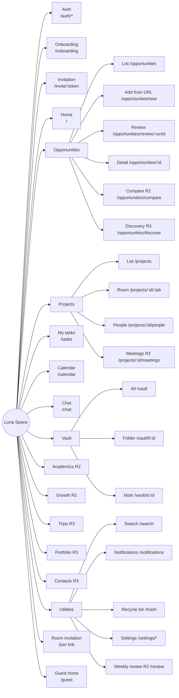

### 2.2 Route inventory

| Route | Screen | Rel. | Notes |
|---|---|---|---|
| `/auth/sign-in`, `/auth/sign-up`, `/auth/reset`, `/auth/callback` | Authentication | <span class="tag r1">R1</span> | Public routes |
| `/onboarding` | Create workspace, profile basics | <span class="tag r1">R1</span> | Only when the user has no workspace |
| `/invite/:token` | Accept invitation | <span class="tag r1">R1</span> | Works signed-out (prompts sign-up) |
| `/join#<token>` | Accept a **Project Room** guest invitation (token in the URL fragment, never sent to servers) | <span class="tag r1">R1</span> | Works signed-out (prompts sign-up, then resumes) |
| `/guest` | Guest home: list of rooms the signed-in person is a guest in | <span class="tag r1">R1</span> | Shown instead of the dashboard to accounts with no workspace but with guest rooms |
| `/` | Dashboard (Shared / Me toggle) | <span class="tag r1">R1</span> | Default landing |
| `/opportunities` | List, board-by-status, filters | <span class="tag r1">R1</span> | `?view=list, pipeline` |
| `/opportunities/new` | Paste URL or manual entry | <span class="tag r1">R1</span> | `?url=` supported for share-target |
| `/opportunities/review/:runId` | Extraction review | <span class="tag r1">R1</span> | |
| `/opportunities/:id` | Detail: Overview, Dates, Sources & history, Eligibility (R2), Participation (R2) | <span class="tag r1">R1</span> | Tabs via `?tab=` |
| `/opportunities/compare?ids=a,b,c` | Comparison table | <span class="tag r2">R2</span> | 2–4 ids |
| `/opportunities/discover` | Discovery inbox from feeds | <span class="tag r3">R3</span> | |
| `/projects` | Project list | <span class="tag r1">R1</span> | |
| `/projects/:id/overview, board, notes, files, checklist, chat, activity` | Project room tabs | <span class="tag r1">R1</span> | |
| `/projects/:id/ideas, decisions, polls` | Collaboration tabs | <span class="tag r2">R2</span> | |
| `/projects/:id/pitch, judge, retro, github` | Preparation tabs | <span class="tag r3">R3</span> | |
| `/projects/:id/people` | People: members, guests, invitations, guest settings | <span class="tag r1">R1</span> | Guests see a read-only list unless Project Admin |
| `/projects/:id/meetings`, `/projects/:id/meetings/:meetingId` | Meetings list and meeting page | <span class="tag r2">R2</span> | Join button opens Google Meet externally |
| `/tasks` | My tasks | <span class="tag r1">R1</span> | Task drawer `?task=:id` on any page |
| `/calendar` | Month / week / day / agenda | <span class="tag r1">R1</span> | `?view=&date=` |
| `/chat` | Workspace conversation | <span class="tag r1">R1</span> | `?project=` filter, `?m=` jump to message |
| `/vault`, `/vault/f/:folderId`, `/vault/n/:noteId`, `/vault/bookmarks`, `/vault/files` | Knowledge Vault | <span class="tag r1">R1</span> | |
| `/vault/snippets` | Code snippets | <span class="tag r2">R2</span> | |
| `/academics/subjects, timetable, assessments` | Academics | <span class="tag r2">R2</span> | |
| `/growth/goals, habits, focus, skills, courses` | Productivity | <span class="tag r2">R2</span> | |
| `/growth/expenses` | Expenses | <span class="tag r3">R3</span> | |
| `/review` | Weekly review | <span class="tag r2">R2</span> | |
| `/trips`, `/trips/:id` | Trips | <span class="tag r3">R3</span> | |
| `/portfolio`, `/portfolio/:userId` | Portfolio (own / partner's shared) | <span class="tag r3">R3</span> | |
| `/contacts`, `/contacts/:id` | Contacts | <span class="tag r3">R3</span> | |
| `/search?q=` | Global search results | <span class="tag r1">R1</span> | Also via command palette |
| `/notifications` | Notification centre | <span class="tag r1">R1</span> | |
| `/trash` | Recycle bin | <span class="tag r1">R1</span> | |
| `/settings/profile, workspace, notifications, privacy, data` | Settings | <span class="tag r1">R1</span> | |
| `/settings/integrations, ai` | Integrations: GitHub and Google (R3), AI (R4) | <span class="tag r3">R3</span> | |
| `/call/:id` | Call screen | <span class="tag r4">R4</span> | Overlay |

## 3. Navigation hierarchy

### 3.1 Levels

| Level | Desktop (≥ 1024 px) | Mobile (< 768 px) |
|---|---|---|
| L0 Global | Left sidebar: Home, Opportunities, Projects, My tasks, Calendar, Chat, Vault; divider; Academics, Growth, Trips, Portfolio, Contacts (as released) | Bottom bar: Home, Opportunities, Projects, Chat, More |
| L0 Utilities | Top bar: search / command palette (Ctrl+K), quick add (+), notifications bell, availability, avatar menu | Top bar: title, search icon, bell; "More" sheet holds Calendar, Tasks, Vault and the rest |
| L1 Section | Page header with view switch (list/board/calendar) and filters | Same, filters in a bottom sheet |
| L2 Object | Detail page with tabs (opportunity, project room) | Detail page; tabs become a horizontally scrollable tab strip |
| L3 Sub-object | Right-side drawer (task, event, note preview) keeps context | Full-screen sheet with back gesture |
| Guest shell | Minimal top bar (room switcher, notifications, avatar) and the room's guest tabs only; no sidebar modules | Same; bottom bar replaced by the room's tab strip |
| Modal | Create/confirm dialogs, review steps | Full-screen dialogs |

### 3.2 Navigation rules

1. **Every object has one canonical URL**; drawers add a query parameter (`?task=…`) so links can be shared between the two members.
2. **Back always returns to the previous context**, including the scroll position and filters of lists.
3. **Cross-links are bidirectional**: an opportunity shows its project; the project shows its opportunity; a calendar item opens its source record.
4. **Quick add (+)** is available everywhere: Opportunity from URL, Task, Event, Note, Bookmark, and (R2) Goal, Focus session.
5. **The command palette** searches records and actions: "new task", "go to calendar", "open project …".
6. **Deep links from notifications** open the exact record and highlight the changed element.
7. **Guests are routed by permission, not by hiding links**: any non-room route opened by a guest shows "You don't have access to this page" and offers the guest home; the data is already denied by RLS.

## 4. First-time user journey

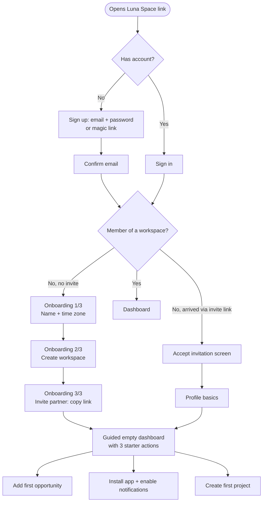

**Starter checklist (shown until done or dismissed):** add an opportunity, invite your partner, install the app, enable notifications, create a project. The checklist is per member and private.

## 5. Authentication journey

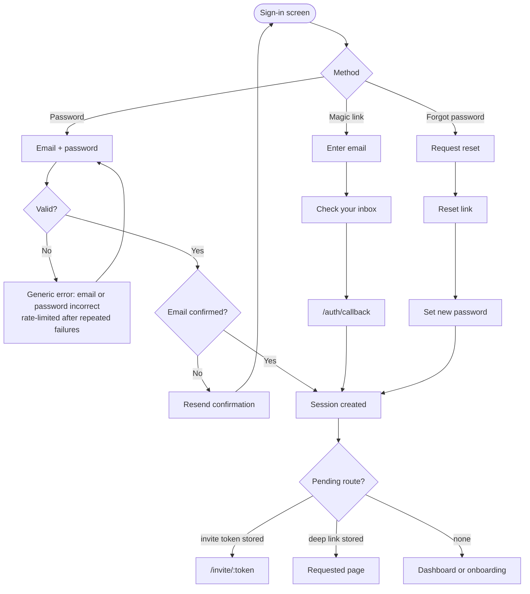

| Rule | Detail |
|---|---|
| Session | Supabase Auth JWT with refresh token; session persists across PWA restarts. |
| Error messages | Never reveal whether an email exists. |
| Return path | The originally requested URL (including `/invite/:token`) is stored in session storage and resumed after sign-in. |
| Sign-out | Clears local caches of private data (IndexedDB) on the device. |

## 6. Workspace creation and invitation journey

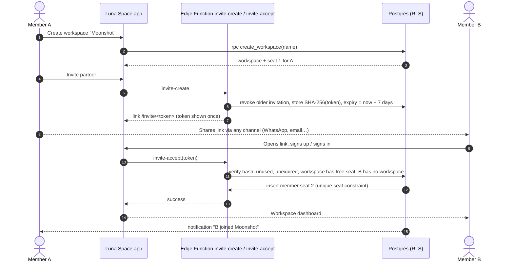

| Case | Behaviour |
|---|---|
| Token invalid/expired/used/revoked | "This invitation is no longer valid. Ask your partner for a new link." No detail about which. |
| Invitee already belongs to a workspace | "You are already in a workspace. Leave it first (Settings → Workspace)." (Leaving is R3; before R3 the user must use a different account.) |
| Workspace already has two members | "This workspace is full." The invitation is marked invalid. |
| Inviter wants to cancel | Settings → Workspace → Revoke invitation. |

## 7. Opportunity discovery journey

Discovery means getting candidate opportunities **into** Luna Space. There is no public scraping; every source is chosen by a member.

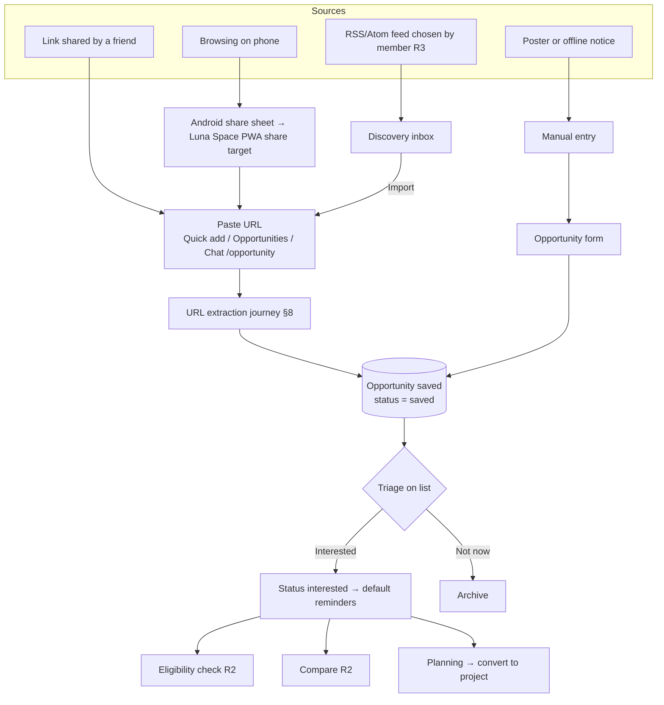

**Status pipeline (FR-OPP-04)**

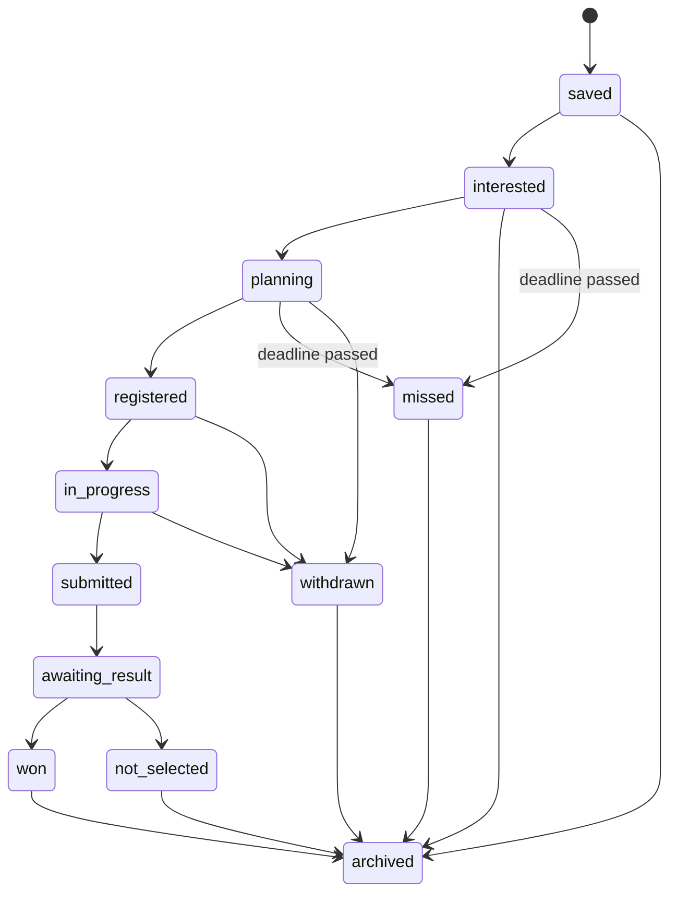

Status changes are free (members can jump between any states); the diagram shows the normal path. The system suggests `missed` when a registration deadline passes while the status is still `interested` or `planning`, but never applies it automatically.

## 8. URL extraction and review journey

### 8.1 Flow

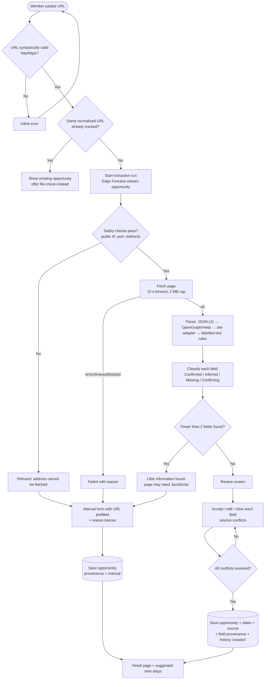

### 8.2 Field statuses on the review screen

| Status | Rule | Review behaviour |
|---|---|---|
| **Confirmed** | Value read from structured data (JSON-LD/schema.org) or from text that names the field explicitly ("Registration closes: 15 Dec 2026"). Evidence snippet stored. | Pre-accepted; member can still edit. |
| **Inferred** | Value derived by a documented rule, e.g. year missing (assumed from the next occurrence after extraction date), time zone assumed from the organizer's country, mode inferred from "venue" text. Reason stored. | Highlighted; requires a tick ("I checked this") or edit before save. |
| **Missing** | No evidence found. | Empty input; optional to fill. Critical missing fields (registration deadline, eligibility, team size, mode) raise a warning after save. |
| **Conflicting** | Two or more different candidate values with evidence. | Member must choose a candidate, type a value, or clear the field. Save is blocked until resolved. |

### 8.3 What happens to the data

| Data | Stored where | Retention |
|---|---|---|
| Run metadata (URL, final URL, HTTP status, timing, content hash, extractor version, error code) | `extraction_runs` | 7 days if not saved; kept with the opportunity if saved |
| Proposed values with status, evidence snippet (≤ 500 chars) and reason | `extraction_fields` | Same as the run |
| Accepted values | `opportunities`, `opportunity_dates` | Life of the record |
| Per-field provenance (source run, status at acceptance, verified by/at) | `opportunity_field_provenance` | Life of the record |
| Change history entries | `opportunity_field_history` | Life of the record |
| Source URL, domain, credibility, last checked | `opportunity_sources` | Life of the record |

## 9. Eligibility-checking journey <span class="tag r2">R2</span>

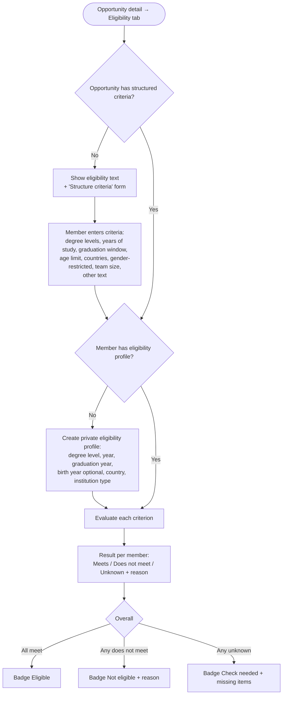

- The partner sees **only the overall badge** for the other member (Eligible / Not eligible / Check needed), never the private profile values.
- Unknown is the default whenever data is missing on either side; the checker never guesses.

## 10. Opportunity comparison journey <span class="tag r2">R2</span>

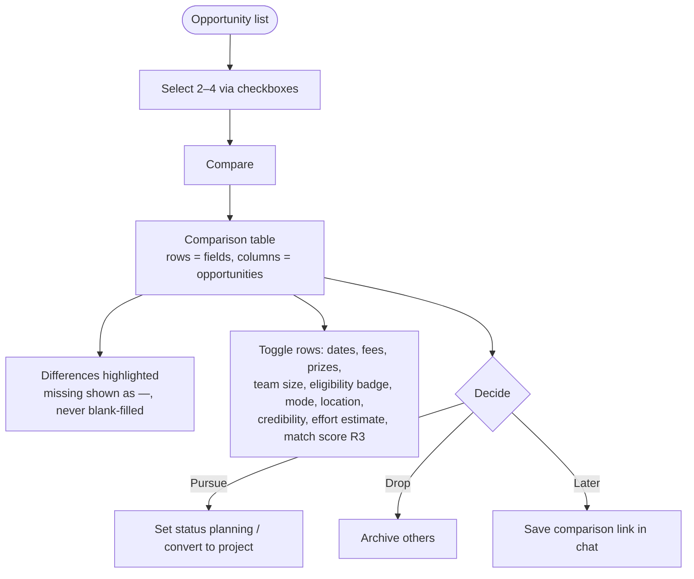

## 11. Project creation journey

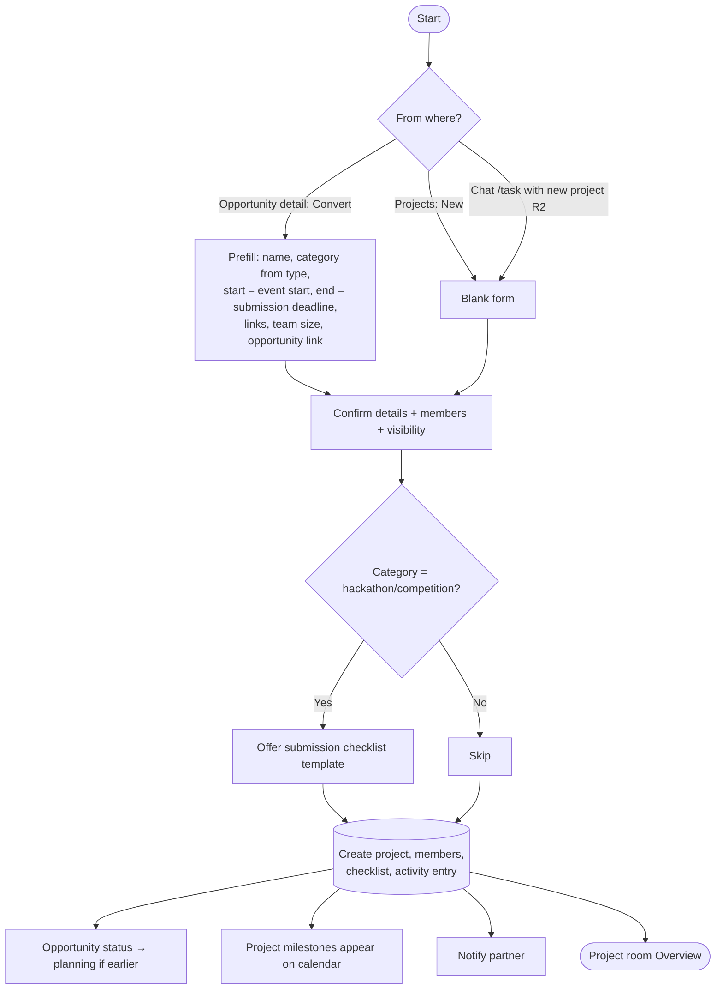

## 12. Project collaboration journey

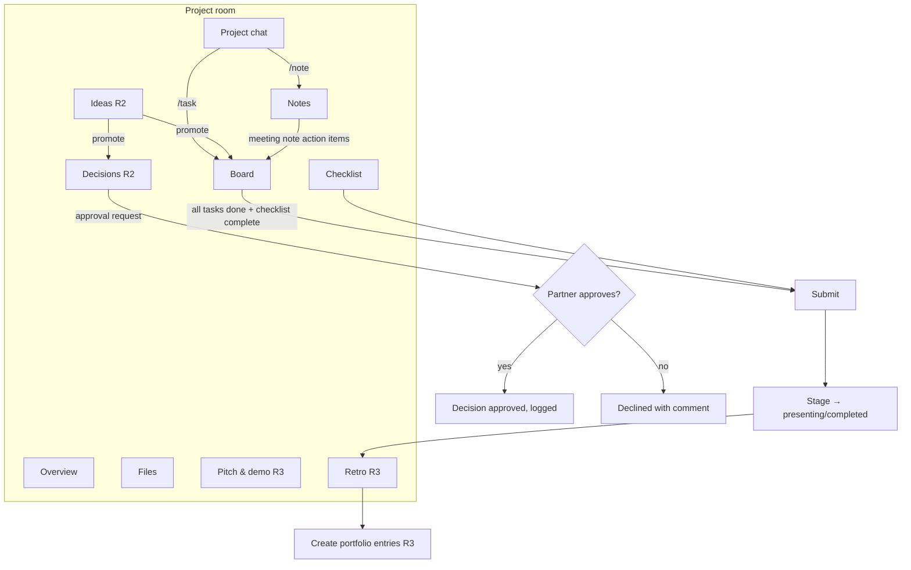

**Collaboration rules**

| Rule | Detail |
|---|---|
| Real-time | Board, checklist, comments and chat update live for both members (Supabase Realtime). |
| Concurrent edits | Notes use "last write wins" with a conflict warning if the note changed since it was opened (version number check). A real-time co-editing editor is not in scope. |
| Presence | Avatars of members currently viewing the room are shown. |
| Approvals | One open approval per subject; reminders after 24 h; the requester can cancel. |

## 13. Task management journey

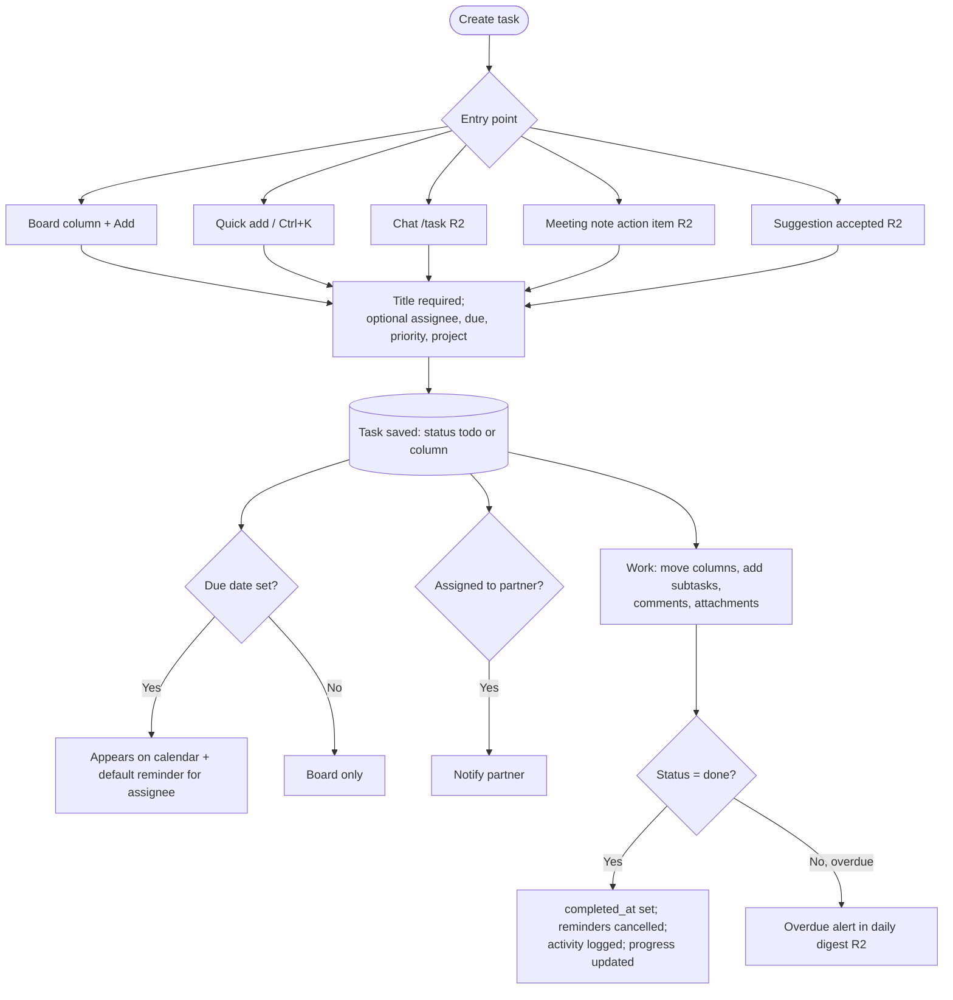

## 14. Calendar and reminder journey

### 14.1 What appears on the calendar

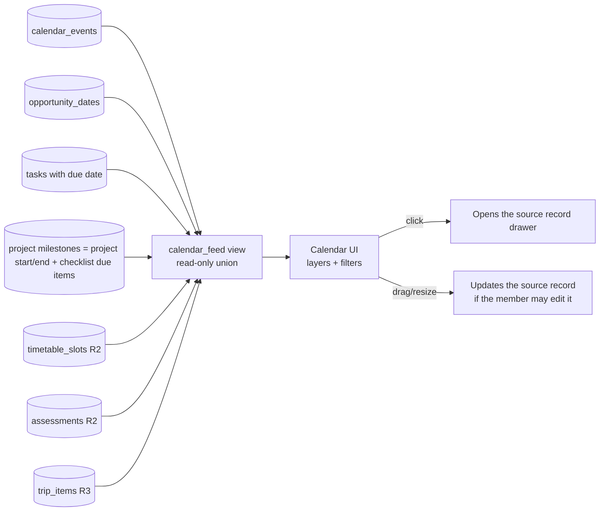

Derived items are **never copied** into `calendar_events`. Editing a hackathon deadline on the calendar edits the `opportunity_dates` row, records history and reschedules reminders.

### 14.2 Reminder lifecycle

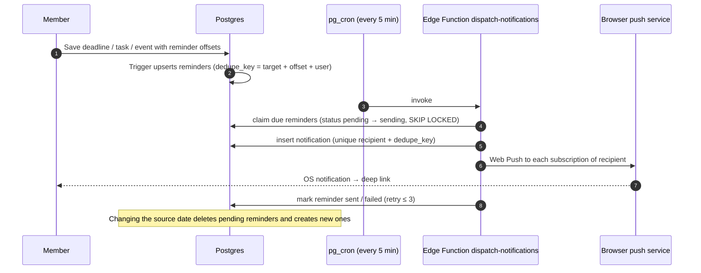

**Date-only rule:** for a date-only deadline, "on the day" reminders fire at 09:00 in the member's time zone and "N days before" at 09:00 on that earlier day (AC-19). Timed deadlines use the exact instant minus the offset.

## 15. Chat and communication journey

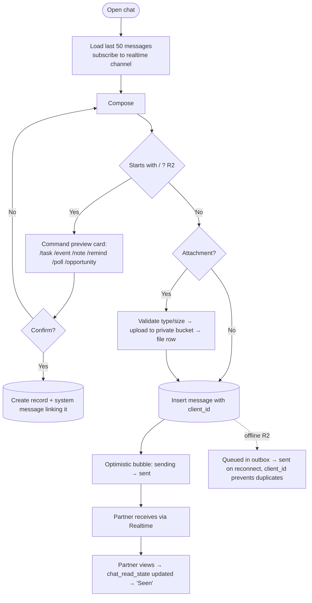

**Calls (R4).** Start call → explain camera/microphone use → browser permission prompt → signalling through a private Realtime channel → peer connection (STUN; TURN fallback) → in-call controls (mute, camera, screen share on desktop, hang up). If the partner does not answer in 30 s, a "missed call" system message is posted.

## 16. Document and Knowledge Vault journey

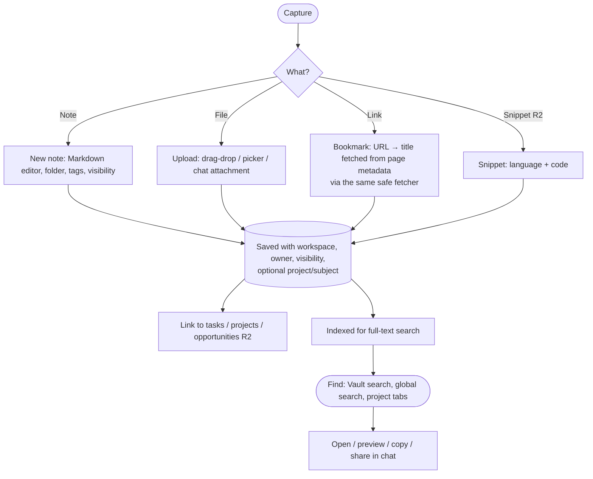

**Organisation rules:** folders are optional (a "smart" view lists everything by recent); a record lives in at most one folder; tags are free-form and shared in the workspace; project rooms show Vault items whose `project_id` matches the project.

## 17. Portfolio creation journey <span class="tag r3">R3</span>

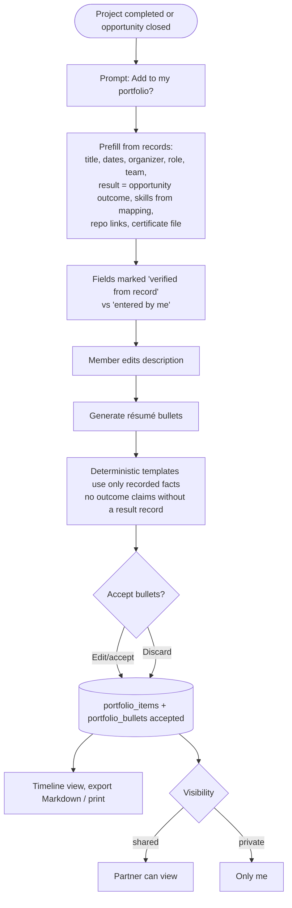

## 18. Weekly review journey <span class="tag r2">R2</span>

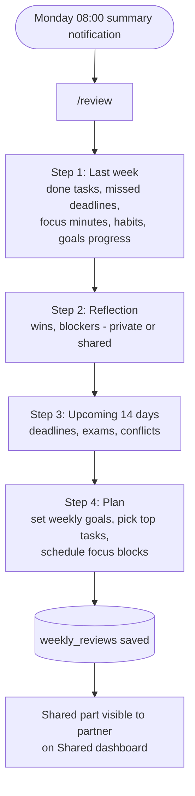

## 19. Error and recovery flows

### 19.1 Error taxonomy

| Class | Example | User sees | Recovery |
|---|---|---|---|
| Validation | Title empty; end before start | Inline message beside the field | Fix and retry |
| Permission | Editing a partner's private record via stale link | "You don't have access to this item" | Back to list |
| Not found / deleted | Opening a link to a deleted task | "This item is in the recycle bin" + Restore (if allowed) | Restore or back |
| Conflict | Note edited by partner since opened | Compare banner: keep mine / keep theirs / copy mine to new note | Choose |
| Network | Offline while saving | Toast "Saved on this device, will sync" (R2) or "Couldn't save — retry" (R1) | Auto-retry / manual retry |
| Rate limit | 21st extraction in an hour | "Too many extractions, try again in N min" | Manual entry |
| External | Extraction blocked, push service failure | Reason + fallback | Manual form; in-app notification remains |
| Server | Unexpected error | "Something went wrong" + error ID | Retry; error ID in logs |
| Quota | Storage near free limit | Banner at 80 % and 95 % | Clean up files; export |

### 19.2 Recovery flows

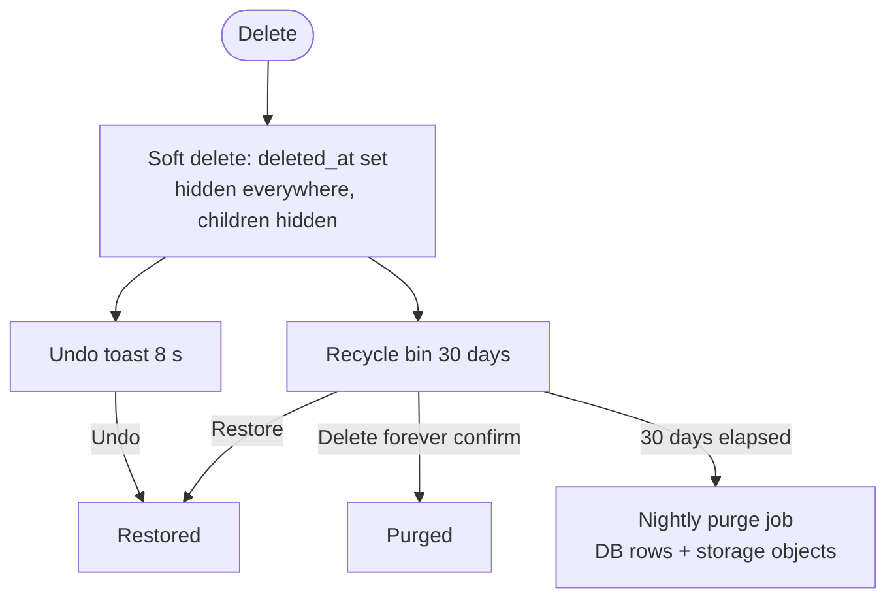

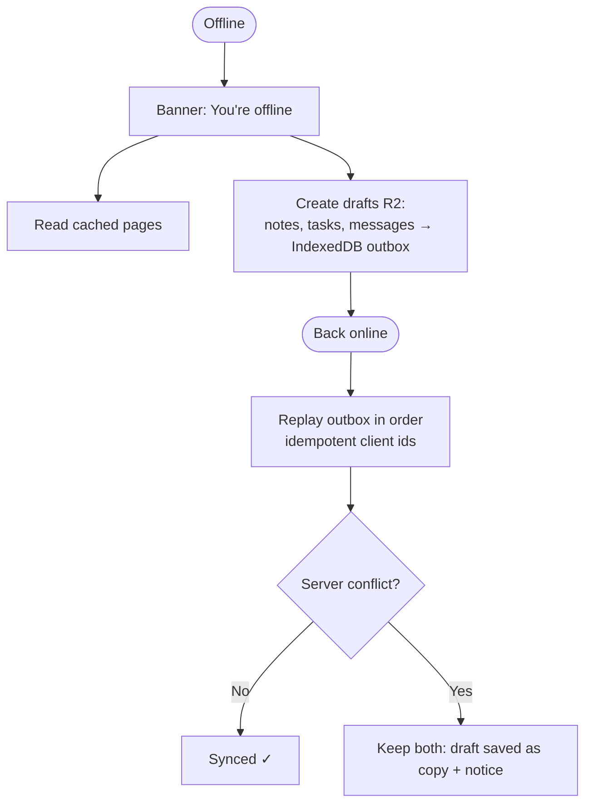

## 20. Cross-module relationships

### 20.1 Relationship map

```mermaid
flowchart TD
  OPP[Opportunity] -- converts to --> PRJ[Project]
  OPP -- dates --> CAL[Calendar]
  OPP -- trip --> TRIP[Trip]
  OPP -- met at --> CONT[Contact]
  OPP -- participation/outcome --> PORT[Portfolio entry]
  PRJ -- tasks --> TSK[Tasks]
  TSK -- due --> CAL
  PRJ -- notes, files, refs --> VAULT[Vault]
  PRJ -- skills applied --> SKL[Skills]
  SKL --> PORT
  PRJ -- completed --> PORT
  CHAT[Chat] -- commands --> TSK & CAL & VAULT & OPP
  TRIP -- expenses --> EXP[Expenses]
  PRJ -- expenses --> EXP
  ACAD[Assessments & timetable] --> CAL
  CAL -- conflicts --> AUTO[Automation]
  AUTO -- reminders, digests, suggestions --> NOTIF[Notifications]
  PRJ -- invitations --> GUEST[Project guests]
  GUEST -- guest-visible tasks, notes, files --> PRJ
  PRJ -- meetings --> MEET[Project meetings]
  MEET -- schedule --> CAL
  MEET -- action items --> TSK
  MEET -- notes --> VAULT
  ALL[Every module] -. activity .-> ACT[Activity log]
  ALL -. search index .-> SRCH[Search]
```

### 20.2 Hand-off matrix

| From → To | Trigger | Data passed | Owner of truth |
|---|---|---|---|
| Opportunity → Project | Convert | name, category, dates, links, team size, opportunity_id | Project after creation; dates stay on the opportunity |
| Opportunity → Calendar | Date saved | `opportunity_dates` rows via feed view | Opportunity |
| Opportunity → Reminders | Status ≥ interested | default reminder offsets | Reminder rows (regenerated on change) |
| Task → Calendar | Due date set | via feed view | Task |
| Chat → any | Quick command | parsed fields, after preview | Created record; message links to it |
| Project → Vault | Note/file/bookmark created in room | `project_id` on item | Vault item |
| Project → Portfolio | Completed + prompt | facts + `project_id` | Portfolio item (copy of facts at creation, links kept) |
| Skills ↔ Projects | Skill mapping | `project_skills` rows; skill stage suggestion "Applied in project" | Skills |
| Trip ↔ Expenses | Expense with trip | `trip_id` | Expense |
| Any → Activity | Write on shared record | action, entity, summary | Activity log (append-only) |
| Any → Notifications | Rules | type, target link, dedupe key | Notifications |
| Project → Guests | Invitation accepted | room id, role; guest sees only guest-visible rows | Guest membership |
| Meeting → Calendar | Meeting scheduled | via `calendar_feed` (meeting rows) | Meeting |
| Meeting → Tasks | Convert action item | title, assignee, due date, project, `guest_visible = true` | Task; action item keeps a link |
| Meeting → Vault | Meeting notes | note of kind `meeting` with `meeting_id` | Note |

## 21. Project guest invitation and acceptance journey

### 21.1 Creating a room invitation

```mermaid
flowchart TD
  A([Project room → People → Invite guests]) --> B{Caller is a workspace member<br/>or guest Project Admin?}
  B -- No --> X[Action not shown; API would be denied by RLS]
  B -- Yes --> C[Invite dialog:<br/>role, expiry, max uses, label]
  C --> D{Role = Project Admin<br/>and caller is a guest?}
  D -- Yes --> D1[Not allowed: only members grant Project Admin]
  D -- No --> E[Edge Function project-invite-create<br/>rate limit 20/h per project]
  E --> F[(Store SHA-256 hash, role, expiry,<br/>max uses, label, creator)]
  F --> G["Show link once:<br/>app URL /join + token fragment<br/>Copy · Share"]
  G --> H[Activity: invitation created<br/>members notified if a guest created it]
```

The plain token exists only in the creator's browser at that moment. Afterwards the People tab shows the invitation by label, role, expiry, use count and status (Active, Expired, Used up, Revoked).

### 21.2 Accepting a room invitation

```mermaid
sequenceDiagram
  autonumber
  actor G as Invited person
  participant UI as Luna Space app
  participant EF as Edge Function project-invite-accept
  participant DB as Postgres (RLS)
  G->>UI: Opens the /join link (token is in the fragment and stays in the browser)
  UI->>UI: Store token in sessionStorage, clear it from the address bar
  alt not signed in
    UI-->>G: Sign in or create account (email confirmation required)
    G->>UI: Returns after confirmation
  end
  UI->>EF: POST token (JWT of the signed-in person)
  EF->>DB: rate limit (10/h per user), hash token, lock invitation row
  EF->>DB: check not revoked, not expired, uses left, project active
  EF->>DB: check person is not a member of that workspace, not already a guest, room below guest cap
  EF->>DB: insert project_guest_memberships (role from invitation), use_count + 1, activity, notifications
  EF-->>UI: room id + role
  UI-->>G: Room overview with "You're a guest in this room" welcome
```

| Case | Behaviour |
|---|---|
| Token invalid, expired, revoked or used up | Generic "This invitation is no longer valid. Ask the person who invited you for a new link." |
| Person is a member of the room's workspace | "You're already a member of this workspace" → opens the room as a member. No guest row. |
| Already a guest of this room | Opens the room; no change (idempotent). |
| Room at its guest cap | "This room is full. Ask a project admin to make space." |
| Project deleted or archived | Generic invalid message. |
| Person has no workspace of their own | After acceptance they land in the room; the guest home lists their rooms. They are never pushed into workspace onboarding. |

## 22. Guest permission management and removal

```mermaid
flowchart TD
  A([People tab]) --> B{Action}
  B -- Change role --> C[Role selector: Viewer / Collaborator<br/>Project Admin only by members]
  C --> C1[(Update role, activity, notify guest)]
  C1 --> C2[New permissions apply on the guest's next request]
  B -- Remove guest --> R[Confirm: name the person and consequences]
  R --> R1[(Set removed_at/by, clear the guest's open assignments in the room,<br/>remove from future meetings, cancel their reminders)]
  R1 --> R2[Notify removed guest, activity entry]
  R2 --> R3[RLS denies every room query; Realtime stops delivering rows]
  B -- Revoke invitation --> V[(Set revoked_at: link dead immediately)]
  B -- Room guest settings --> S[Toggle: collaborators upload files, create tasks,<br/>schedule meetings · viewers comment · guests see activity · max guests]
  B -- Guest leaves --> L[Guest home → Leave room → same as removal, reason 'left']
```

**What a guest can open** (everything else is absent from the guest shell and denied by the database):

| Room tab | Viewer | Collaborator | Project Admin |
|---|---|---|---|
| Overview | Read | Read | Read + edit details |
| Board / tasks / subtasks | Read guest-visible | Create, edit, move, comment | Same + delete guest-created tasks |
| Checklist | Read | Tick, add items | Same |
| Notes, Files, References | Read guest-visible | Create (always guest-visible), edit guest-visible, upload if allowed | Same + remove guest-created items |
| Meetings (R2) | Read, join, respond | Schedule with manual link if allowed, notes, action items | Same |
| People | Read names and roles | Read | Invite (Viewer/Collaborator), change roles, remove guests, settings |
| Activity | Guest-visible entries if allowed | Same | Same |
| Workspace chat, dashboard, calendar, opportunities, vault outside the room, other rooms, settings | — | — | — |

## 23. Meeting scheduling journey <span class="tag r2">R2</span>

```mermaid
flowchart TD
  A([Room → Meetings → Schedule]) --> B[Title, date, start/end, time zone,<br/>agenda, participants, visible to guests, reminders]
  B --> C{Link}
  C -- Paste existing Meet URL --> D{Valid meet.google.com address?}
  D -- No --> D1[Inline error] --> C
  D -- Yes --> S
  C -- Add later --> S
  C -- Create Google Meet link R3 --> G{Member has connected Google<br/>and integration configured?}
  G -- No --> G1[Explain + Connect Google or paste a link] --> C
  G -- Yes --> E[Edge Function google-meet:<br/>create event with Meet conference<br/>or create Meet space]
  E -- failed / pending too long --> G2[Keep meeting, show retry or paste link]
  E -- link returned --> S
  S[(Save meeting, participants,<br/>reminders, activity)] --> N[Notify participants:<br/>meeting scheduled]
  S --> CAL[Appears on members' calendar<br/>and on the room schedule for guests]
```

**Rescheduling or cancelling** updates the meeting, regenerates reminders, notifies participants once, and — for links created through Google — updates or cancels the Google event (R3). A manual link is never changed by Luna Space.

## 24. Joining a meeting and follow-up <span class="tag r2">R2</span>

```mermaid
flowchart LR
  R[Reminder 1 day / 15 min before] --> P[Meeting page]
  P --> J[Join meeting<br/>opens meet.google.com in a new tab<br/>or the Meet app on Android]
  J --> M[Call happens in Google Meet<br/>outside Luna Space]
  P --> NOTES[Meeting notes<br/>note of kind meeting]
  P --> DEC[Decisions → decision log]
  P --> AI[Action items]
  AI -- Convert to task --> T[(Task in room, guest-visible,<br/>assignee + due date)]
  M --> AFTER[After end time:<br/>meeting moves to Previous,<br/>prompt to add notes and action items]
```

| Rule | Detail |
|---|---|
| Who can see the link | Workspace members; room guests only when the meeting is visible to guests. Anyone the link is forwarded to can still ask to join in Google Meet — admission is controlled by the meeting host in Google Meet. |
| Join button | Enabled at any time; highlighted from 10 minutes before start until end. |
| Calendar for participants | "Add to my calendar" gives a Google Calendar template link or `.ics` file; no Google account connection needed. |
| Not supported | Embedding Meet, starting the call from inside Luna Space, recordings or transcripts. |

## Glossary

| Term | Meaning |
|---|---|
| Canonical URL | The single address of a record that both members can share. |
| Drawer | A side panel that shows a record without leaving the current page. |
| Feed view | A read-only database view that combines dates from several tables for the calendar. |
| Outbox | Device-local queue of changes made offline, replayed when online (R2). |
| Share target | PWA capability that lets Android's share sheet send a URL to Luna Space. |
| Dedupe key | A unique string that prevents the same reminder or notification being created twice. |
| Guest shell | The reduced app frame a project guest sees: room switcher and that room's guest tabs only. |
| URL fragment | The part of a link after `#`; browsers do not send it to servers, which keeps invitation tokens out of logs. |
