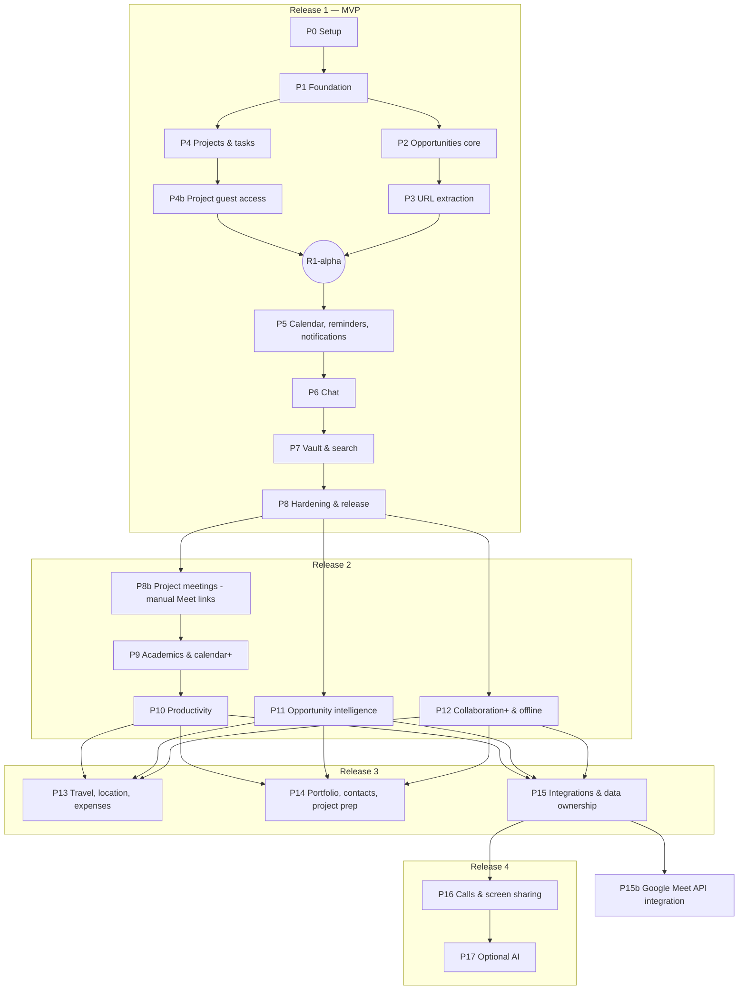
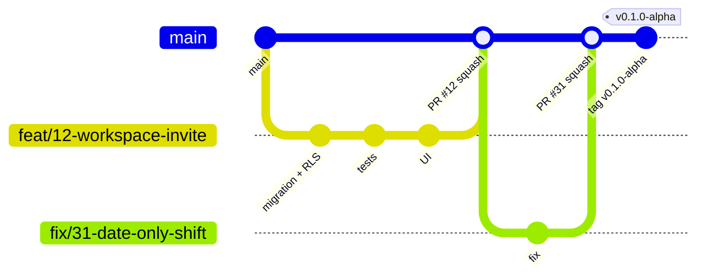
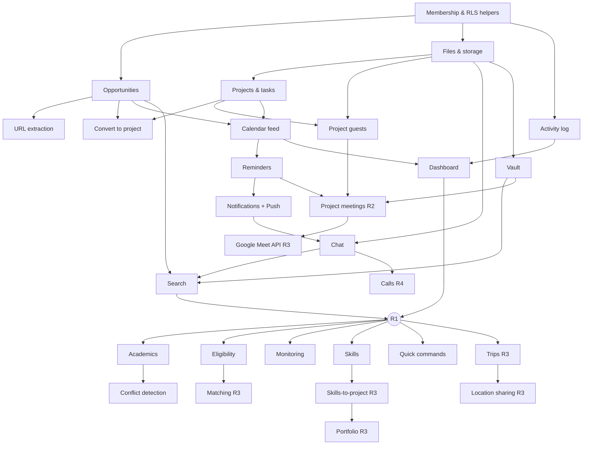
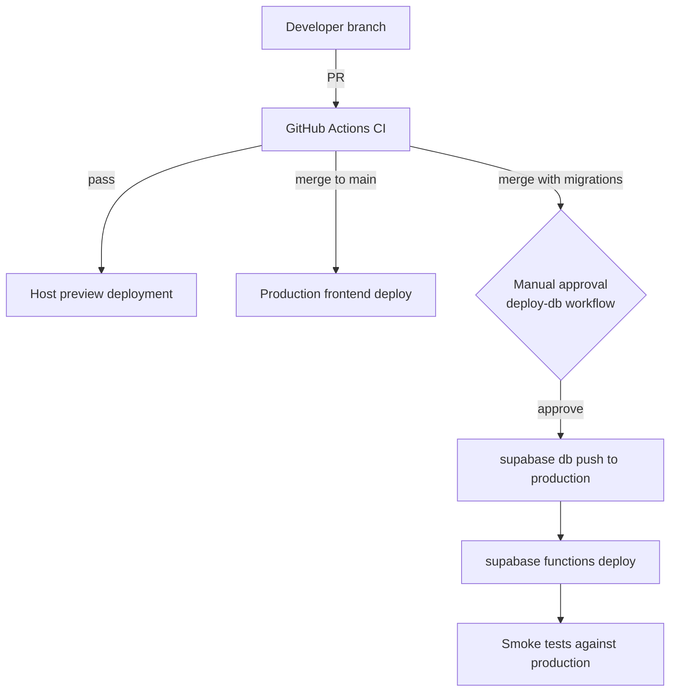
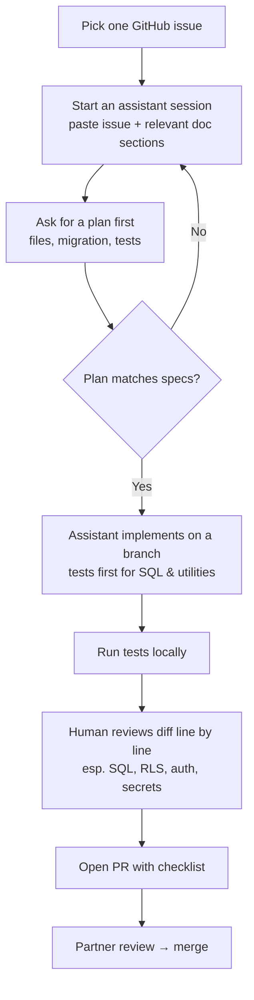

## How to read this document

This plan explains **how Luna Space is built, in what order, and how each step is verified**. It is written for a small team of beginner-to-intermediate developers working with an AI coding assistant.

- Scope and release assignment come from the PRD (01). Technical choices come from the TRD (04). Table names and migrations come from the Backend Schema (06).
- Work is divided into **phases** (P0–P17) grouped into **releases** (R1–R4). Each phase lists objective, features, technical tasks, dependencies, deliverables, acceptance criteria and testing requirements.
- Tasks are sized **S** (a focused session, one small pull request), **M** (two to four sessions) or **L** (should be split further before starting). **No calendar dates are given**: the team's available hours are unknown, and estimates should be made only after Phase 0 and Phase 1 reveal the real pace.

> **Proposed:** This is a plan, not a record of completed work. Adjust phase order only with a PRD revision if it changes release scope.

## 1. Development strategy

### 1.1 Principles

| # | Principle | Practical consequence |
|---|---|---|
| D1 | **Vertical slices** | Each phase delivers working screens backed by real tables, RLS, and tests — not a layer at a time. |
| D2 | **Database first, then UI** | For every feature: migration → RLS policies → database tests → typed API hooks → UI → end-to-end test. |
| D3 | **Security from the first table** | No table is merged without RLS and a policy test (PRD NFR-SEC-01). |
| D4 | **Small pull requests** | One issue = one branch = one pull request, ideally under ~400 changed lines (excluding generated types). |
| D5 | **Usable early** | "R1-alpha" (after P4) is used for a real hackathon by the two members to get feedback. |
| D6 | **Free-tier aware** | Every phase checks its effect on database size, storage, function invocations and Realtime messages. |
| D7 | **Docs are the specification** | When implementation differs from the docs, update the docs in the same pull request (or open an issue). |

### 1.2 Release and phase overview



## 2. Project setup

| Step | Action | Result |
|---|---|---|
| 2.1 | Create a GitHub **private** repository `luna-space` under an account both members can administer (PRD PRIV-14). | Repository exists; both members are admins. |
| 2.2 | Scaffold the app: `npm create vite@latest luna-space -- --template react-ts`. | React + TypeScript + Vite project. |
| 2.3 | Add Tailwind CSS, ESLint (typescript-eslint), Prettier, Vitest, Testing Library, Playwright. | `npm run lint`, `npm test`, `npm run e2e` work. |
| 2.4 | Add runtime libraries listed in TRD §3 (React Router, TanStack Query, Zod, React Hook Form, date-fns + date-fns-tz, supabase-js, vite-plugin-pwa, dnd-kit, FullCalendar standard packages, Dexie, react-markdown + rehype-sanitize). | Dependencies pinned in `package-lock.json`. |
| 2.5 | Install Supabase CLI and initialise `supabase/` folder (`supabase init`). | `supabase/config.toml` committed. |
| 2.6 | Add `AGENTS.md` (see §16), `README.md`, `.env.example`, `docs/` with the six specifications in Markdown. | Shared context for people and the coding assistant. |
| 2.7 | Configure CI (GitHub Actions): lint, type-check, unit tests, database tests, build, secret scan. | Green CI on `main`. |

## 3. GitHub repository workflow

### 3.1 Branching



| Rule | Detail |
|---|---|
| Default branch | `main` is always deployable; protected (PR required, CI must pass, 1 approval from the partner when both are active). |
| Branch names | `feat/<issue>-<slug>`, `fix/<issue>-<slug>`, `chore/…`, `docs/…`, `sec/…`. |
| Commits | Conventional Commits (`feat(opp): add review screen`). |
| Merging | Squash-merge; PR title becomes the commit message. |
| Releases | Git tags `v0.x.y` per phase milestone; `v1.0.0` = R1. Release notes generated from PR titles. |
| Reviews | The partner reviews; for solo periods, use a self-review checklist plus an AI-assisted review of the diff. |

### 3.2 Pull request checklist (template)

- [ ] Linked issue and PRD requirement IDs (e.g. FR-OPP-07).
- [ ] Migration added (never edited after merge) and types regenerated.
- [ ] RLS enabled and policies tested for: owner, partner, outsider, anonymous.
- [ ] Input validated with Zod on the client and constraints on the server.
- [ ] Loading, empty, error and offline states implemented (UI/UX spec §24).
- [ ] Unit/component tests; E2E updated if a journey changed.
- [ ] No secrets, no service-role key in frontend; `.env.example` updated if a variable was added.
- [ ] Accessibility: keyboard reachable, labelled, contrast ok.
- [ ] Docs updated if behaviour differs from the specification.

## 4. Environment setup

### 4.1 Developer machine (Windows)

| Tool | Purpose | Notes |
|---|---|---|
| Node.js LTS (≥ 20) | Frontend tooling | Use `nvm-windows` or the official installer. |
| Git + GitHub CLI | Version control | Configure `core.autocrlf=input` to avoid line-ending churn in SQL. |
| VS Code + extensions | Editor | ESLint, Prettier, Tailwind CSS IntelliSense, Deno (for Edge Functions), PostgreSQL syntax, Playwright Test, GitLens. |
| Docker Desktop | Local Supabase stack | Free for personal/educational use; requires WSL 2. If the laptop cannot run Docker, use a dedicated free **development** Supabase project instead (see 4.3). |
| Supabase CLI | Migrations, local stack, type generation, function deploy | `npm i -D supabase` and run via `npx supabase`. |
| Deno | Run/test Edge Functions locally | Supabase CLI bundles the runtime for `functions serve`. |
| Android phone with Chrome | Device testing | Use `chrome://inspect` over USB for debugging the PWA. |

### 4.2 Environment variables

| Variable | Where | Secret? |
|---|---|---|
| `VITE_SUPABASE_URL` | Frontend (`.env.local`, host settings) | No (public) |
| `VITE_SUPABASE_ANON_KEY` (publishable key) | Frontend | No (public, protected by RLS) |
| `VITE_VAPID_PUBLIC_KEY` | Frontend | No |
| `SUPABASE_SERVICE_ROLE_KEY` (secret key) | Edge Function secrets only (auto-provided) | **Yes** |
| `VAPID_PRIVATE_KEY`, `VAPID_SUBJECT` | Edge Function secrets | **Yes** |
| `INVITE_BASE_URL` | Edge Function secrets | No |
| `GITHUB_CLIENT_ID` / `GITHUB_CLIENT_SECRET` (R3) | Edge Function secrets | **Yes** (secret) |
| `GOOGLE_CLIENT_ID` / `GOOGLE_CLIENT_SECRET` (R3, optional) | Edge Function secrets | **Yes** (secret) |
| `GOOGLE_OAUTH_REDIRECT_URI`, `APP_BASE_URL` | Edge Function secrets | No |
| `SUPABASE_DB_PASSWORD`, `BACKUP_AGE_PUBLIC_KEY` | GitHub Actions secrets (backup job) | **Yes** |

> **Security:** Only variables prefixed `VITE_` reach the browser. A CI step greps the built `dist/` folder for `service_role` and known secret patterns and fails the build if found.

### 4.3 Environments

| Environment | Frontend | Backend | Purpose |
|---|---|---|---|
| Local | `npm run dev` (localhost:5173) | `supabase start` (Docker) with `seed.sql` test users | Daily development |
| Preview | Host preview deployment per PR | Local-only or the dev project | UI review on phone |
| Development (optional) | — | Second free Supabase project | When Docker is unavailable; integration testing of push/cron |
| Production | Host production (from `main`) | Production Supabase project | Real use by the two members |

> **Cost:** The Supabase Free plan allows a small number of free projects per account (two at the time of writing). Using one for production and one for development consumes both.

## 5. Supabase setup

| Step | Action | Verification |
|---|---|---|
| 5.1 | Create the production project in the region closest to users (e.g. Mumbai `ap-south-1`). Save the database password in a password manager. | Dashboard accessible to both members. |
| 5.2 | Auth settings: enable email provider; require email confirmation; set Site URL and redirect URLs (production, preview pattern, localhost); minimum password length 10; enable leaked-password protection if available on the plan. | Sign-up confirmation email arrives. |
| 5.3 | Configure custom SMTP (free tier of a transactional email provider) — the built-in email service is for testing only and is heavily rate-limited. | Magic link delivered within 1 minute. |
| 5.4 | Link the CLI: `npx supabase link --project-ref <ref>`; apply migrations with `npx supabase db push`. | Tables visible; RLS on. |
| 5.5 | Create storage buckets (`workspace-files`, `avatars`, `exports`) as **private** via migration (Schema §29). | Public access returns 400/404. |
| 5.6 | Enable extensions in migrations: `pg_cron`, `pg_net`, `pgcrypto` (default), `pg_trgm`, `unaccent`; Vault for secrets. | `select * from cron.job` works. |
| 5.7 | Set Edge Function secrets: `npx supabase secrets set VAPID_PRIVATE_KEY=…`. | `supabase secrets list` shows names only. |
| 5.8 | Deploy functions: `npx supabase functions deploy <name>`; set `verify_jwt` per function (TRD §7). | Function logs visible. |
| 5.9 | Schedule cron jobs via migration (reminders every 5 min, maintenance nightly, re-checks daily in R2). | `cron.job_run_details` shows successes. |
| 5.10 | Turn on Realtime for the tables listed in TRD §9 (publication `supabase_realtime`). | Board updates appear in a second browser. |

### 5.1 Google Cloud setup (Phase 15b, optional)

Only needed for automatic Google Meet links. Manual Meet links (Phase 8b) need none of this.

| Step | Action | Verification |
|---|---|---|
| G1 | Create a Google Cloud project (free) under the shared project account (PRD PRIV-14). No billing account is needed for the Calendar or Meet REST APIs (verify on the console at setup time). | Project visible to both members |
| G2 | Enable **Google Calendar API** (recommended path) and, if the Meet REST path is chosen, **Google Meet REST API** (TRD §25.2). | APIs listed as enabled |
| G3 | Configure the **OAuth consent screen**: user type External; app name "Luna Space"; support email; scopes from TRD §25.3; add both members as **test users**. | Consent screen shows only the requested scopes |
| G4 | Create an **OAuth client ID** (type Web application) with redirect URI `https://<project-ref>.supabase.co/functions/v1/google-oauth/callback`. | Client ID and secret issued |
| G5 | Store `GOOGLE_CLIENT_ID`, `GOOGLE_CLIENT_SECRET`, `GOOGLE_OAUTH_REDIRECT_URI`, `APP_BASE_URL` with `supabase secrets set`. | `supabase secrets list` shows the names |
| G6 | Decide the publishing status (TRD §25.5): stay in **Testing** (refresh tokens expire after 7 days → reconnect weekly) or **publish unverified** (one-time "unverified app" warning; no 7-day expiry). | Decision recorded in an ADR |

## 6. Folder structure

```text
luna-space/
├─ .github/
│  ├─ workflows/ ci.yml · deploy-db.yml · backup.yml · e2e.yml
│  ├─ ISSUE_TEMPLATE/ feature.yml · bug.yml · security.yml
│  └─ pull_request_template.md
├─ docs/                      # the six specifications (Markdown) + adr/ (architecture decision records)
├─ public/                    # icons, maskable icons, robots.txt
├─ src/
│  ├─ app/                    # App.tsx, router.tsx, providers (QueryClient, Auth, Theme), AppShell layout
│  ├─ components/
│  │  ├─ ui/                  # design-system primitives: Button, Input, Select, Dialog, Drawer, Toast, Tabs, Badge…
│  │  └─ patterns/            # EmptyState, ErrorState, VisibilityToggle, DateField, FieldStatusBadge, FileDrop…
│  ├─ features/
│  │  ├─ auth/  workspace/  dashboard/  opportunities/  projects/  tasks/
│  │  ├─ guests/  meetings/  calendar/  academics/  growth/  chat/  vault/  automation/
│  │  ├─ trips/  portfolio/  contacts/  notifications/  search/  settings/  trash/
│  │  └─ <feature>/ { api.ts · hooks.ts · schemas.ts · types.ts · components/ · pages/ · __tests__/ }
│  ├─ lib/                    # supabase.ts (client), dates.ts, tz.ts, markdown.ts, files.ts, offline/ (R2)
│  ├─ pwa/                    # service worker (injectManifest), push handlers
│  ├─ styles/                 # tailwind.css, tokens.css
│  └─ types/database.ts       # generated by `supabase gen types`
├─ supabase/
│  ├─ config.toml
│  ├─ migrations/             # 0001_extensions.sql … (Schema §30 order)
│  ├─ functions/
│  │  ├─ _shared/             # cors.ts, auth.ts, validate.ts, ratelimit.ts, safe-fetch.ts, push.ts
│  │  ├─ invite-create/  invite-accept/  extract-opportunity/  fetch-link-preview/  dispatch-notifications/
│  │  ├─ export-data/  maintenance/  recheck-opportunities/ (R2)  weekly-summary/ (R2)
│  │  ├─ project-invite-create/  project-invite-accept/ (R1)
│  │  └─ github-oauth/  github-sync/  discovery-poll/  google-oauth/  google-meet/ (R3)  turn-credentials/  ai-assist/ (R4)
│  ├─ tests/                  # pgTAP: rls_*.test.sql, constraints_*.test.sql
│  └─ seed.sql                # two test users, one workspace, sample data (local only)
├─ tests/e2e/                 # Playwright specs with two browser contexts (member A and B)
├─ AGENTS.md                  # instructions for coding assistants (see §16)
├─ .env.example
└─ package.json
```

**Feature-folder rule:** a feature may import from `components/`, `lib/` and its own folder; it must not import another feature's internals. Cross-feature needs go through a small exported API (`features/<x>/index.ts`), which keeps the modular monolith modular.

## 7. Development phases

Each phase below follows the same structure. "AC" lines refer to PRD acceptance criteria where available.

### 7.1 Phase 0 — Setup and walking skeleton <span class="tag r1">R1</span>

| Item | Detail |
|---|---|
| Objective | A deployed "hello" app that signs in against Supabase, with CI, tests and docs in place. |
| Features | None user-facing beyond sign-in placeholder. |
| Technical tasks | S: scaffold Vite app · S: Tailwind + tokens from UI spec §4–6 · S: ESLint/Prettier/strict TS · S: Supabase CLI init + first migration (extensions) · S: Supabase client in `lib/` · S: CI workflow · S: host project connected to GitHub with preview deployments · S: `AGENTS.md`, PR template, issue templates · S: Playwright smoke test. |
| Dependencies | Accounts: GitHub, Supabase, static host. |
| Deliverables | Deployed URL; green CI; docs folder. |
| Acceptance criteria | Opening production URL shows the app shell; CI runs lint, types, unit, build on each PR; secret scan passes. |
| Testing | One unit test, one Playwright smoke test (page loads, title correct). |

### 7.2 Phase 1 — Foundation: identity, workspace, shell <span class="tag r1">R1</span>

| Item | Detail |
|---|---|
| Objective | Two people can sign up, create a workspace, invite each other, and see a navigable empty app on laptop and phone. |
| Features | FR-PLAT-01–06, 19; app shell navigation (UI spec §8–11). |
| Technical tasks | M: migrations `profiles`, `workspaces`, `workspace_members` (seat constraint), `workspace_invitations`, `activity_log`, helper functions `private.current_workspace_id()` / `private.is_member(ws)` · M: RLS + pgTAP tests (owner/partner/outsider/anon) · M: Edge Functions `invite-create`, `invite-accept` with rate limiting · M: auth pages, session handling, route guards · S: onboarding wizard · M: AppShell (sidebar, top bar, bottom nav, theme toggle) · S: profile settings · S: workspace settings (rename, invitation status, revoke). |
| Dependencies | P0. |
| Deliverables | Working onboarding and invitation; RLS test suite foundation; design-system primitives (Button, Input, Dialog, Toast, Tabs). |
| Acceptance criteria | AC-01 – AC-06. A third member insert fails at the database level. |
| Testing | pgTAP: seat constraint, one-workspace-per-user, invitation policies. E2E: A creates workspace, B accepts link (two browser contexts). |

### 7.3 Phase 2 — Opportunities core <span class="tag r1">R1</span>

| Item | Detail |
|---|---|
| Objective | Members can track opportunities manually with correct dates, status, provenance and history. |
| Features | FR-OPP-01–05, 10–12, 14 (warnings), 15 (convert — UI stub until P4). |
| Technical tasks | M: migrations `opportunities`, `opportunity_dates`, `opportunity_sources`, `opportunity_field_provenance`, `opportunity_field_history` + triggers for history · S: enums for type/status/mode · M: list page with filters/sort (URL query state) · M: create/edit form with date-only vs date-time field component (`DateField`) · M: detail page tabs Overview / Dates / Sources & history · S: status menu + pipeline view · S: missing-info warnings · S: soft delete + activity entries. |
| Dependencies | P1. |
| Deliverables | Opportunity module usable manually. |
| Acceptance criteria | AC-15, AC-18 (date display in two time zones). Every saved field has a provenance row with source `manual`. |
| Testing | Unit: date utilities (date-only never shifts across zones). pgTAP: visibility rules on opportunities. E2E: create, edit, change status, view history. |

### 7.4 Phase 3 — URL extraction <span class="tag r1">R1</span>

| Item | Detail |
|---|---|
| Objective | Paste a URL, review trustworthy proposed values, save with provenance; fall back gracefully. |
| Features | FR-OPP-06–09, 13. |
| Technical tasks | M: `_shared/safe-fetch.ts` (scheme/port checks, DNS resolution + IP range block list, manual redirects ≤ 3 with re-validation, timeout, size cap, content-type check) · M: migrations `extraction_runs`, `extraction_fields`, `rate_limit_events` · L→split: parsers — (a) JSON-LD/schema.org Event, (b) OpenGraph/meta, (c) labelled-text rules for dates/fees/team size/eligibility/mode/prizes, (d) date parser with "inferred year" logic, (e) conflict detection, (f) adapters for common hackathon platforms where server HTML contains the data · M: `extract-opportunity` function orchestrating runs · M: review screen (UI spec §15) with accept/edit/clear/resolve · S: manual fallback with reason banner · S: duplicate URL detection (normalized URL). |
| Dependencies | P2. |
| Deliverables | End-to-end extraction with fixtures. |
| Acceptance criteria | AC-08 – AC-14. |
| Testing | Deno unit tests on **saved HTML fixtures** (no live sites in CI) covering each status; SSRF test table (TRD §8.4) as automated tests; E2E with a local fixture server. |

### 7.5 Phase 4 — Projects and tasks <span class="tag r1">R1</span>

| Item | Detail |
|---|---|
| Objective | Hackathon project rooms with a real-time board, tasks, files and submission checklists. |
| Features | FR-PRJ-01–10, FR-OPP-15, FR-AUTO-08; file storage foundation (used by chat and vault later). |
| Technical tasks | M: migrations `projects`, `project_members`, `tasks`, `task_comments`, `files`, `checklists`, `checklist_items`, `templates` (+ seed built-in templates) · M: storage bucket policies + upload helper (type/size validation, path convention) · M: project list + room layout with tabs · L→split: board (columns, drag-and-drop with dnd-kit, keyboard moves, fractional ordering, optimistic updates, Realtime subscription) · M: task drawer (subtasks, comments, attachments, assignee, priority, due) · S: My tasks page · M: checklist from template + save as template · S: convert opportunity → project · S: project activity tab. |
| Dependencies | P1 (P2 for conversion). |
| Deliverables | Project rooms usable by the two members; file storage foundation. (R1-alpha follows Phase 4b so hackathon teammates can join.) |
| Acceptance criteria | AC-16, AC-17, AC-20 (upload limits). |
| Testing | Unit: ordering algorithm. pgTAP: task visibility via project, file ownership. E2E: two contexts see a card move. |

### 7.5b Phase 4b — Project guest access <span class="tag r1">R1</span>

| Item | Detail |
|---|---|
| Objective | Hackathon teammates join one Project Room as guests through a secure, room-scoped link, without ever becoming workspace members. |
| Features | FR-GUEST-01–15; NFR-SEC-14–17. |
| Technical tasks | S: enum `guest_role` · M: migrations `project_guest_invitations`, `project_guest_memberships`, `project_guest_settings` (Schema §31) · S: `guest_visible` columns on tasks, checklists, notes, bookmarks, files, activity_log + check "private items never guest-visible" · S: assignee validation trigger (member or active guest of the task's project) replacing the member-only FK · M: helper `private.guest_role(project_id)` + guard trigger `private.guard_guest_write()` · L→split: guest RLS policies per table (projects, tasks, task_comments, checklists, checklist_items, notes, bookmarks, files, activity_log, storage objects) · M: `project_directory(project_id)` RPC (names/avatars/roles only) · M: Edge Functions `project-invite-create` and `project-invite-accept` (hashing, fragment links, rate limits, row lock, guest cap) · S: RPCs `revoke_project_invitation`, `set_guest_role`, `remove_project_guest`, `leave_project` · M: People tab, invite dialog, role selector, guest settings · M: `/join` acceptance page with sign-up resume · M: guest home `/guest` and guest shell · S: "Visible to guests" toggles, eye icons, guest banner · S: guest activity entries and notification triggers (in-app now; push when P5 lands). |
| Dependencies | P1 (auth, workspace helpers), P4 (projects, tasks, files, checklists). Notes/bookmarks policies are added in P7 when those tables exist; meetings policies in P8b. |
| Deliverables | **R1-alpha** milestone: platform + opportunities + extraction + projects + room guests. |
| Acceptance criteria | AC-26 – AC-35; AC-04 still passes (two-member limit untouched). |
| Testing | pgTAP **guest matrix**: for every table, roles {member A, member B, guest viewer, guest collaborator, guest admin, removed guest, guest of another room, outsider, anon} × {select, insert, update, soft-delete}; invitation function tests (expired, revoked, used up, cap reached, member-as-guest, concurrent accepts); E2E with three browser contexts (A, B, guest G) covering invite → accept → task assignment → removal. |

### 7.6 Phase 5 — Calendar, reminders and notifications <span class="tag r1">R1</span>

| Item | Detail |
|---|---|
| Objective | All dates in one calendar; reminders delivered reliably in-app and by Web Push. |
| Features | FR-CAL-01–05, FR-AUTO-01, FR-PLAT-07–08. |
| Technical tasks | M: migrations `calendar_events`, `reminders`, `notifications`, `notification_preferences`, `push_subscriptions`; view `calendar_feed` · M: FullCalendar integration with layers and drawer editing of the source record · M: reminder generation triggers (opportunity dates, tasks, events) with dedupe keys · M: `dispatch-notifications` function + pg_cron schedule (claim with `FOR UPDATE SKIP LOCKED`) · M: Web Push: VAPID keys, subscription flow per device, service-worker `push` and `notificationclick` handlers · S: notification centre page + bell · S: notification preferences. |
| Dependencies | P2, P4. |
| Deliverables | Working reminders on Windows and Android. |
| Acceptance criteria | AC-18, AC-19; NFR-REL-02. |
| Testing | Unit: reminder time computation (date-only 09:00 rule, DST-free zones and a DST zone). pgTAP: dedupe uniqueness. Manual device test matrix (TRD §10). |

### 7.7 Phase 6 — Chat <span class="tag r1">R1</span>

| Item | Detail |
|---|---|
| Objective | Real-time conversation with replies, reactions, edits, deletes, receipts, attachments and presence. |
| Features | FR-CHAT-01–09. |
| Technical tasks | M: migrations `messages`, `message_reactions`, `chat_read_state` · M: chat page with virtualised list, pagination (50 per page), jump-to-message · S: composer with Markdown-lite and attachment upload · S: replies and reactions · S: edit/delete (delete clears body) · S: read receipts · S: Realtime Presence + availability status · S: project thread filter. |
| Dependencies | P4 (files), P5 (notifications for new messages when app closed). |
| Deliverables | Chat used daily by both members. |
| Acceptance criteria | FR-CHAT-01 latency; AC-20, AC-21. |
| Testing | E2E: two contexts exchange, react, edit, delete. pgTAP: only sender can edit/delete. |

### 7.8 Phase 7 — Knowledge Vault and search <span class="tag r1">R1</span>

| Item | Detail |
|---|---|
| Objective | Notes, files, bookmarks and references in folders, searchable with the rest of the workspace. |
| Features | FR-VAULT-01–06, FR-PLAT-11–12, FR-PRJ-07. |
| Technical tasks | M: migrations `vault_folders`, `notes`, `bookmarks`; generated `tsvector` columns + GIN indexes on opportunities, tasks, notes, bookmarks, messages · M: Vault pages (folders tree, list, note editor with preview, file library, bookmarks) · S: bookmark title fetch via safe fetcher · M: `search_workspace(q)` RPC (security invoker) + global search page + command palette · S: project room tabs filtered by project. |
| Dependencies | P4 (files), P6 (messages in search). |
| Deliverables | Vault and search. |
| Acceptance criteria | AC-22. |
| Testing | pgTAP: search never returns partner's private rows. Unit: Markdown sanitisation (no script execution). |

### 7.9 Phase 8 — Hardening and Release 1 <span class="tag r1">R1</span>

| Item | Detail |
|---|---|
| Objective | A reliable, installable, accessible, secure MVP. |
| Features | FR-DASH-01–06, FR-PLAT-09–10, 13, 15; remaining R1 polish. |
| Technical tasks | M: dashboard widgets (Shared / Me) · S: activity feed UI · M: recycle bin page + `maintenance` function (purge after 30 days incl. storage objects) · M: `export-data` function (JSON) · M: PWA manifest, icons, offline app shell, update prompt, Android share target · M: accessibility audit and fixes · M: performance budget (bundle analysis, lazy routes) · M: security review (§12) · S: usage panel (DB size, storage) · S: backup workflow (§14) · S: release checklist (§15). |
| Dependencies | P1–P7. |
| Deliverables | `v1.0.0` tagged and deployed. |
| Acceptance criteria | AC-07; all R1 ACs passing; NFR-PERF-01–05 measured; zero high-severity findings open. |
| Testing | Full E2E suite; Lighthouse PWA/accessibility checks; restore-from-backup drill. |

### 7.10 Release 2 phases <span class="tag r2">R2</span>

| Phase | Objective | Key features | Main tables / functions | Acceptance focus |
|---|---|---|---|---|
| **P8b Project meetings (first R2 phase)** | Plan and document team calls; join through Google Meet | FR-MEET-01–10 | `project_meetings`, `meeting_participants`, `meeting_action_items`; `notes.meeting_id`, `reminders.meeting_id`, `decisions.meeting_id`; `calendar_feed` meeting rows; guest policies for meetings | AC-36 – AC-39; link validation; reminders deduplicated; guests see only guest-visible meetings |
| **P9 Academics & calendar+** | Study life on the same calendar | FR-ACAD-01–05, FR-CAL-06–07, FR-AUTO-04 | `subjects`, `timetable_slots`, `assessments`; recurrence (`rrule`) on events; conflict query | Timetable shows on calendar for owner only; exam/deadline clash warning |
| **P10 Productivity** | Personal growth tools | FR-PROD-01–06, 08; FR-DASH-07 | `goals`, `habits`, `habit_logs`, `focus_sessions`, `skills`, `skill_stage_history`, `courses`, `learning_logs`, `weekly_reviews` | Pomodoro timer survives tab switch; streaks correct across time zones |
| **P11 Opportunity intelligence** | Decide better, stay current | FR-OPP-16–20, FR-AUTO-06 | `member_eligibility`, `opportunities.eligibility_criteria` (jsonb), `opportunity_participants`, `opportunity_pending_changes`; `recheck-opportunities` | Change never applied without review; eligibility unknown when data missing |
| **P12 Collaboration+ & offline** | Turn talk into action; work offline | FR-CHAT-10, FR-PRJ-11–15, FR-VAULT-07–08, FR-AUTO-03, 05, 07, 09, FR-PLAT-16 | `ideas`, `idea_votes`, `decisions`, `approval_requests`, `polls`, `poll_options`, `poll_votes`, `snippets`, `resource_links`; `weekly-summary`; IndexedDB outbox | Quick command preview before save; offline drafts sync once without duplicates |

### 7.11 Release 3 phases <span class="tag r3">R3</span>

| Phase | Objective | Key features | Main tables / functions | Acceptance focus |
|---|---|---|---|---|
| **P13 Travel, location, expenses** | Safe trips to offline events | FR-TRIP-01–07, FR-PROD-07 | `trips`, `trip_items`, `trip_emergency_contacts`, `location_shares`, `expenses`; Leaflet map | AC-23; balances correct to the paisa |
| **P14 Portfolio, contacts, project prep** | Record achievements and relationships honestly | FR-PORT-01–07, FR-CONT-01–04, FR-PRJ-16–18 | `portfolio_items`, `portfolio_bullets`, `contacts`, `judge_questions`, `retrospectives`, `project_skills` | AC-24; only owner edits portfolio |
| **P15 Integrations & data ownership** | Connect GitHub, voice, discovery; leave cleanly | FR-PRJ-19, FR-CHAT-11, FR-OPP-21–22, FR-PLAT-14, 17–18 | `github_connections`, `project_repositories`, `discovery_feeds`, `discovery_items`; `github-sync`, ZIP export, leave-workspace RPC | AC-25; tokens never reach the browser |
| **P15b Google Meet API integration** | Create Meet links automatically from a member's Google account | FR-MEET-11–13, NFR-SEC-18 | `google_connections`, `oauth_states` (shared with GitHub OAuth); `google-oauth`, `google-meet` functions; Google Cloud setup §5.1 | AC-40; works with Google disabled; token never reaches the browser; mocked Google endpoints in CI |

### 7.12 Release 4 phases <span class="tag r4">R4</span>

| Phase | Objective | Key features | Main tables / functions | Acceptance focus |
|---|---|---|---|---|
| **P16 Calls & screen sharing** | Talk face to face inside Luna Space | FR-CHAT-12–13 | `call_sessions` (log only); Realtime signalling channel; `turn-credentials` | Call connects on same Wi-Fi and on mobile data (with TURN); permissions explained first |
| **P17 Optional AI** | Opt-in assistance | FR-AUTO-11–12 | `ai_settings`; `ai-assist` | Disabled by default; data preview before sending; outputs labelled and require acceptance |

## 8. Feature implementation order

Within each phase, implement in this order to keep every pull request testable:

1. **Migration** (tables, constraints, indexes) → 2. **RLS policies** → 3. **pgTAP tests** → 4. **Regenerate types** → 5. **API hooks** (`api.ts` + TanStack Query `hooks.ts`) with Zod schemas → 6. **UI components** (empty/loading/error states first) → 7. **Realtime subscriptions** if needed → 8. **E2E test** → 9. **Docs update**.

| Order | Feature | Why here |
|---|---|---|
| 1 | Auth, profiles, workspace, membership, invitations | Every RLS policy depends on membership |
| 2 | Activity log, soft-delete convention | Used by every later table |
| 3 | Opportunities (manual) | Core value; simplest domain to establish patterns |
| 4 | Extraction | Highest product risk — validate early |
| 5 | Files + projects + tasks + checklists | Files are reused by chat and vault |
| 5b | Project guest access | Needs projects, tasks and files; must exist before teammates use R1-alpha |
| 6 | Calendar feed, reminders, notifications, push | Needs dated records from 3 and 5 |
| 7 | Chat | Needs files and notifications |
| 8 | Vault + search | Needs content from all previous modules |
| 9 | Dashboard, recycle bin, export, PWA polish | Aggregates everything |

## 9. Dependencies between features



## 10. Milestones and deliverables

| Milestone | Contents | Exit criteria | Tag |
|---|---|---|---|
| M0 Walking skeleton | P0 | Deployed app, CI green | `v0.0.1` |
| M1 Foundation | P1 | AC-01 – AC-06 pass | `v0.1.0` |
| M2 Opportunities | P2 + P3 | AC-08 – AC-15 pass; extraction success measured on 20 real URLs | `v0.2.0` |
| M3 R1-alpha | P4 + P4b | Used for one real hackathon with teammates as room guests; feedback issues logged | `v0.3.0-alpha` |
| M4 Time & talk | P5 + P6 | Reminders and chat used daily for 2 weeks without critical bugs | `v0.5.0` |
| M5 Knowledge | P7 | Search finds content across modules | `v0.7.0` |
| M6 **Release 1** | P8 | Release checklist complete | `v1.0.0` |
| M7 **Release 2** | P8b, P9 – P12 | R2 ACs pass; meetings used for a real team call; offline sync verified | `v2.0.0` |
| M8 **Release 3** | P13 – P15, P15b | AC-23 – AC-25 and AC-40 pass | `v3.0.0` |
| M9 **Release 4** | P16 – P17 | Calls on 3 network types; AI off by default verified | `v4.0.0` |

## 11. Testing strategy

### 11.1 Test pyramid

| Level | Tool | What | Where it runs |
|---|---|---|---|
| Static | TypeScript strict, ESLint, `supabase db lint` | Types, unsafe patterns, SQL issues | CI on every PR |
| Unit | Vitest | Date/time utilities, reminder computation, ordering, parsers shared in TS, Zod schemas, résumé templates | CI |
| Component | Vitest + Testing Library | Forms, field-status badges, review screen logic, empty/error states | CI |
| Database | pgTAP via `supabase test db` | Constraints, triggers, RLS per role (owner, partner, outsider, anonymous), purge jobs | CI (local Supabase in Docker on the runner) |
| Edge Functions | Deno test | safe-fetch, extraction parsers on fixtures, invitation logic, rate limiting | CI |
| End-to-end | Playwright (Chromium; Android emulation viewport) | Critical journeys with two browser contexts (member A and B) | CI on PRs touching journeys; nightly full run |
| Manual | Device matrix | PWA install, push, share target, camera/mic (R3–R4) | Before each release |

### 11.2 Critical end-to-end journeys (R1)

1. Sign up A → create workspace → invite → sign up B → accept → both see dashboard.
2. Paste fixture URL → review (confirmed, inferred, missing, conflicting) → resolve → save → history shows creation.
3. Convert to project → apply template → create tasks → B moves a card → A sees it live.
4. Add deadline → reminder computed → dispatch job (triggered manually in test) → notification visible for the right member only.
5. Chat: send, reply, react, edit, delete, attach file; B sees each change.
6. Create private note as A → B cannot find it via search or direct URL.
7. Delete task → restore from recycle bin → export JSON contains it.
8. A invites guest G (Collaborator, max uses 1) → G signs up from the link and accepts → G creates and moves a task → B sees it live → A marks a note visible to guests → G reads it → A removes G → G's next request returns nothing from the room.
9. (R2) G schedules a meeting with a pasted Meet link → A and B are notified → reminder fires → action item converted to a task.

### 11.3 Test data

`supabase/seed.sql` creates two users (`a@example.test`, `b@example.test`), one workspace, and representative records. A third user (`outsider@example.test`) with their own workspace is used for isolation tests. No real personal data is used in tests.

## 12. Security testing

| Area | Test | Method | Release |
|---|---|---|---|
| RLS coverage | Every `public` table has RLS enabled and at least one policy | SQL query in CI fails if not | R1 |
| RLS behaviour | For each table: owner/partner/outsider/anon × select/insert/update/delete matrix | pgTAP generated from a table list | R1 |
| Two-member limit | Insert third member directly; race two simultaneous accepts | pgTAP + concurrent script | R1 |
| Invitations | Reuse, expiry, revoked, brute force (rate limit) | Deno tests | R1 |
| Guest isolation | Guest matrix (Phase 4b) on every table; guests read zero rows from opportunities, calendar_events, messages, loose tasks, other projects, private notes, profiles | pgTAP | R1 |
| Two-member limit with guests | Many guests accepted; `workspace_members` unchanged; third member insert still fails | pgTAP | R1 |
| Room invitations | Expired, revoked, used-up, max-uses race (two concurrent accepts for the last use), guest cap, member-as-guest, token never stored in plain text, generic error messages, rate limits | Deno tests + pgTAP | R1 |
| Guest privilege escalation | Guest tries to grant Project Admin, change project visibility/owner/workspace, un-hide items, soft-delete members' items, read token hashes | pgTAP | R1 |
| Removal | Removed guest loses access on next request; Realtime stops delivering | pgTAP + E2E | R1 |
| Meeting links | Only `https://meet.google.com/<code>` without parameters accepted; hidden meetings invisible to guests | pgTAP + unit | R2 |
| Google tokens | Refresh token never returned; disconnect revokes and deletes; guests cannot call `google-meet`; OAuth `state` + PKCE validated | Function tests with mocked Google | R3 |
| SSRF | URLs to `localhost`, `127.0.0.1`, `[::1]`, `10.x`, `172.16.x`, `192.168.x`, `169.254.169.254`, `0.0.0.0`, decimal/octal IP forms, IPv6-mapped IPv4, redirects to private IPs, DNS names resolving to private IPs, non-80/443 ports, `file:`/`ftp:` schemes | Deno tests against safe-fetch | R1 |
| Uploads | Oversized, wrong MIME, double extensions, SVG with script, path traversal in file names | Component + function tests | R1 |
| XSS | Markdown with `<script>`, `javascript:` links, event handlers; message bodies | Unit tests on sanitiser; CSP header check | R1 |
| Secrets | No service-role key or private keys in repo/bundle | gitleaks action + `dist/` grep | R1 |
| Dependencies | Known vulnerabilities | `npm audit --omit=dev`, Dependabot alerts | R1 |
| Auth | Session expiry, sign-out clears local caches | E2E | R1 |
| Location | Expiry erases coordinates; partner cannot read after expiry | pgTAP + cron test | R3 |
| Tokens | GitHub token never returned by any API | pgTAP (column privileges) + function tests | R3 |
| Calls | TURN credentials short-lived; signalling channel private | Function tests | R4 |
| AI | Partner's private data never included in prompts | Unit tests on context builder | R4 |

## 13. Deployment strategy



| Rule | Detail |
|---|---|
| Order | Database migrations deploy **before** the frontend that needs them; migrations must be backward compatible with the currently deployed frontend (add columns first, remove later). |
| Approval | `deploy-db` runs only via manual `workflow_dispatch` or on a release tag, using an environment with required reviewers. |
| Rollback (frontend) | Re-deploy the previous build from the host dashboard. |
| Rollback (database) | Forward-fix with a new migration; restore from backup only for data loss. |
| Edge Functions | Deployed with the CLI from CI; versioned by Git tag. |
| Feature flags | Simple `app_config` table or environment flags for features under test (e.g. `extraction_adapters_enabled`). |

## 14. Backup and recovery

> **Cost:** The Supabase Free plan does not include downloadable automatic backups (at the time of writing). Luna Space therefore runs its own backups.

| What | How | Frequency | Retention |
|---|---|---|---|
| Database (schema + data) | GitHub Action: `supabase db dump --data-only` and schema dump using the DB password secret → compress → encrypt with `age` public key → upload as workflow artifact (or push to a separate private backup repository) | Weekly + before each production migration | 12 weekly copies |
| Storage files | Script using the Storage API (service key in Actions secret) to download changed objects → encrypt → archive | Monthly + before releases | 3 copies |
| Migrations and code | GitHub repository | Every commit | Permanent |
| Personal export | In-app JSON export (R1) / ZIP (R3) | On demand | User-held |

**Recovery drill (every release):** create a scratch local Supabase stack → apply migrations → restore the latest dump → run the RLS test suite → open the app against it → record the time taken in the release notes. The private `age` key is kept offline by both members; without it, backups cannot be read.

## 15. Release checklist

| # | Check | Owner |
|---|---|---|
| 1 | All acceptance criteria for the release pass in CI | Both |
| 2 | RLS coverage query returns zero tables without RLS | Builder |
| 3 | Security test table (§12) green; no open high/critical issues | Both |
| 4 | Migrations applied to production via approved workflow; types regenerated | Builder |
| 5 | Edge Functions deployed; secrets present; cron jobs scheduled and succeeding | Builder |
| 6 | Backup taken immediately before deploy; restore drill done this release | Organizer |
| 7 | Lighthouse: PWA installable, accessibility ≥ 95, performance ≥ 85 on mobile profile | Builder |
| 8 | Device test matrix passed (Windows Chrome/Edge, Android Chrome; push; install; share target) | Organizer |
| 9 | Free-tier usage below 60 % of each limit | Organizer |
| 10 | Release notes and docs updated; version tag created | Both |

## 16. Coding-assistant workflow

### 16.1 `AGENTS.md` contents (proposed)

```markdown
# Luna Space — instructions for coding assistants
- Specs live in docs/01..06. Read the relevant sections before coding; cite requirement IDs in PRs.
- Stack: React + TS (strict) + Vite + Tailwind; Supabase (Postgres, Auth, Realtime, Storage, Edge Functions).
- Order of work: migration → RLS → pgTAP tests → types → hooks → UI → e2e.
- Never edit a merged migration; create a new one.
- Every new table: workspace_id, RLS enabled, policies use workspace_id = (select private.current_workspace_id()); add to rls tests.
- Never put the service-role key or any secret in frontend code; only VITE_* vars reach the browser.
- Dates: date-only values are `date` and ISO 'YYYY-MM-DD' strings in TS; never convert them through Date().
- Validate inputs with Zod on the client; constraints in SQL are the final authority.
- Keep components in src/features/<feature>; no cross-feature internal imports.
- Run: npm run lint && npm run typecheck && npm test && npx supabase test db before proposing a PR.
```

### 16.2 Session workflow



| Do | Don't |
|---|---|
| Give the assistant one issue at a time with acceptance criteria | Ask for "build the whole calendar" in one session |
| Ask for tests that fail before the fix | Accept code that has not been run |
| Ask the assistant to explain every RLS policy in plain language | Merge security code you do not understand |
| Paste error messages and logs verbatim | Paste real secrets, tokens or personal data |
| Ask for a review of your own diff against the PR checklist | Let generated migrations drop or rename columns without a data plan |

### 16.3 Prompt template for an issue

```text
Context: Luna Space, see docs/06 §<n> (tables) and docs/01 <FR IDs>.
Task: <issue title>. Acceptance criteria: <list>.
Constraints: follow AGENTS.md; small PR; include pgTAP/Vitest tests.
First: propose a plan (files to add/change, migration name, tests). Wait for approval.
```

## 17. Suggested GitHub issues and milestones

### 17.1 Labels

`release:R1`…`R4` · `phase:P0`…`P17`, `phase:P4b`, `phase:P8b`, `phase:P15b` · `module:plat|dash|opp|prj|guest|meet|cal|acad|prod|chat|vault|auto|trip|port|cont` · `type:feature|bug|chore|docs|security|test` · `size:S|M|L` · `good first task` · `blocked`.

### 17.2 Milestones

One GitHub milestone per phase (`P0 Setup` … `P17 Optional AI`, plus `P4b Project guest access`, `P8b Project meetings`, `P15b Google Meet API integration`) plus release milestones `R1 MVP`, `R2`, `R3`, `R4` used for release notes.

### 17.3 Issue template (feature)

```text
Title: [OPP] Review screen: resolve conflicting fields
Requirement: FR-OPP-08, AC-10
Description: …
Acceptance criteria:
- [ ] Conflicting field shows all candidates with evidence
- [ ] Save disabled until each conflict is resolved
Tests: component test for disabled state; e2e step in extraction journey
Size: S   Labels: module:opp, phase:P3, release:R1
```

## 18. Initial development backlog

The backlog below covers **R1 in full**, broken into small tasks. Later releases are broken down when R1 is complete, using the phase tables in §7.10–7.12.

### 18.1 Phase 0 — Setup

| # | Issue | Size | Depends on |
|---|---|---|---|
| 1 | Create repo, branch protection, labels, milestones | S | — |
| 2 | Scaffold Vite React-TS app; strict TS; path aliases | S | 1 |
| 3 | Tailwind + design tokens (colours, type scale, spacing) | S | 2 |
| 4 | ESLint, Prettier, Vitest, Testing Library setup | S | 2 |
| 5 | Supabase CLI init; migration 0001 extensions | S | 2 |
| 6 | Supabase client module and env handling | S | 5 |
| 7 | CI workflow: lint, typecheck, test, build, gitleaks | S | 4 |
| 8 | Static host connected; preview deployments | S | 7 |
| 9 | Playwright smoke test | S | 8 |
| 10 | AGENTS.md, PR template, issue templates, docs folder | S | 1 |

### 18.2 Phase 1 — Foundation

| # | Issue | Size | Depends on |
|---|---|---|---|
| 11 | Migration: profiles + trigger on auth user creation | S | 5 |
| 12 | Migration: workspaces, workspace_members (seat 1/2, one workspace per user) | S | 11 |
| 13 | Helper functions `private.is_member`, `private.current_workspace_id` | S | 12 |
| 14 | RLS policies for profiles/workspaces/members + pgTAP | M | 13 |
| 15 | Migration: workspace_invitations + `rate_limit_events` | S | 12 |
| 16 | Edge Function `invite-create` (token hash, revoke previous, rate limit) | M | 15 |
| 17 | Edge Function `invite-accept` (validate, insert seat 2, audit) | M | 16 |
| 18 | Migration: activity_log + `private.log_activity()` | S | 13 |
| 19 | Auth pages: sign up, sign in, magic link, reset, callback | M | 6 |
| 20 | Route guards + pending-route resume | S | 19 |
| 21 | Onboarding wizard (name, tz, workspace, invite link) | M | 16, 20 |
| 22 | Invitation acceptance page | S | 17 |
| 23 | UI primitives: Button, Input, Select, Dialog, Drawer, Toast, Tabs, Badge | M | 3 |
| 24 | AppShell: sidebar, top bar, mobile bottom nav, More sheet | M | 23 |
| 25 | Theme toggle (light/dark/system) | S | 24 |
| 26 | Settings: profile, workspace (rename, invite status, revoke) | S | 24 |
| 27 | E2E: two-member onboarding journey | S | 21, 22 |

### 18.3 Phase 2 — Opportunities core

| # | Issue | Size | Depends on |
|---|---|---|---|
| 28 | Enums: opportunity_type, opportunity_status, participation_mode, visibility | S | 12 |
| 29 | Migration: opportunities + RLS + tests | M | 28 |
| 30 | Migration: opportunity_dates (date-only vs timed check) + tests | S | 29 |
| 31 | Migration: opportunity_sources, field_provenance, field_history + triggers | M | 29 |
| 32 | `lib/dates.ts`: date-only helpers, tz formatting + unit tests | S | 2 |
| 33 | `DateField` component (date-only / date-time + tz) | M | 32 |
| 34 | Opportunity form (create/edit) with Zod schema | M | 33 |
| 35 | Opportunity list: filters, sort, URL query state | M | 29 |
| 36 | Pipeline (status columns) view | S | 35 |
| 37 | Detail page: Overview, Dates, Sources & history tabs | M | 31 |
| 38 | Missing-info warnings component | S | 37 |
| 39 | Soft delete + activity entries for opportunities | S | 18 |

### 18.4 Phase 3 — URL extraction

| # | Issue | Size | Depends on |
|---|---|---|---|
| 40 | `_shared/safe-fetch.ts` with SSRF protections + tests | M | 5 |
| 41 | Migration: extraction_runs, extraction_fields | S | 29 |
| 42 | Parser: JSON-LD / schema.org Event | S | 40 |
| 43 | Parser: OpenGraph + meta tags | S | 40 |
| 44 | Parser: labelled-text rules (deadlines, fees, team size, mode, eligibility, prizes, documents) | M | 40 |
| 45 | Date parser with inferred-year rule + tests | S | 44 |
| 46 | Merge + conflict detection + status classification | M | 42–45 |
| 47 | `extract-opportunity` function + rate limiting | M | 41, 46 |
| 48 | HTML fixture set (≥ 15 pages) and regression tests | M | 47 |
| 49 | Paste-URL screen + duplicate detection | S | 47 |
| 50 | Review screen: statuses, evidence, accept/edit/clear, conflicts | M | 49 |
| 51 | Save from review → provenance + history | S | 50, 31 |
| 52 | Manual fallback with reason banner | S | 49 |
| 53 | Measure success rate on 20 real URLs; log adapter needs | S | 51 |

### 18.5 Phase 4 — Projects and tasks

| # | Issue | Size | Depends on |
|---|---|---|---|
| 54 | Migration: projects, project_members + RLS | S | 12 |
| 55 | Migration: tasks (subtasks via parent), task_comments + RLS | M | 54 |
| 56 | Migration: files + storage buckets + storage policies | M | 12 |
| 57 | Upload helper (validate type/size, path, signed URLs) | M | 56 |
| 58 | Migration: templates (seed built-ins), checklists, checklist_items | S | 54 |
| 59 | Project list + create form | S | 54 |
| 60 | Project room layout + Overview tab | M | 59 |
| 61 | Board: columns + rendering + fractional ordering | M | 55 |
| 62 | Board: drag-and-drop + keyboard moves + optimistic update | M | 61 |
| 63 | Board: Realtime sync | S | 62 |
| 64 | Task drawer: fields, subtasks | M | 55 |
| 65 | Task comments and attachments | S | 57, 64 |
| 66 | My tasks page | S | 55 |
| 67 | Checklist tab: from template, edit, save as template | M | 58 |
| 68 | Convert opportunity → project (+ template offer) | S | 59, 67 |
| 69 | Project activity tab | S | 18 |
| 70 | Project files tab (uses files table) | S | 57 |

### 18.5b Phase 4b — Project guest access

| # | Issue | Size | Depends on |
|---|---|---|---|
| 103 | Enum `guest_role`; migration `project_guest_invitations` (hashed tokens, expiry ≤ 30 d, max uses) | S | 54 |
| 104 | Migration `project_guest_memberships` (one active row per person/room, removal fields) + `project_guest_settings` | S | 103 |
| 105 | `guest_visible` columns + "private never guest-visible" checks on tasks, checklists, files, activity_log | S | 104 |
| 106 | Assignee validation trigger for tasks and checklist items (member or active guest) | S | 104 |
| 107 | `private.guest_role()` helper and `private.guard_guest_write()` trigger | M | 104 |
| 108 | Guest RLS policies: projects, tasks, task_comments, checklists, checklist_items, files, storage objects, activity_log | M | 107 |
| 109 | pgTAP guest matrix (generated per table) incl. two-member-limit regression | M | 108 |
| 110 | `project_directory()` RPC (names, avatars, roles only) | S | 104 |
| 111 | Edge Function `project-invite-create` (rate limit, fragment link, role rules) | M | 103 |
| 112 | Edge Function `project-invite-accept` (lock, uses, cap, member check, idempotent) + tests | M | 104, 111 |
| 113 | RPCs: revoke invitation, set guest role, remove guest, leave room (+ assignment clean-up) | M | 108 |
| 114 | People tab: members, guests, invitations, settings | M | 110, 113 |
| 115 | Invite dialog with role selector and one-time link display | S | 111 |
| 116 | `/join` page with sign-up resume; guest home `/guest`; guest shell and route guard | M | 112 |
| 117 | "Visible to guests" toggles, eye icons, guest-presence banner | S | 105 |
| 118 | Guest notifications and activity entries (joined, role changed, removed, assigned) | S | 113 |
| 119 | E2E: three-context guest journey (critical journey 8) | M | 114–118 |

**Phase 8b (R2) outline:** meetings migration and guest policies · `calendar_feed` meeting rows · reminders for meetings · Meetings tab and scheduler · meeting page (Join, notes, decisions, action items → tasks) · add-to-calendar links (Google template URL, `.ics`) · tests (AC-36 – AC-39).

**Phase 15b (R3) outline:** Google Cloud setup (§5.1) · `oauth_states` and `google_connections` migrations · `google-oauth` function (PKCE, state, Vault) · `google-meet` function (create/update/cancel, pending handling) · Settings → Integrations Google card · scheduler "Create Google Meet link" option with fallback · mocked-Google function tests · manual test with a real account (AC-40).

### 18.6 Phases 5–8 — remaining R1

| # | Issue | Size | Phase |
|---|---|---|---|
| 71 | Migration: calendar_events + RLS | S | P5 |
| 72 | View: calendar_feed (events, opportunity dates, tasks, project dates, checklist due items) | M | P5 |
| 73 | Calendar page with FullCalendar views and layer toggles | M | P5 |
| 74 | Event drawer; edit derived items through source record | M | P5 |
| 75 | Migration: reminders, notifications, notification_preferences, push_subscriptions | M | P5 |
| 76 | Reminder generation triggers + unit tests for time rules | M | P5 |
| 77 | `dispatch-notifications` function + cron schedule | M | P5 |
| 78 | Service worker push + notificationclick deep links | M | P5 |
| 79 | Push opt-in flow per device | S | P5 |
| 80 | Notification centre + bell | S | P5 |
| 81 | Migration: messages, message_reactions, chat_read_state + RLS | M | P6 |
| 82 | Chat page: list, pagination, Realtime | M | P6 |
| 83 | Composer: text, Markdown-lite, attachments | M | P6 |
| 84 | Replies, reactions | S | P6 |
| 85 | Edit/delete, read receipts | S | P6 |
| 86 | Presence + availability status | S | P6 |
| 87 | Migration: vault_folders, notes, bookmarks + search vectors | M | P7 |
| 88 | Vault pages: folders, list, file library | M | P7 |
| 89 | Note editor with sanitised preview + version check | M | P7 |
| 90 | Bookmarks with safe title fetch | S | P7 |
| 91 | `search_workspace` RPC + search page | M | P7 |
| 92 | Command palette (Ctrl+K) | M | P7 |
| 93 | Dashboard widgets (Shared / Me) | M | P8 |
| 94 | Recycle bin page + maintenance purge function | M | P8 |
| 95 | `export-data` function + settings page | M | P8 |
| 96 | PWA manifest, icons, offline shell, update prompt, share target | M | P8 |
| 97 | Accessibility audit and fixes | M | P8 |
| 98 | Performance budget and lazy routes | S | P8 |
| 99 | Security review against §12; fix findings | M | P8 |
| 100 | Backup workflow + restore drill | M | P8 |
| 101 | Usage panel | S | P8 |
| 102 | Release 1 checklist and `v1.0.0` | S | P8 |

## Glossary

| Term | Meaning |
|---|---|
| Phase | A group of related issues delivering one vertical slice. |
| R1-alpha | Internal milestone after Phase 4b (projects + room guests) used for real feedback. |
| pgTAP | PostgreSQL unit-testing framework used to test constraints and RLS. |
| Fixture | Saved HTML page used to test extraction without hitting live websites. |
| Preview deployment | Temporary deployment of a pull request for review. |
| ADR | Architecture Decision Record — a short document explaining a significant technical decision. |
| `age` | A simple, modern file-encryption tool used for backups. |
