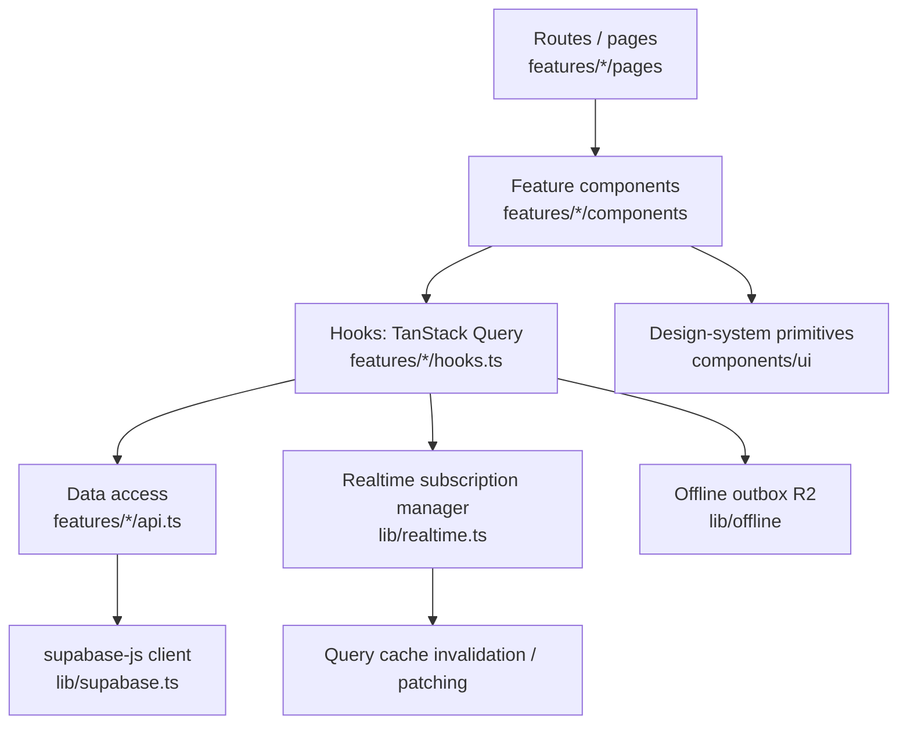
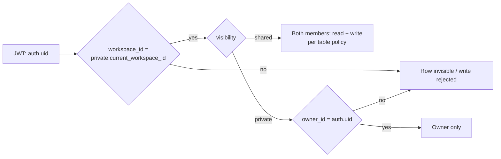
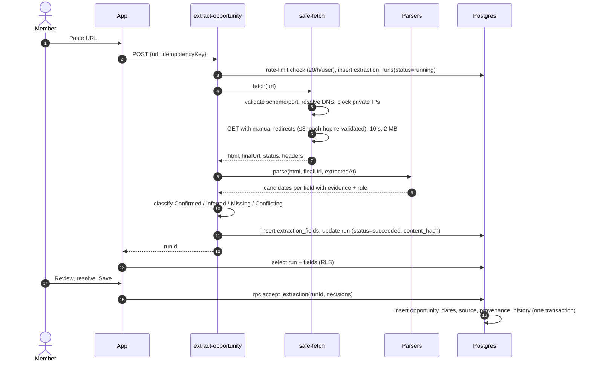
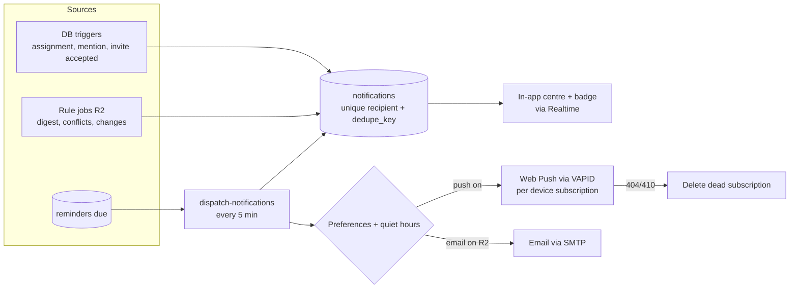
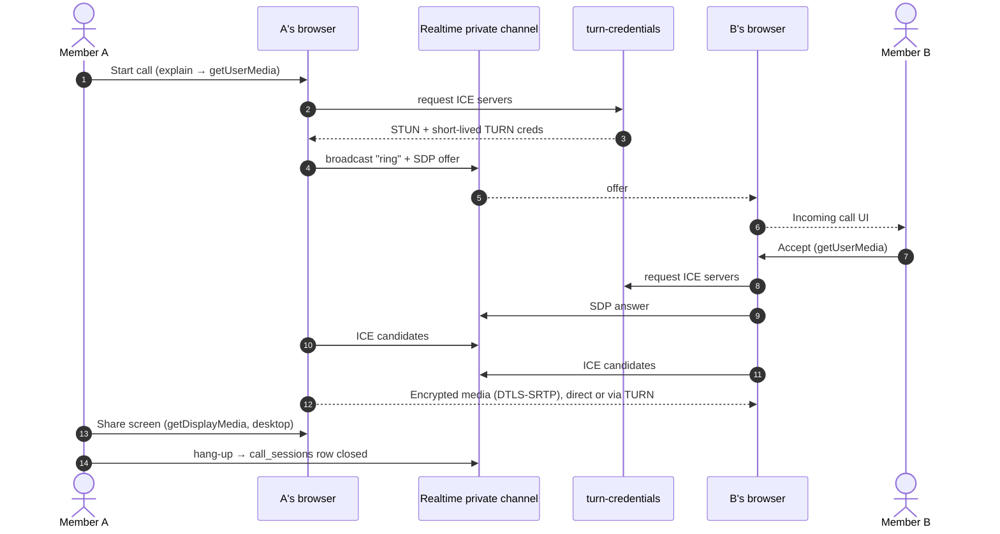

## How to read this document

This Technical Requirements Document (TRD) specifies **how** Luna Space is built: architecture, technologies, runtime behaviour, security controls and operational limits. It implements the PRD (01) and is implemented by the Backend Schema (06) and the Implementation Plan (03).

- Each section ends with **technical requirements** (`TR-<AREA>-nn`) that are verifiable.
- Status labels: **Proposed** (recommended, not yet built), **Decision needed** (open choice with a default), **Constraint** (externally imposed).
- Free-tier numbers are **as understood in November 2026 and must be re-checked** on the provider's pricing page before relying on them. Nothing in this document guarantees that a free tier will remain available.

> **Proposed:** No part of this architecture has been implemented yet.

## 1. System overview

Luna Space is a **modular monolith**: one React single-page application (installed as a PWA) talking to one Supabase project. Most reads and writes go directly from the browser to PostgreSQL through Supabase's auto-generated REST API (PostgREST), protected by Row Level Security. A small number of **Edge Functions** handle work that must not run in the browser: fetching external URLs, managing invitations with secrets, sending push notifications, exports, third-party tokens and scheduled jobs.

| Concern | Where it runs |
|---|---|
| UI, routing, client validation, optimistic updates, offline cache | Browser (React PWA, service worker) |
| Data storage, integrity, authorization, triggers, search | PostgreSQL (Supabase) |
| Identity and sessions | Supabase Auth |
| Live updates, presence, call signalling | Supabase Realtime |
| Files | Supabase Storage (private buckets) |
| External fetches, secrets, scheduled work, push delivery | Supabase Edge Functions (Deno) + pg_cron |
| Static hosting | Free static host (CDN) |

## 2. Architecture diagram

Member devices — Windows laptop (Chrome/Edge) · Android phone (installed PWA)

<b>React SPA</b>UI, routing, Zod validation, TanStack Query cache

<b>Service worker</b>Offline app shell, Web Push handlers, share target

<b>IndexedDB</b>Cached data, offline outbox (R2)

<b>Static host CDN</b>Serves the built SPA only (HTML, JS, CSS, icons)

▼ HTTPS + WSS, every request carries the member's JWT ▼◄ map tiles (R3), call media (R4) go directly to OSM / STUN-TURN

Supabase project (one per environment)

<b>Auth</b>Sign-up, sign-in, sessions

<b>PostgREST</b>Table API + RPC functions

<b>Realtime</b>DB changes, broadcast, presence

<b>Storage</b>Private buckets, signed URLs

<b>Edge Functions</b>Deno; holds secrets; invites, extraction, push, export

▼ SQL under Row Level Security (Edge Functions may use the service role after explicit checks) ▼

PostgreSQL

<b>Tables + RLS</b>Workspace-scoped, shared/private visibility

<b>Functions, triggers, views</b>Invariants, history, reminders, calendar feed, search

<b>pg_cron + pg_net</b>Schedules that invoke Edge Functions

<b>Vault</b>Encrypted tokens and keys

▲ Edge Functions only — never the browser ▲

External services

<b>Push services</b>Browser vendors' endpoints (VAPID)

<b>Public web pages</b>Pasted by members, fetched safely

<b>SMTP provider</b>Auth emails

<b>GitHub API</b>R3

<b>AI provider</b>Optional, R4

Figure 2.1 — Layered runtime architecture (proposed).

The browser talks to Supabase only with the member's own JWT; every row it can read or write is decided by RLS. External services that need secrets or that could be abused (fetching arbitrary URLs, push, GitHub, AI) are reached **only** from Edge Functions. The browser contacts third parties directly only for map tiles (R3) and call media relays (R4).

**TR-ARCH-01** All persistent state lives in the single Supabase project; the frontend host serves only static files.

**TR-ARCH-02** No additional backend servers or microservices are introduced in R1–R3. An exception requires an Architecture Decision Record (ADR).

## 3. Technology stack and justification

| Layer | Choice | Justification | Alternatives considered |
|---|---|---|---|
| Language | TypeScript (strict) | One language for frontend and Edge Functions; type safety with generated DB types | JavaScript (less safe) |
| UI framework | React 18+ | Mature ecosystem, required by brief, good AI coding-assistant support | Svelte, Vue |
| Build | Vite | Fast dev server, simple config, PWA plugin | Next.js (server features unnecessary on a static host) |
| Styling | Tailwind CSS + CSS variables for tokens | Consistent design system, dark mode via tokens | CSS modules |
| Accessible primitives | Radix UI primitives (or equivalent headless library) | Keyboard and screen-reader behaviour for dialogs, menus, tabs | Hand-written (risky) |
| Routing | React Router | Standard, supports lazy routes | TanStack Router |
| Server state | TanStack Query | Caching, retries, optimistic updates, offline persistence | SWR |
| Client state | React context + small Zustand stores (UI only) | Minimal global state | Redux (heavier) |
| Forms & validation | React Hook Form + Zod | Shared schemas for validation; Zod also usable in Edge Functions | Formik, Yup |
| Dates | date-fns + date-fns-tz | Tree-shakeable; explicit time-zone handling | Luxon, Day.js |
| Calendar UI | FullCalendar (MIT standard plugins: daygrid, timegrid, list, interaction) | Month/week/day/agenda out of the box | react-big-calendar |
| Drag and drop | dnd-kit | Accessible drag with keyboard sensors | react-beautiful-dnd (unmaintained) |
| Markdown | react-markdown + remark-gfm + rehype-sanitize | Safe rendering of notes and messages | Rich-text editors (later option) |
| Offline storage | IndexedDB via Dexie | Outbox and cached data | localStorage (too small, sync) |
| PWA | vite-plugin-pwa (Workbox, injectManifest) | Precache shell, custom push handlers | Hand-written SW |
| Maps (R3) | Leaflet + react-leaflet + OSM tiles | Free, no API key | Google Maps (paid key) |
| Calls (R4) | Browser WebRTC + Supabase Realtime Broadcast for signalling | No media server; free signalling | Hosted video APIs (paid) |
| Backend | Supabase (Postgres 15+, Auth, Realtime, Storage, Edge Functions) | One free platform covering DB, auth, realtime, files, functions | Firebase (NoSQL, less SQL/RLS power), self-hosted |
| Search | PostgreSQL full-text search (`tsvector`, GIN) + `pg_trgm` | No extra service | Algolia/Meilisearch (extra cost/ops) |
| Scheduling | pg_cron + pg_net calling Edge Functions | Built into Supabase | External cron (extra service) |
| Testing | Vitest, Testing Library, Playwright, pgTAP, Deno test | Covers every layer | Jest, Cypress |
| Hosting | Cloudflare Pages (**Decision needed**, default) | Free tier with generous static bandwidth and preview deploys | Vercel Hobby (non-commercial terms), Netlify, GitHub Pages (no preview deploys per PR) |

**TR-STACK-01** All runtime libraries must be open source with permissive licences (MIT/BSD/Apache/ISC) and pinned in `package-lock.json`.

**TR-STACK-02** No library may load scripts from third-party CDNs at runtime; everything is bundled.

## 4. Frontend architecture

### 4.1 Layers

### 4.2 Conventions

| Topic | Rule |
|---|---|
| Data access | Components never call `supabase` directly; they use hooks from their feature's `hooks.ts`. |
| Query keys | `[module, entity, workspaceId, params]`, e.g. `['opp','list',ws,{status:'interested'}]`. |
| Mutations | Optimistic update where latency matters (board moves, chat, checklist ticks); rollback on error with a toast. |
| Types | `src/types/database.ts` generated by `supabase gen types typescript`; never hand-edited. |
| Validation | Zod schemas in `features/*/schemas.ts`; the same constraints exist in SQL. |
| Routing | Lazy-loaded route modules per feature; drawers via query parameters. |
| Error boundaries | One per route plus one global; shows error ID (UI spec §24). |
| Dates | Date-only values remain ISO strings `YYYY-MM-DD` end to end; never passed through `new Date()` for display. Timed values are ISO instants, formatted in the viewer's zone. |
| Feature isolation | A feature imports another only via its `index.ts` public API. |

### 4.3 State categories

| State | Storage | Example |
|---|---|---|
| Server state | TanStack Query cache (persisted to IndexedDB for offline read in R1) | Opportunities, tasks |
| Realtime ephemeral | Zustand store | Presence, typing indicator, call state |
| UI preferences | `localStorage` (per device) | Dashboard Shared/Me toggle, sidebar collapsed |
| Drafts and outbox (R2) | IndexedDB (Dexie) | Unsent messages, offline notes |

**TR-FE-01** Initial JS ≤ 300 KB gzipped; each route chunk ≤ 150 KB gzipped (CI bundle check).

**TR-FE-02** Every data view implements loading, empty, error and offline states.

**TR-FE-03** Signing out clears the persisted query cache and IndexedDB tables on that device.

## 5. Backend architecture

### 5.1 Responsibilities by mechanism

| Mechanism | Used for | Examples |
|---|---|---|
| Direct table access (PostgREST) under RLS | Ordinary CRUD | Create task, edit note, list opportunities |
| SQL functions (RPC) | Multi-step atomic operations; derived reads | `create_workspace`, `convert_opportunity_to_project`, `move_task`, `search_workspace`, `restore_item`, `accept_extraction` |
| Triggers | Invariants and side effects inside the transaction | `updated_at`, field history, reminder regeneration, activity log, tsvector maintenance |
| Views (security invoker) | Read models | `calendar_feed`, `dashboard_upcoming` |
| Edge Functions | External I/O, secrets, privileged steps | `extract-opportunity`, `invite-*`, `dispatch-notifications`, `export-data` |
| pg_cron | Schedules | reminders every 5 min, nightly maintenance, daily re-checks (R2) |

### 5.2 Database conventions (detail in Schema §1)

- UUID primary keys (`gen_random_uuid()`), `created_at`/`updated_at` `timestamptz`.
- Every workspace-scoped table has `workspace_id` (FK, not null) and RLS.
- Soft delete via `deleted_at`, `deleted_by`; purged after 30 days.
- Visibility enum `shared | private` with `owner_id`.
- Date-only values in `date` columns; instants in `timestamptz` with an IANA zone name stored when the source zone matters.
- Security-definer helper functions live in a non-exposed `private` schema with `search_path` fixed.

**TR-BE-01** All schema changes are SQL migrations in `supabase/migrations`, applied in order, never edited after merge.

**TR-BE-02** Every RPC validates inputs and raises descriptive errors (`raise exception using errcode = 'P0001', message = …`).

**TR-BE-03** Security-definer functions set `search_path = ''` and fully qualify object names.

## 6. Authentication and authorization

### 6.1 Authentication

| Item | Specification |
|---|---|
| Methods | Email + password; email magic link. (GitHub OAuth as a *sign-in* method is not planned; GitHub is an integration in R3.) |
| Email confirmation | Required. |
| Password policy | Minimum 10 characters; leaked-password check where available. |
| Sessions | Supabase JWT access token (default ~1 h) + refresh token, persisted in browser storage by supabase-js; automatic refresh. |
| Rate limits | Supabase Auth built-in limits; custom SMTP to avoid the built-in email cap. |
| Redirect URLs | Allow-list: production origin, preview pattern, `http://localhost:5173`. |

### 6.2 Authorization model

| Rule | Enforcement point |
|---|---|
| Only members can access workspace data | RLS `using (workspace_id = (select private.current_workspace_id()))` |
| Private rows only for owner | RLS `and (visibility = 'shared' or owner_id = auth.uid())` |
| Owner-only edits (messages, portfolio, private items, comments) | RLS `with check` + update policy on `owner_id`/`sender_id` |
| Workspace has ≤ 2 members | Table constraint (seat ∈ {1,2}, unique per workspace) |
| A user is in ≤ 1 workspace | Unique constraint on `workspace_members.user_id` |
| Children inherit parent access (comments of a task, items of a checklist) | RLS policies join to parent via helper functions |
| Privileged operations (invitation accept, export, purge) | Edge Functions using service role after explicit checks |

**TR-AUTH-01** The anon key is the only key in the frontend; it grants nothing without RLS policies.

**TR-AUTH-02** No policy uses `auth.role() = 'authenticated'` alone; every policy references workspace membership or ownership.

**TR-AUTH-03** `user_metadata` is never used in authorization decisions (it is user-editable).

## 7. API and Edge Function strategy

### 7.1 Edge Function inventory

| Function | Trigger | Auth | Purpose | Rel. |
|---|---|---|---|---|
| `invite-create` | App | JWT (member) | Create/revoke invitation, return link once | R1 |
| `invite-accept` | App | JWT (any signed-in user) | Validate token, add seat 2 | R1 |
| `extract-opportunity` | App | JWT (member) | Safe fetch + parse + store run & fields | R1 |
| `fetch-link-preview` | App | JWT (member) | Title/description for bookmarks via safe fetch | R1 |
| `dispatch-notifications` | pg_cron (5 min) | Shared secret header | Turn due reminders into notifications + Web Push | R1 |
| `export-data` | App | JWT (member) | Build JSON (R1) / ZIP (R3) export, signed URL | R1 |
| `maintenance` | pg_cron (nightly) | Shared secret | Purge soft-deleted rows and their storage objects, retention clean-up | R1 |
| `recheck-opportunities` | pg_cron (daily) | Shared secret | Re-extract tracked opportunities, create pending changes | R2 |
| `weekly-summary` | pg_cron (hourly, sends at 08:00 local Monday) | Shared secret | Build weekly summary notifications | R2 |
| `github-oauth`, `github-sync` | App / cron | JWT / secret | OAuth code exchange; read repo data | R3 |
| `discovery-poll` | pg_cron (6 h) | Shared secret | Fetch RSS/Atom feeds chosen by members | R3 |
| `turn-credentials` | App | JWT (member) | Short-lived TURN credentials | R4 |
| `ai-assist` | App | JWT (member) | Proxy to member-configured AI provider | R4 |

### 7.2 Function design rules

| Rule | Detail |
|---|---|
| Input | JSON body validated with Zod; reject unknown fields; max body 64 KB. |
| Identity | Use the caller's JWT to create a user-scoped client for reads; use the service-role client only for the specific privileged write, after explicit checks. |
| Output | `{ ok: true, data }` or `{ ok: false, error: { code, message, errorId } }` with proper HTTP status. |
| Rate limiting | `rate_limit_events` table with per-user, per-action sliding window (Schema §27). |
| CORS | Allow only the production, preview and localhost origins. |
| Idempotency | Mutating functions accept an `idempotencyKey`; repeated keys return the first result. |
| Timeouts | Each external call has its own timeout; the function returns before the platform limit. |
| Cron authentication | Cron-invoked functions require a secret header stored in Vault and in function secrets. |

**TR-API-01** No Edge Function returns rows the caller could not read through RLS.

**TR-API-02** Every Edge Function logs a structured line per request with `errorId`, function name, duration and outcome (no personal content).

## 8. URL extraction architecture

### 8.1 Pipeline

### 8.2 Parser chain

| Order | Parser | Finds | Status assigned |
|---|---|---|---|
| 1 | JSON-LD (`schema.org/Event`, `EducationalOccupationalProgram`, `JobPosting`) | name, organizer, dates, location, mode (`eventAttendanceMode`), offers/price, URL | Confirmed |
| 2 | Microdata / RDFa | Same as above | Confirmed |
| 3 | OpenGraph + `<meta>` + `<title>` | name, description, image, canonical URL | Confirmed (name/description only) |
| 4 | Site adapters (configurable list) | Platform-specific blocks when present in server HTML | Confirmed |
| 5 | Labelled-text rules | Text near labels such as "Registration closes", "Submission deadline", "Team size", "Eligibility", "Prize pool", "Registration fee", "Venue", "Online/Offline" | Confirmed if label + value in the same sentence/element; Inferred if proximity-based |
| 6 | Date normaliser | Dates in many formats; missing year → next occurrence after extraction date; time zone abbreviations (IST, UTC, PST…) mapped to IANA zones | Inferred when any component was assumed |
| 7 | Merger | Combines candidates; equal values deduplicated; different values for one field → Conflicting | — |

**Never-fabricate rule (TR-EXT-01):** a value may be produced only from a text span on the fetched page (or structured data in it). Each candidate stores the span (≤ 500 characters) and the rule ID that produced it. Defaults (e.g. "team size 1–4") are never inserted.

### 8.3 Limits and known gaps

| Limitation | Handling |
|---|---|
| Pages rendered client-side (JavaScript) contain little server HTML | Detected by "fewer than 2 fields" → manual form with explanation. Headless browser rendering is **not** planned (no free reliable option inside Edge Functions). |
| Login-walled pages | Not fetched; manual entry. |
| Sites that forbid automated access | Respect `robots.txt` for the path; user agent `LunaSpaceFetcher/1.0 (+contact page URL)`; no evasion. |
| PDFs (e.g. rule books) | R1: not parsed; link stored as rules link. R2 option: extract text from small PDFs (≤ 2 MB) if a Deno-compatible library proves reliable. |
| Non-English pages | Labels are English-only in R1. |

### 8.4 SSRF protection (safe-fetch)

| Control | Specification |
|---|---|
| Scheme | `http`, `https` only. |
| Port | 80 or 443 only (explicit or implied). |
| Host forms | Reject IP literals in decimal, octal, hex or mixed forms; reject userinfo (`user@host`). |
| DNS | Resolve A/AAAA; reject if **any** address is in: 0.0.0.0/8, 10/8, 100.64/10, 127/8, 169.254/16, 172.16/12, 192.0.0/24, 192.168/16, 198.18/15, 224/4, 240/4, ::1, ::/128, fc00::/7, fe80::/10, ::ffff:0:0/96 mapped private ranges. |
| Redirects | `redirect: 'manual'`; follow at most 3; repeat all checks per hop. |
| DNS rebinding | Connect only after validation; if the runtime cannot pin the resolved IP, re-resolve after fetch and compare (best effort), and keep the request unauthenticated so internal services gain nothing. |
| Request | GET only, no cookies, no auth headers, `Accept: text/html,application/xhtml+xml`. |
| Response | Abort after 2 MB or 10 s; accept `text/html`/`application/xhtml+xml` only (plus `application/rss+xml`/`atom` for discovery). |
| Logging | Log host and outcome, not page content. |

> **Decision needed:** Confirm that `Deno.resolveDns` (or an equivalent) is available in the Supabase Edge runtime at implementation time. If not, use a DNS-over-HTTPS lookup for validation and keep the remaining controls.

**TR-EXT-02** Extraction completes or fails within 20 s (p95).

**TR-EXT-03** Every field in the review screen shows status, evidence and rule; Save is blocked while any field is Conflicting.

**TR-EXT-04** Fixtures cover each status and each parser; CI never contacts live sites.

## 9. Realtime communication architecture

| Use | Realtime feature | Channel | Notes |
|---|---|---|---|
| Board, checklist, comments | Postgres Changes on `tasks`, `checklist_items`, `task_comments` | `ws:<workspace_id>:project:<project_id>` | RLS applies to change events |
| Chat messages, reactions, receipts | Postgres Changes on `messages`, `message_reactions`, `chat_read_state` | `ws:<id>:chat` | Pagination via REST; live tail via Realtime |
| Presence (online, viewing room) | Presence | `ws:<id>:presence` | Not stored in DB |
| Typing indicator | Broadcast | `ws:<id>:chat` | Ephemeral |
| Notifications badge | Postgres Changes on `notifications` filtered by recipient | `user:<uid>` | |
| Call signalling (R4) | Broadcast on **private** channel with Realtime authorization | `ws:<id>:call:<call_id>` | SDP offers/answers, ICE candidates |
| Location sharing (R3) | Postgres Changes on `location_shares` | `ws:<id>:location` | Latest point only |

**Reconnection:** on reconnect, the client refetches the affected queries (since Realtime does not replay missed events) and then resumes subscriptions.

**TR-RT-01** Chat delivery ≤ 2 s p95 between two online clients.

**TR-RT-02** Realtime is enabled only for the tables listed above.

**TR-RT-03** Private channels (calls) use Realtime authorization policies so only workspace members can join.

## 10. Notification architecture

| Item | Specification |
|---|---|
| Source of truth | `notifications` table; push and email are delivery channels only. |
| Deduplication | `unique (recipient_id, dedupe_key)`; reminders use `unique (dedupe_key)`; jobs use `insert … on conflict do nothing`. |
| Claiming | `update reminders set status='sending' … where id in (select … for update skip locked limit 100)` so overlapping runs never double-send. |
| Retries | Up to 3 attempts with backoff; then status `failed` (still visible in-app). |
| Quiet hours | Per user (default 23:00–07:00 local); push deferred, in-app unaffected; deadline-day reminders exempt if the user chooses. |
| Push payload | Minimal: title, short body, deep-link path, notification id. No private content beyond the title for lock-screen privacy (configurable). |
| Platforms | Windows Chrome/Edge; Android Chrome (PWA installed or not). iOS out of scope. |

**TR-NOT-01** Reminder delivery within 5 min of due time (p99) while the backend is up.

**TR-NOT-02** A given reminder produces at most one notification per recipient.

## 11. File storage architecture

| Bucket | Access | Path convention | Max size | Allowed types |
|---|---|---|---|---|
| `workspace-files` | Private | `{workspace_id}/{entity}/{file_id}/{sanitised_name}` | 25 MB (voice 5 MB) | Images (png, jpeg, webp, gif), PDF, plain text, Markdown, CSV, Office documents (docx, xlsx, pptx), ODF, ZIP, audio (webm, ogg, m4a) |
| `avatars` | Private (signed URL, long cache) | `{user_id}/avatar.webp` | 2 MB | png, jpeg, webp |
| `exports` | Private, owner only | `{user_id}/{export_id}.json` or `.zip` | 500 MB | json, zip |

| Control | Specification |
|---|---|
| Metadata | Every object has a `files` row (owner, workspace, visibility, size, MIME, SHA-256, links to task/message/note/project/trip). The row is created first; the storage policy requires a matching row. |
| Upload | Client validates type and size; storage policy checks bucket, path prefix = workspace the user belongs to, and `files` row ownership; database check constraints enforce size/MIME on the row. |
| Download | Signed URLs valid ≤ 1 hour, generated on demand; never public URLs. |
| SVG | Not allowed (script risk). |
| Executables | Rejected by allow-list (no `.exe`, `.bat`, `.js`, `.html`). |
| Deletion | Soft delete hides the row; nightly `maintenance` removes the storage object after 30 days. |
| Quota | Usage panel warns at 80 % of the 1 GB free storage. Images are resized client-side (max 2560 px, WebP) before upload where possible. |

**TR-FILE-01** No storage object exists without a `files` row, and vice versa after nightly reconciliation.

**TR-FILE-02** No bucket is public.

## 12. PWA and offline strategy

| Capability | R1 | R2 |
|---|---|---|
| Installable (manifest, icons incl. maskable, standalone display) | ✓ | |
| App shell precached; navigation fallback to shell | ✓ | |
| Read-only offline: last-viewed data from persisted query cache | ✓ | |
| Offline banner and disabled write actions (R1) | ✓ | |
| Share target (Android share sheet → `/opportunities/new?url=`) | ✓ | |
| Web Push handlers in service worker | ✓ | |
| Offline drafts + outbox (messages, tasks, notes, checklist ticks) | | ✓ |
| Background Sync API where supported, else replay on app focus | | ✓ |

**Outbox design (R2):** each offline mutation is stored with a client-generated UUID (`client_id`) and replayed in order. Server tables that accept offline writes have `unique (client_id)` so replays are idempotent. Conflicts (row changed on server since the draft's base version) create a copy instead of overwriting, and the user is notified.

**Update flow:** new service worker waits; the app shows "Update available — Reload"; never forces reload during typing.

**TR-PWA-01** Lighthouse installability passes on Android Chrome and Windows Edge.

**TR-PWA-02** Private cached data is cleared on sign-out.

## 13. GitHub integration R3

| Item | Specification |
|---|---|
| Purpose | Link repositories to projects; show recent commits, open issues and pull requests (read-only). |
| Auth | GitHub OAuth App (or GitHub App) per member; scopes: `read:user` and `repo` only if private repos are needed (**Decision needed**: prefer a GitHub App with read-only repository permissions). |
| Flow | App → `github-oauth` function builds authorize URL with `state` (stored server-side) → GitHub callback → function exchanges code → token encrypted in Supabase Vault → `github_connections` row stores Vault secret id, login and scopes. |
| Usage | `github-sync` fetches data with the owning member's token, caches a summary in `project_repositories.cache` (≤ 50 KB), refresh at most every 15 min on view. |
| Rate limits | GitHub authenticated limits per token (thousands of requests/hour) are far above two-person needs. |
| Revocation | Disconnect deletes the Vault secret and calls GitHub's revoke endpoint. |

**TR-GH-01** Tokens never leave Edge Functions; no table column returns a token to clients.

## 14. WebRTC architecture R4

| Item | Specification |
|---|---|
| Topology | Peer-to-peer, exactly two participants (no SFU). |
| Signalling | Supabase Realtime Broadcast on a private channel per call. |
| NAT traversal | Public STUN; TURN needed for symmetric NAT / mobile networks. |
| TURN options | (a) a provider free tier with monthly bandwidth caps; (b) self-hosted coturn on an always-free cloud VM; (c) no TURN → calls may fail on some networks, fallback "open external meeting link". **Decision needed** before P16. |
| Media | Opus audio; VP8/VP9/H.264 video at adaptive resolution; screen share at 1080p/5–15 fps. |
| Privacy | Media never stored; only call metadata (start, end, participants) logged. |

## 15. Maps and location architecture R3

| Item | Specification |
|---|---|
| Map | Leaflet with OpenStreetMap standard tiles; attribution displayed; tiles loaded only when a map is opened. |
| Geocoding | Manual pin placement or address text; optional Nominatim lookups ≤ 1 request/second, user-initiated only, results cached on the trip. |
| Location sharing | `navigator.geolocation.watchPosition` while the app is open and sharing is active; position written at most every 30 s or 50 m change to `location_shares.last_*` columns. |
| Expiry | `expires_at` ≤ `started_at + 24 h` enforced by check constraint; RLS hides rows where `now() > expires_at` or `revoked_at` is set; cron every 5 min nulls coordinates of expired/revoked shares and deletes them after 7 days. |
| Background | Browsers stop location updates when the PWA is in the background; the UI states this clearly ("Sharing while Luna Space is open"). |

**TR-LOC-01** No location history table exists; only the latest point is stored.

**TR-LOC-02** Coordinates are unreadable by the partner after expiry, even before the clean-up job runs (RLS).

## 16. AI integration strategy R4

| Principle | Implementation |
|---|---|
| Optional | `ai_settings.provider = 'none'` by default; all AI UI hidden until enabled. |
| No mandatory cost | Options: (1) **bring your own key** for a provider the member chooses; (2) **local model** on the laptop through an OpenAI-compatible local server; (3) in-browser small models where feasible. |
| Key storage | BYO keys encrypted in Supabase Vault; used only inside `ai-assist`. |
| Data minimisation | The client builds a context from records the requesting member can read; the partner's private records are excluded by construction; a preview shows exactly what will be sent. |
| Output handling | Output labelled "AI suggestion"; never saved without acceptance; never used to fill opportunity facts or portfolio claims without a source record. |
| Features | Summarise note/meeting, brainstorm ideas, natural-language search (translated to structured filters, executed under RLS), pitch outline, portfolio bullet *phrasing* of verified facts. |

## 17. Security requirements

| ID | Control | Enforced where |
|---|---|---|
| TR-SEC-01 | RLS enabled on all `public` tables; CI query blocks merge otherwise | Postgres, CI |
| TR-SEC-02 | Two-member limit via `seat smallint check (seat in (1,2))` + `unique (workspace_id, seat)`; one workspace per user via `unique (user_id)` | Postgres constraints |
| TR-SEC-03 | Private visibility via RLS; never client-side filtering only | Postgres |
| TR-SEC-04 | Service-role key only in Edge Function environment; CI scans repo and bundle | Supabase secrets, CI |
| TR-SEC-05 | Invitation tokens: 32 random bytes (base64url), SHA-256 hash stored, 7-day expiry, single use, revocable, rate limited (5/h) | `invite-*` functions, Postgres |
| TR-SEC-06 | Server-side validation: SQL constraints (lengths, enums, ranges, date ordering) + Zod in functions | Postgres, Edge Functions |
| TR-SEC-07 | Rate limiting: extraction 20/h, invitations 5/h, exports 3/day, link previews 60/h, AI 30/h | `rate_limit_events` + functions |
| TR-SEC-08 | Audit log for security events (PRD NFR-SEC-12) in `activity_log` with `category = 'security'`; append-only (no update/delete policies) | Postgres |
| TR-SEC-09 | Safe uploads (§11) | Client, storage policies, constraints |
| TR-SEC-10 | GitHub/AI tokens encrypted in Vault; never selectable by clients | Postgres privileges, functions |
| TR-SEC-11 | SSRF controls (§8.4) | `safe-fetch` |
| TR-SEC-12 | Camera/mic/location/screen requested only on explicit action, after explanation; `Permissions-Policy` header restricts to self | Client, host headers |
| TR-SEC-13 | CSP: `default-src 'self'`; `script-src 'self'`; `connect-src 'self' https://<project>.supabase.co wss://<project>.supabase.co` (+ tile/TURN hosts when enabled); `img-src 'self' data: blob: https://<project>.supabase.co https://tile.openstreetmap.org`; `frame-ancestors 'none'` | Host headers file |
| TR-SEC-14 | Markdown sanitised (rehype-sanitize; no raw HTML; links `rel="noopener noreferrer"`, `javascript:` blocked) | Client |
| TR-SEC-15 | Dependency hygiene: Dependabot, `npm audit` in CI, lockfile committed | GitHub |
| TR-SEC-16 | HTTPS everywhere; HSTS on host | Host |

## 18. Privacy requirements

| ID | Requirement | Implementation |
|---|---|---|
| TR-PRIV-01 | Data minimisation | Only fields in the schema; no device fingerprinting; no third-party analytics |
| TR-PRIV-02 | Private-by-default categories (PRD PRIV-02) | Column defaults + RLS |
| TR-PRIV-03 | Extraction stores snippets ≤ 500 chars and a hash, never full pages | Constraint on `extraction_fields.evidence` length |
| TR-PRIV-04 | Retention schedule (PRD PRIV-13) | `maintenance` function + documented in Schema §26 |
| TR-PRIV-05 | Export and departure (PRD PRIV-11, 12) | `export-data`, `leave_workspace` RPC (R3) |
| TR-PRIV-06 | Lock-screen privacy option for push payloads | Notification preferences |
| TR-PRIV-07 | Logs exclude message bodies, note content, coordinates and tokens | Logging helper redaction list |

## 19. Performance and scalability

| Area | Target | Technique |
|---|---|---|
| Load | Interactive ≤ 3 s first, ≤ 1.5 s repeat (mid-range Android, 4G) | Code splitting, precache, font subsetting, no heavy libraries on first route |
| Lists | Smooth with 1,000+ items | Pagination (cursor by `created_at, id`), virtualised lists for chat and large tables |
| Queries | p95 < 100 ms in DB for list queries | Composite indexes beginning with `workspace_id` (Schema §11); avoid N+1 via embedded selects |
| RLS cost | Policies compare `workspace_id` with `(select private.current_workspace_id())` (a `stable` function evaluated once per statement because a user has at most one workspace) and wrap `auth.uid()` in a sub-select | Postgres |
| Realtime | ≤ 10 subscriptions per client | Channel per area, not per row |
| Storage | ≤ 1 GB | Client-side image compression, size caps, clean-up |
| Scale ceiling | Designed for 2 users; data volume ~10⁵ rows per year | Not designed for multi-tenant scale; that is a non-goal |

## 20. Error handling

| Layer | Strategy |
|---|---|
| Postgres | Constraint and RLS errors mapped to user messages via error code table (`23505` duplicate, `23514` check, `42501` permission, `P0001` business rule). |
| Edge Functions | Typed error codes (`RATE_LIMITED`, `FETCH_BLOCKED`, `FETCH_TIMEOUT`, `UNSUPPORTED_CONTENT`, `INVITE_INVALID`, `WORKSPACE_FULL`…), `errorId` UUID in response and logs. |
| Client | TanStack Query retries idempotent reads (3, exponential); mutations not auto-retried except outbox replays with `client_id`. Error boundaries per route. Toasts for transient errors; inline for validation. |
| Realtime | Auto-reconnect with backoff; refetch on reconnect; status indicator in chat. |
| Push | Dead subscriptions removed on 404/410; failures never block in-app notifications. |

## 21. Logging and monitoring

| Signal | Tool (free) | Retention | Notes |
|---|---|---|---|
| Edge Function logs | Supabase dashboard logs | Plan-limited (short on Free) | Structured JSON lines |
| Postgres logs, slow queries | Supabase dashboard, `pg_stat_statements` | Plan-limited | Review monthly |
| Cron job results | `cron.job_run_details` | Pruned nightly to 14 days | Dashboard "System health" card |
| Client errors | `client_errors` table via RPC (rate-limited, no personal content) | 30 days | Optional; replaces third-party error trackers |
| Usage vs. free tier | Usage panel: DB size (`pg_database_size`), storage sum from `files`, function counts from logs | Live | Warnings at 80 %/95 % |
| Uptime | Optional free external ping of the static site | — | Not required |

**TR-OBS-01** Every server error shown to users includes an `errorId` that can be found in logs.

## 22. Deployment and environments

| Environment | Frontend | Supabase | Data |
|---|---|---|---|
| Local | Vite dev server | `supabase start` (Docker) | `seed.sql` test data |
| Preview | Host preview per PR | Local or development project | Test data only |
| Development (optional) | — | Second free project | Test data only |
| Production | Host production from `main` | Production project | Real data |

**Hosting decision (Decision needed):** default **Cloudflare Pages** (free static hosting, preview deployments, custom headers file for CSP). Alternatives: Netlify (similar), Vercel Hobby (check commercial-use terms), GitHub Pages (no per-PR previews, limited headers). The app is a static SPA, so moving hosts is low effort.

**Release pipeline:** CI → manual approval → `supabase db push` → `supabase functions deploy` → frontend deploy → smoke tests. Details in Implementation Plan §13.

**Backups:** weekly encrypted logical dumps via GitHub Actions (Implementation Plan §14), because the Free plan has no downloadable backups.

## 23. Free-tier limitations and cost risks

> **Cost:** Figures below are approximate, as understood in November 2026, and change frequently. Verify on each provider's pricing page before R1 and at each release.

| Service | Free-tier limit (approx.) | Expected two-person use | Risk | Mitigation |
|---|---|---|---|---|
| Supabase database | 500 MB per project | < 100 MB/year | Low | Retention clean-up; usage panel |
| Supabase file storage | 1 GB | Depends on files; chat images grow fastest | **Medium** | Image compression, 25 MB cap, clean-up, link large files externally |
| Supabase egress | ~5 GB/month | Low–moderate | Medium (videos/large PDFs) | Signed URLs with caching; avoid re-downloads |
| Supabase Edge Functions | ~500k invocations/month | Cron every 5 min ≈ 8.6k/month + user calls | Low | Combine jobs; back off when idle |
| Supabase Realtime | ~200 concurrent connections, ~2M messages/month | 2–6 connections | Low | — |
| Supabase Auth | 50k monthly active users | 2 | None | — |
| Supabase inactivity pause | Free projects pause after ~1 week without activity | Possible during holidays | **Medium** | Restore from dashboard; cron activity may not count — do not rely on it; document restore steps |
| Supabase backups | No downloadable backups on Free | — | **High** if unmitigated | Own weekly encrypted dumps |
| Supabase projects | ~2 free projects per account | prod + dev | Low | — |
| Built-in auth email | Very low hourly cap; for testing only | Sign-ups, magic links | **High** | Custom SMTP free tier (daily caps of ~100–300 emails) |
| Static host | Generous free static bandwidth | Small | Low | — |
| GitHub Actions (private repo) | ~2,000 minutes/month | CI + E2E + backups | Medium | Run E2E on relevant paths only; cache dependencies |
| Web Push | Free (browser vendors) | — | Low | — |
| OpenStreetMap tiles | Free under usage policy (light, attributed, no heavy use) | Occasional trip maps | Low | Load on demand; switch to another free tile provider if needed |
| Nominatim geocoding | 1 request/second, no bulk | Rare | Low | User-initiated only |
| GitHub API | Thousands of requests/hour per token | Small | Low | Caching |
| TURN relay (R4) | Free tiers exist with monthly bandwidth caps; video is bandwidth-heavy | Hours of calls during hackathons | **High** | Audio-first; lower video resolution; self-hosted coturn; external meeting fallback |
| AI providers (R4) | Free tiers vary and change; local models are free but need hardware | Optional | Medium | AI optional; BYO key or local model |

**Features that may incur cost or hit limits:** large file libraries (storage), video calls (TURN bandwidth), email notifications (SMTP caps), AI features (provider pricing), heavy CI usage (Actions minutes), and any future move to Supabase Pro for backups or to avoid pausing.

## Glossary

| Term | Meaning |
|---|---|
| PostgREST | Service that exposes Postgres tables as a REST API; Supabase uses it for data access. |
| RPC | A Postgres function called through the API. |
| Security definer / invoker | Whether a function runs with its owner's privileges or the caller's. |
| pg_cron / pg_net | Postgres extensions for scheduled jobs and outbound HTTP calls. |
| Supabase Vault | Encrypted secret storage inside Postgres. |
| VAPID | Keys identifying the server that sends Web Push messages. |
| SDP / ICE | WebRTC session description and connectivity candidates. |
| SFU | Selective Forwarding Unit — a media server for group calls (not used). |
| CSP | Content Security Policy — browser rules restricting what a page may load. |
| ADR | Architecture Decision Record. |
