## How to read this document

This document specifies the **PostgreSQL data model** for Luna Space on Supabase: tables, columns, types, keys, constraints, indexes, Row Level Security (RLS), storage policies and the migration order. It implements the PRD (01) and TRD (04) and is the reference for every migration written during the Implementation Plan (03).

- SQL is **proposed DDL**. It is written for PostgreSQL 15 or later (Supabase) and is intended to be copied into migrations after review, not run as-is in one file.
- Release tags show when a table is introduced: <span class="tag r1">R1</span> (MVP), <span class="tag r2">R2</span>, <span class="tag r3">R3</span>, <span class="tag r4">R4</span>.
- Common columns (`id`, `workspace_id`, `owner_id`, `visibility`, timestamps, soft delete) are defined once in §1 and abbreviated as **[std]** in later tables.

> **Proposed:** No database exists yet. Names, types and policies may change during implementation; changes must be reflected here.

## 1. Database design principles

| # | Principle | Implementation |
|---|---|---|
| DB1 | **One workspace boundary** | Every user-content table carries `workspace_id`. Child rows repeat it and use **composite foreign keys** `(parent_id, workspace_id)` so a row can never point to a parent in another workspace. |
| DB2 | **Two members, enforced by the database** | `workspace_members.seat ∈ {1,2}` with `unique (workspace_id, seat)`; `unique (user_id)` limits each user to one workspace. |
| DB3 | **Shared vs private is data, not UI** | `visibility` (`shared`/`private`) + `owner_id` on every record that can be private; RLS enforces it. Always-private tables have no `visibility` column and owner-only policies. |
| DB4 | **Dates are typed by meaning** | Date-only facts use `date`; instants use `timestamptz` plus an IANA zone name where the original zone matters. Never store a date-only deadline as midnight UTC. |
| DB5 | **Provenance over overwrite** | Opportunity values keep field-level provenance and change history; extraction keeps evidence snippets. |
| DB6 | **Soft delete, then purge** | `deleted_at`/`deleted_by`; recycle bin reads them; nightly purge after 30 days. Clients never hard-delete content. |
| DB7 | **Derived, not duplicated** | The calendar reads a view over source tables; dashboards read views; nothing is copied into a second table to be kept in sync. |
| DB8 | **Simple over clever** | Enumerations as Postgres enums where the list is stable; `text` with `check` where it may grow; `jsonb` only for genuinely flexible structures (eligibility criteria, template bodies, caches). |
| DB9 | **Idempotent writes** | Offline-capable tables have `client_id uuid unique`; reminders and notifications use dedupe keys. |
| DB10 | **Least privilege** | Security-definer functions live in the unexposed `private` schema with `search_path = ''`; clients have no DELETE policies on content tables. |
| DB11 | **Guests are a separate audience** | Project Room guests live in `project_guest_memberships`, never in `workspace_members`. Project content carries a `guest_visible` flag; guest access is granted only by explicit guest policies (§31). |

### 1.1 Standard columns [std]

```sql
id           uuid        primary key default gen_random_uuid(),
workspace_id uuid        not null references public.workspaces(id) on delete cascade,
owner_id     uuid        references public.profiles(id) on delete set null,   -- creator / owner
visibility   public.visibility not null default 'shared',                    -- only where records can be private
created_at   timestamptz not null default now(),
updated_at   timestamptz not null default now(),                             -- maintained by trigger
deleted_at   timestamptz,                                                    -- soft delete
deleted_by   uuid        references public.profiles(id) on delete set null,
unique (id, workspace_id),                                                   -- target for composite FKs
check (visibility = 'shared' or owner_id is not null)                        -- a private row always has an owner
```

### 1.2 Naming

Tables are plural `snake_case`; foreign keys `<entity>_id`; booleans `is_…`/`has_…`; timestamps `…_at`; dates `…_on` or `…_date`; enums singular (`task_status`).

## 2. Entity relationship diagram

The full model is split into small domain diagrams so that each stays readable on a printed page. Diagrams show relationships and a few defining attributes only; complete columns are in the DDL in §§14–27.

### 2.1 Workspace and membership <span class="tag r1">R1</span>

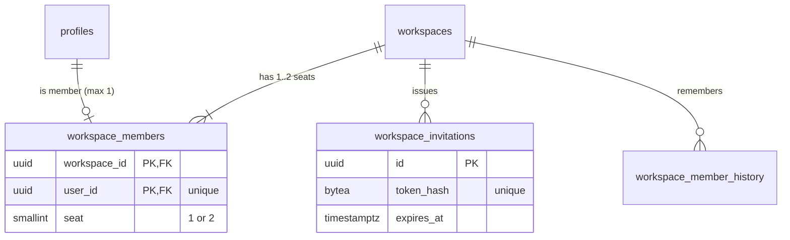

### 2.2 Notifications, reminders and audit <span class="tag r1">R1</span>

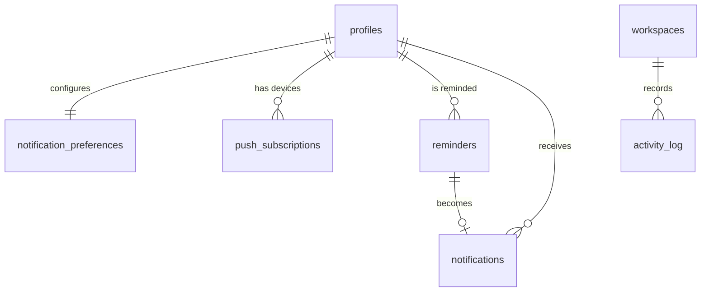

### 2.3 Opportunities <span class="tag r1">R1</span>

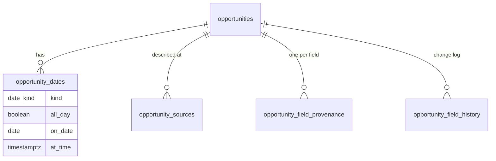

### 2.4 Extraction and provenance <span class="tag r1">R1</span>

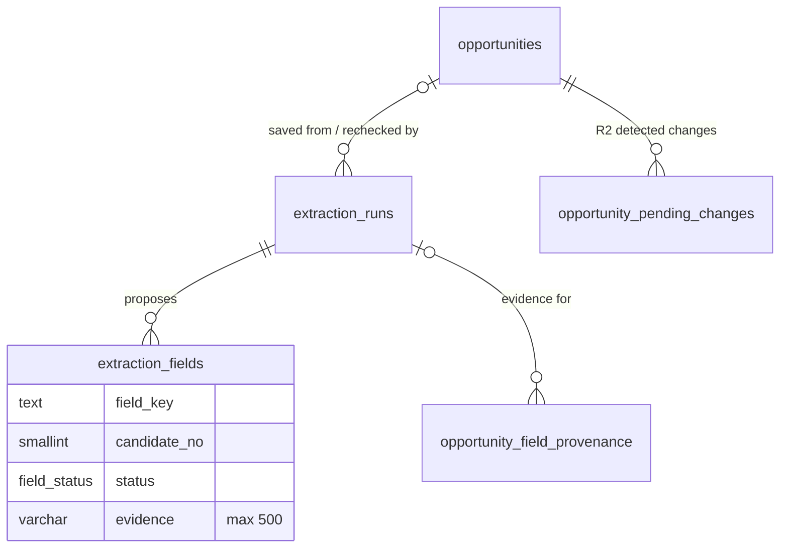

### 2.5 Projects, tasks and files <span class="tag r1">R1</span>

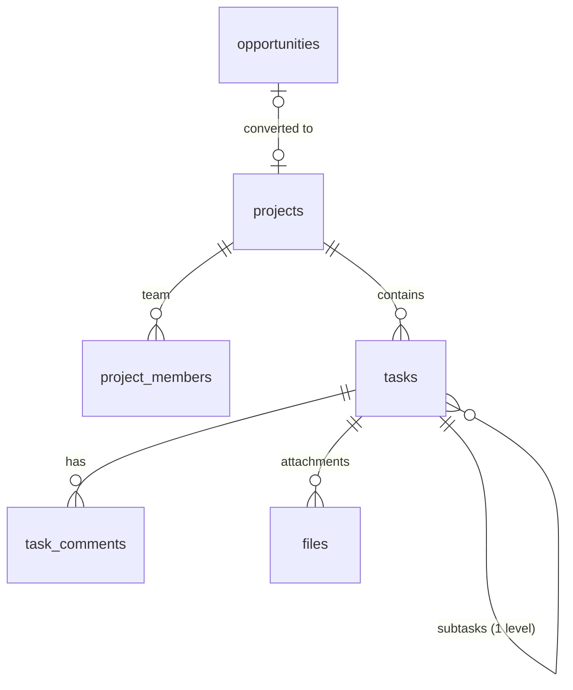

### 2.6 Checklists, templates and project knowledge <span class="tag r1">R1</span>

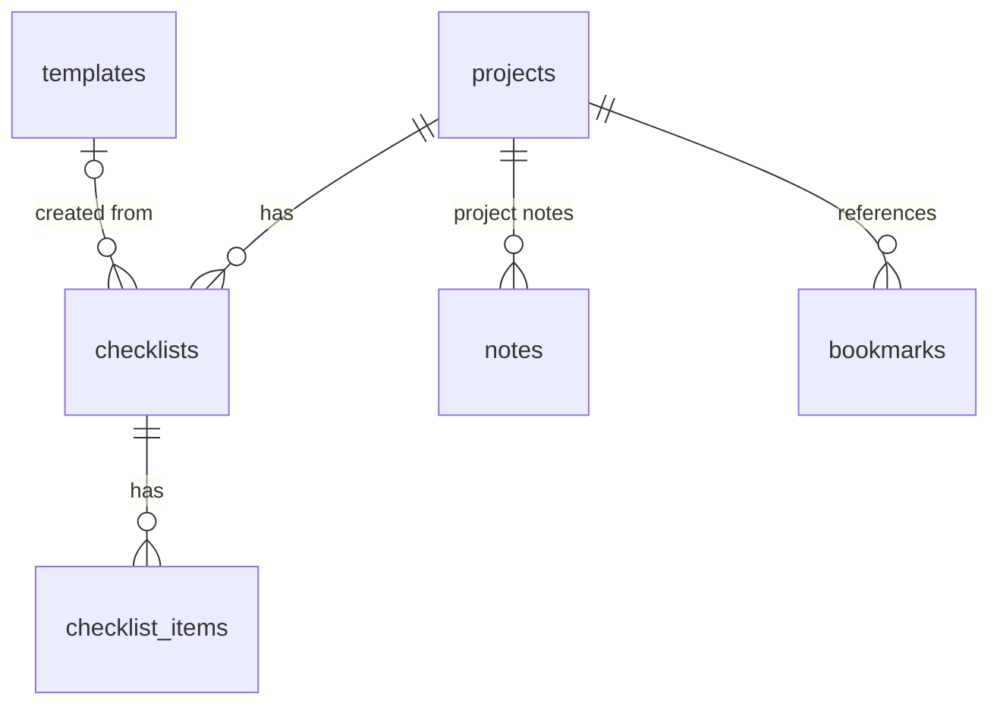

### 2.7 Calendar and reminders <span class="tag r1">R1</span>

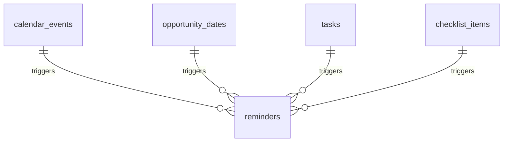

### 2.8 Chat <span class="tag r1">R1</span>

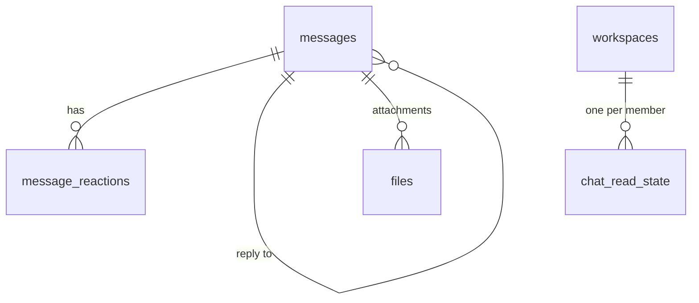

### 2.9 Knowledge Vault <span class="tag r1">R1</span>

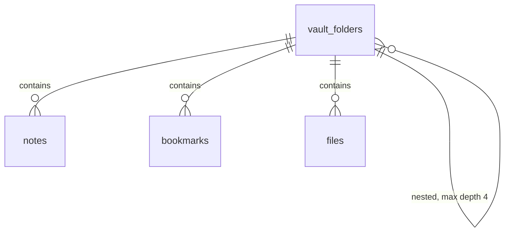

### 2.10 Later-release relationships <span class="tag r2">R2</span> <span class="tag r3">R3</span> <span class="tag r4">R4</span>

| Parent | Child | Cardinality | Rel. |
|---|---|---|---|
| `subjects` | `timetable_slots`, `assessments` | 1 : N | <span class="tag r2">R2</span> |
| `profiles` | `goals`, `habits`, `skills`, `courses`, `learning_logs`, `focus_sessions`, `weekly_reviews` | 1 : N | <span class="tag r2">R2</span> |
| `habits` | `habit_logs` | 1 : N (one per day) | <span class="tag r2">R2</span> |
| `skills` | `skill_stage_history` | 1 : N | <span class="tag r2">R2</span> |
| `projects` | `ideas` → `idea_votes`; `decisions`; `polls` → `poll_options` → `poll_votes` | 1 : N | <span class="tag r2">R2</span> |
| `decisions` / `checklist_items` / `expenses` | `approval_requests` | 1 : 0..1 pending | <span class="tag r2">R2</span> |
| `opportunities` | `opportunity_participants`, `opportunity_pending_changes` | 1 : N | <span class="tag r2">R2</span> |
| `profiles` | `member_eligibility` | 1 : 0..1 | <span class="tag r2">R2</span> |
| `projects` ↔ `skills` | `project_skills` | N : M | <span class="tag r3">R3</span> |
| `trips` | `trip_items`, `trip_emergency_contacts`, `checklists` (packing), `expenses`, `files` | 1 : N | <span class="tag r3">R3</span> |
| `trips` | `location_shares` | 1 : N (optional link) | <span class="tag r3">R3</span> |
| `profiles` | `portfolio_items` → `portfolio_bullets` | 1 : N | <span class="tag r3">R3</span> |
| `projects` / `opportunities` | `portfolio_items` (source records) | 1 : N | <span class="tag r3">R3</span> |
| `workspaces` | `contacts`, `discovery_feeds` → `discovery_items` | 1 : N | <span class="tag r3">R3</span> |
| `profiles` | `github_connections`; `projects` → `project_repositories` | 1 : 0..1 / 1 : N | <span class="tag r3">R3</span> |
| `profiles` | `ai_settings`; `workspaces` → `call_sessions` | 1 : 0..1 / 1 : N | <span class="tag r4">R4</span> |

### 2.11 Project guest access <span class="tag r1">R1</span>

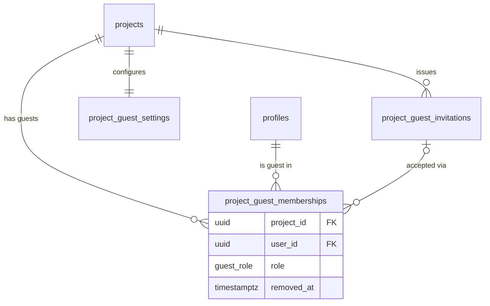

Guests never appear in `workspace_members`; the two-seat constraint (§15) is unaffected.

### 2.12 Project meetings and Google <span class="tag r2">R2</span> <span class="tag r3">R3</span>

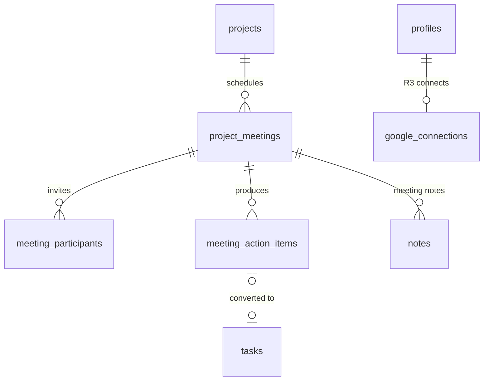

## 3. Complete table inventory

| # | Table | Domain | Visibility model | Rel. |
|---|---|---|---|---|
| 1 | `profiles` | Platform | Workspace members can read each other | <span class="tag r1">R1</span> |
| 2 | `workspaces` | Platform | Members | <span class="tag r1">R1</span> |
| 3 | `workspace_members` | Platform | Members | <span class="tag r1">R1</span> |
| 4 | `workspace_invitations` | Platform | Members (no token) | <span class="tag r1">R1</span> |
| 5 | `workspace_member_history` | Platform | Members | <span class="tag r1">R1</span> |
| 6 | `activity_log` | Platform | Shared or actor-only | <span class="tag r1">R1</span> |
| 7 | `notifications` | Platform | Recipient only | <span class="tag r1">R1</span> |
| 8 | `notification_preferences` | Platform | Owner only | <span class="tag r1">R1</span> |
| 9 | `push_subscriptions` | Platform | Owner only | <span class="tag r1">R1</span> |
| 10 | `reminders` | Platform | Owner (recipient) only | <span class="tag r1">R1</span> |
| 11 | `files` | Platform | Shared/private | <span class="tag r1">R1</span> |
| 12 | `rate_limit_events` | Platform | Server only | <span class="tag r1">R1</span> |
| 13 | `export_jobs` | Platform | Owner only | <span class="tag r1">R1</span> |
| 14 | `app_config` | Platform | Read-only to members | <span class="tag r1">R1</span> |
| 15 | `client_errors` | Platform | Insert via RPC only | <span class="tag r1">R1</span> |
| 16 | `opportunities` | Opportunities | Shared/private | <span class="tag r1">R1</span> |
| 17 | `opportunity_dates` | Opportunities | Inherits opportunity | <span class="tag r1">R1</span> |
| 18 | `opportunity_sources` | Opportunities | Inherits opportunity | <span class="tag r1">R1</span> |
| 19 | `extraction_runs` | Opportunities | Requester; plus partner when linked to a shared opportunity | <span class="tag r1">R1</span> |
| 20 | `extraction_fields` | Opportunities | Inherits run | <span class="tag r1">R1</span> |
| 21 | `opportunity_field_provenance` | Opportunities | Inherits opportunity | <span class="tag r1">R1</span> |
| 22 | `opportunity_field_history` | Opportunities | Inherits opportunity | <span class="tag r1">R1</span> |
| 23 | `opportunity_pending_changes` | Opportunities | Inherits opportunity | <span class="tag r2">R2</span> |
| 24 | `member_eligibility` | Opportunities | Owner only | <span class="tag r2">R2</span> |
| 25 | `opportunity_participants` | Opportunities | Inherits opportunity | <span class="tag r2">R2</span> |
| 26 | `discovery_feeds` | Opportunities | Shared/private | <span class="tag r3">R3</span> |
| 27 | `discovery_items` | Opportunities | Inherits feed | <span class="tag r3">R3</span> |
| 28 | `projects` | Projects | Shared/private | <span class="tag r1">R1</span> |
| 29 | `project_members` | Projects | Inherits project | <span class="tag r1">R1</span> |
| 30 | `tasks` | Projects | Inherits project, or shared/private when loose | <span class="tag r1">R1</span> |
| 31 | `task_comments` | Projects | Inherits task | <span class="tag r1">R1</span> |
| 32 | `templates` | Projects | Built-in (all) or workspace | <span class="tag r1">R1</span> |
| 33 | `checklists` | Projects | Inherits project/trip | <span class="tag r1">R1</span> |
| 34 | `checklist_items` | Projects | Inherits checklist | <span class="tag r1">R1</span> |
| 35 | `ideas`, `idea_votes` | Projects | Inherits project | <span class="tag r2">R2</span> |
| 36 | `decisions` | Projects | Inherits project | <span class="tag r2">R2</span> |
| 37 | `approval_requests` | Projects | Members | <span class="tag r2">R2</span> |
| 38 | `polls`, `poll_options`, `poll_votes` | Projects/Chat | Members | <span class="tag r2">R2</span> |
| 39 | `judge_questions` | Projects | Inherits project | <span class="tag r3">R3</span> |
| 40 | `retrospectives` | Projects | Inherits project | <span class="tag r3">R3</span> |
| 41 | `project_skills` | Projects | Inherits project | <span class="tag r3">R3</span> |
| 42 | `calendar_events` | Calendar | Shared/private | <span class="tag r1">R1</span> |
| 43 | `subjects` | Academics | Shared/private (default private) | <span class="tag r2">R2</span> |
| 44 | `timetable_slots` | Academics | Inherits subject | <span class="tag r2">R2</span> |
| 45 | `assessments` | Academics | Shared/private (default private) | <span class="tag r2">R2</span> |
| 46 | `messages` | Chat | Members | <span class="tag r1">R1</span> |
| 47 | `message_reactions` | Chat | Members | <span class="tag r1">R1</span> |
| 48 | `chat_read_state` | Chat | Members read, owner writes | <span class="tag r1">R1</span> |
| 49 | `call_sessions` | Chat | Members | <span class="tag r4">R4</span> |
| 50 | `vault_folders` | Vault | Shared/private | <span class="tag r1">R1</span> |
| 51 | `notes` | Vault | Shared/private | <span class="tag r1">R1</span> |
| 52 | `bookmarks` | Vault | Shared/private | <span class="tag r1">R1</span> |
| 53 | `snippets` | Vault | Shared/private | <span class="tag r2">R2</span> |
| 54 | `resource_links` | Vault | Members (both ends must be readable) | <span class="tag r2">R2</span> |
| 55 | `goals` | Productivity | Shared/private | <span class="tag r2">R2</span> |
| 56 | `habits`, `habit_logs` | Productivity | Owner only | <span class="tag r2">R2</span> |
| 57 | `focus_sessions` | Productivity | Owner only (status shared via presence) | <span class="tag r2">R2</span> |
| 58 | `skills`, `skill_stage_history` | Productivity | Shared/private | <span class="tag r2">R2</span> |
| 59 | `courses`, `learning_logs` | Productivity | Shared/private / owner only | <span class="tag r2">R2</span> |
| 60 | `weekly_reviews` | Productivity | Owner only (+ shared highlight via function) | <span class="tag r2">R2</span> |
| 61 | `expenses` | Productivity | Shared/private | <span class="tag r3">R3</span> |
| 62 | `trips` | Travel | Shared | <span class="tag r3">R3</span> |
| 63 | `trip_items` | Travel | Inherits trip | <span class="tag r3">R3</span> |
| 64 | `trip_emergency_contacts` | Travel | Inherits trip | <span class="tag r3">R3</span> |
| 65 | `location_shares` | Travel | Members while active | <span class="tag r3">R3</span> |
| 66 | `portfolio_items`, `portfolio_bullets` | Portfolio | Owner edits; shared readable | <span class="tag r3">R3</span> |
| 67 | `contacts` | Contacts | Shared/private | <span class="tag r3">R3</span> |
| 68 | `github_connections` | Integrations | Owner only; token column hidden | <span class="tag r3">R3</span> |
| 69 | `project_repositories` | Integrations | Inherits project | <span class="tag r3">R3</span> |
| 70 | `ai_settings` | Integrations | Owner only; key hidden | <span class="tag r4">R4</span> |
| 71 | `project_guest_invitations` | Guests | Room members + guest Project Admins (no token hash) | <span class="tag r1">R1</span> |
| 72 | `project_guest_memberships` | Guests | Room members; each guest sees own row; Project Admin sees room list | <span class="tag r1">R1</span> |
| 73 | `project_guest_settings` | Guests | Room members + guests (read), members + Project Admin (write) | <span class="tag r1">R1</span> |
| 74 | `project_meetings` | Meetings | Room members; guests when `guest_visible` | <span class="tag r2">R2</span> |
| 75 | `meeting_participants` | Meetings | Inherits meeting | <span class="tag r2">R2</span> |
| 76 | `meeting_action_items` | Meetings | Inherits meeting | <span class="tag r2">R2</span> |
| 77 | `google_connections` | Integrations | Owner only; token reference hidden | <span class="tag r3">R3</span> |
| 78 | `oauth_states` | Integrations | Server only | <span class="tag r3">R3</span> |

**Views:** `calendar_feed`, `dashboard_upcoming`, `expense_balances` (R3) — all `security_invoker = true`.

## 4. Table descriptions

| Table | Purpose |
|---|---|
| `profiles` | Public-to-partner profile for each auth user: name, avatar, time zone, availability. Created by trigger on sign-up. |
| `workspaces` | The private shared space. |
| `workspace_members` | Seats 1 and 2. The heart of isolation and the two-member rule. |
| `workspace_invitations` | Hashed, expiring, single-use invitation tokens. |
| `workspace_member_history` | Who has been a member and when, with a display-name snapshot so authorship survives departure. |
| `activity_log` | Append-only record of important actions (activity and security categories). |
| `notifications` | In-app notifications; the source of truth for every delivery channel. |
| `notification_preferences` | Channel switches, quiet hours, default reminder offsets. |
| `push_subscriptions` | Web Push endpoints per device. |
| `reminders` | Scheduled per-user reminders derived from dated records or created manually. |
| `files` | Metadata for every stored object; links to its owner record. |
| `rate_limit_events` | Sliding-window counters for Edge Functions. |
| `export_jobs` | Requests for personal/workspace exports and their temporary files. |
| `app_config` | Small key/value feature flags. |
| `client_errors` | Minimal, content-free client error reports. |
| `opportunities` | Every hackathon, competition, internship, scholarship, programme or event. |
| `opportunity_dates` | Registration, submission, event and other dates — each date-only or timed. |
| `opportunity_sources` | URLs where the opportunity is described; credibility and last check. |
| `extraction_runs` | One attempt to read a URL. |
| `extraction_fields` | Candidate values per field per run, with status and evidence. |
| `opportunity_field_provenance` | Current source and verification of each saved field. |
| `opportunity_field_history` | Old → new values for important fields. |
| `opportunity_pending_changes` | Changes found by re-checks, awaiting review (R2). |
| `member_eligibility` | Private attributes used by the eligibility checker (R2). |
| `opportunity_participants` | Who took part, role and result — participation history (R2). |
| `discovery_feeds` / `discovery_items` | Member-chosen RSS/Atom sources and their items (R3). |
| `projects`, `project_members` | Project rooms and team roles. |
| `tasks`, `task_comments` | Board tasks with one level of subtasks, and comments. |
| `templates`, `checklists`, `checklist_items` | Reusable templates and their instantiated checklists (submission, packing, etc.). |
| `ideas`, `idea_votes`, `decisions`, `approval_requests`, `polls`… | Collaboration records (R2). |
| `judge_questions`, `retrospectives`, `project_skills` | Preparation, reflection and skill mapping (R3). |
| `calendar_events` | Native events (meetings, personal, milestones not derived elsewhere). |
| `subjects`, `timetable_slots`, `assessments` | Academic structure (R2). |
| `messages`, `message_reactions`, `chat_read_state` | Chat. |
| `vault_folders`, `notes`, `bookmarks`, `snippets`, `resource_links` | Knowledge Vault. |
| `goals`, `habits`, `habit_logs`, `focus_sessions`, `skills`, `skill_stage_history`, `courses`, `learning_logs`, `weekly_reviews`, `expenses` | Productivity and learning. |
| `trips`, `trip_items`, `trip_emergency_contacts`, `location_shares` | Travel (R3). |
| `portfolio_items`, `portfolio_bullets`, `contacts` | Portfolio and networking (R3). |
| `github_connections`, `project_repositories`, `ai_settings`, `call_sessions` | Integrations and calls (R3–R4). |
| `project_guest_invitations` | Hashed, expiring, use-limited, revocable invitation links into one Project Room. |
| `project_guest_memberships` | Guest role of a person in one room, with join and removal audit fields. |
| `project_guest_settings` | Per-room guest permission toggles and guest cap. |
| `project_meetings`, `meeting_participants`, `meeting_action_items` | Room meetings with Meet link, participants and follow-up items (R2). |
| `google_connections`, `oauth_states` | Optional per-member Google account connection and short-lived OAuth state (R3). |

## 5. Column definitions

Columns of the platform and R1 domain tables are given as DDL in §§14–27; this section defines the shared enumerations used by all of them.

```sql
create type public.visibility          as enum ('shared','private');
create type public.availability_status as enum ('available','busy','focus','away');
create type public.opportunity_type    as enum (
  'hackathon','coding_competition','innovation_challenge','internship','scholarship','fellowship',
  'research_programme','conference','workshop','summer_school','ambassador_programme',
  'open_source_programme','exchange_programme','technical_event','other');
create type public.opportunity_status  as enum (
  'saved','interested','planning','registered','in_progress','submitted','awaiting_result',
  'won','not_selected','withdrawn','missed','archived');
create type public.participation_mode  as enum ('online','offline','hybrid','unknown');
create type public.date_kind           as enum (
  'registration_open','registration_deadline','submission_deadline','event_start','event_end','result','other');
create type public.field_status        as enum ('confirmed','inferred','missing','conflicting');
create type public.provenance_source   as enum ('manual','extraction','recheck');
create type public.credibility_level   as enum ('official','known_platform','unverified','caution');
create type public.project_stage       as enum (
  'idea','planning','building','testing','submitting','presenting','completed','archived');
create type public.project_category    as enum (
  'hackathon','competition','academic','practice','personal','research','other');
create type public.task_status         as enum ('backlog','todo','in_progress','review','done');
create type public.task_priority       as enum ('low','medium','high','urgent');
create type public.event_kind          as enum (
  'meeting','deadline','milestone','assignment','exam','class','lab','travel','focus','personal','other');
create type public.skill_stage         as enum ('not_started','learning','practicing','applied','confident');
create type public.portfolio_kind      as enum (
  'project','hackathon','competition','award','certificate','internship','workshop','research',
  'open_source','leadership','volunteering');
```

## 6. Data types

| Kind of value | Type | Rationale |
|---|---|---|
| Identifiers | `uuid` (`gen_random_uuid()`) | Safe to expose in URLs; generated client-side for offline `client_id`s |
| Append-only logs | `bigint generated always as identity` | Compact, ordered |
| Short text | `text` + `check (char_length(x) between 1 and N)` | Postgres `varchar(n)` has no performance benefit; explicit checks give clear errors |
| Evidence snippets | `varchar(500)` | Hard limit stated in privacy requirements |
| Money | `numeric(12,2)` + `char(3)` currency (ISO 4217) | Exact arithmetic; INR default |
| Date-only facts | `date` | No time-zone shifting (PRD FR-OPP-03) |
| Instants | `timestamptz` + `text` IANA zone (e.g. `Asia/Kolkata`) where display zone matters | Correct ordering and display in the organizer's zone |
| Recurring local times | `time` + zone on the row (timetable) | A 09:00 lecture stays 09:00 local |
| Coordinates | `numeric(9,6)` | ~11 cm precision; no PostGIS needed |
| Lists of labels | `text[]` with GIN index | Tags, tracks, documents |
| Flexible structured data | `jsonb` | Eligibility criteria, template bodies, caches, candidate values |
| Hashes | `bytea` | SHA-256 of tokens and page content |
| Search | `tsvector` generated column + GIN | Postgres full-text search |

## 7. Primary keys

Every table has a single-column `uuid` primary key **except**:

| Table | Primary key | Reason |
|---|---|---|
| `profiles` | `id` = `auth.users.id` | One profile per auth user |
| `workspace_members` | `(workspace_id, user_id)` | Natural key |
| `notification_preferences`, `member_eligibility`, `github_connections`, `ai_settings` | `user_id` | One row per user |
| `message_reactions` | `(message_id, user_id, emoji)` | One reaction type per user per message |
| `chat_read_state` | `(workspace_id, user_id)` | One state per member |
| `idea_votes` | `(idea_id, user_id)` | One vote per member |
| `poll_votes` | `(option_id, user_id)` | One vote per option per member |
| `habit_logs` | `(habit_id, log_date)` | One log per day |
| `opportunity_field_provenance` | `(opportunity_id, field_key)` | One current provenance per field |
| `project_members` | `(project_id, user_id)` | Natural key |
| `project_skills` | `(project_id, skill_id)` | Natural key |
| `activity_log`, `opportunity_field_history`, `rate_limit_events`, `skill_stage_history` | identity `bigint` | Append-only, high volume |
| `app_config` | `key text` | Key/value |

## 8. Foreign keys

| Pattern | Example | On delete |
|---|---|---|
| Workspace ownership | `workspace_id → workspaces(id)` | `cascade` (deleting a workspace deletes everything) |
| Person reference (author, owner, actor) | `owner_id → profiles(id)` | `set null` (authorship display falls back to `workspace_member_history`) |
| Member-only reference (approver, payer) | `(workspace_id, assignee_id) → workspace_members(workspace_id, user_id)` | `set null (assignee_id)` — a departed member can no longer be assigned |
| Room-participant reference (task / checklist / action-item assignee, meeting participant) | `assignee_id → profiles(id)` + trigger `private.validate_room_person()` (member of the workspace or active guest of the row's project) | `set null`; guest removal clears assignments in that room |
| Parent–child in same workspace | `(project_id, workspace_id) → projects(id, workspace_id)` | `cascade` for owned children (tasks, items); `set null (project_id)` for optional links |
| Optional cross-module link | `(opportunity_id, workspace_id) → opportunities(id, workspace_id)` | `set null (opportunity_id)` (PostgreSQL 15 column-list syntax) |
| File references | `receipt_file_id → files(id)` | `set null` |
| Run evidence | `extraction_run_id → extraction_runs(id)` | `set null` (evidence copied into provenance) |

Every foreign-key column is indexed (see §11).

## 9. Unique constraints

| Table | Unique | Purpose |
|---|---|---|
| `workspace_members` | `(workspace_id, seat)`, `(user_id)` | Two seats; one workspace per user |
| `workspace_invitations` | `token_hash`; partial `(workspace_id) where accepted_at is null and revoked_at is null` | Token lookup; one open invitation |
| `notifications` | `(recipient_id, dedupe_key)` | No duplicate notifications |
| `reminders` | `(dedupe_key)` | No duplicate reminders |
| `push_subscriptions` | `(endpoint)` | One row per device endpoint |
| `opportunity_dates` | partial `(opportunity_id, kind) where kind <> 'other'` | One registration deadline etc. per opportunity |
| `opportunity_sources` | `(opportunity_id, normalized_url)`; partial `(opportunity_id) where is_primary` | No duplicate sources; one primary |
| `extraction_fields` | `(run_id, field_key, candidate_no)` | Ordered candidates |
| `projects` | partial `(opportunity_id) where opportunity_id is not null and deleted_at is null` | One active project per opportunity |
| `files` | `(storage_path)` | One metadata row per object |
| `messages`, `tasks`, `notes`, `checklist_items` | `(client_id)` | Idempotent offline replay |
| `vault_folders` | `unique nulls not distinct (workspace_id, parent_id, name)` | No duplicate folder names at a level |
| `location_shares` | partial `(sharer_id) where revoked_at is null and cleared_at is null` | One active share per member |
| `project_guest_memberships` | partial `(project_id, user_id) where removed_at is null` | One active guest membership per person per room |
| `project_guest_invitations` | `token_hash` | Token lookup |
| `meeting_participants` | `(meeting_id, user_id)` (PK) | One response per person |
| `weekly_reviews` | `(user_id, week_start)` | One review per week |

> **Privacy note:** uniqueness that spans private records can leak their existence through constraint errors. For that reason duplicate-URL detection for opportunities is performed by a query under RLS, not by a workspace-wide unique constraint.

## 10. Check constraints

Representative checks (full set in the DDL):

| Table | Check |
|---|---|
| All with `visibility` | `visibility = 'shared' or owner_id is not null` |
| `workspace_members` | `seat in (1,2)` |
| `workspace_invitations` | `expires_at <= created_at + interval '7 days'`; `octet_length(token_hash) = 32` |
| `opportunities` | `team_min >= 1`, `team_max <= 50`, `team_min <= team_max`; `fee_amount >= 0`; `fee_currency ~ '^[A-Z]{3}$'`; URLs `~ '^https?://'`; `not (is_free and fee_amount > 0)` |
| `opportunity_dates`, `calendar_events`, `tasks`, `assessments` | exactly one of date-only / timed is set; timed rows have a zone; end ≥ start |
| `extraction_fields` | `missing` status ⇒ `value is null`; `conflicting` ⇒ more than one candidate row (enforced by function) |
| `files` | `size_bytes between 1 and 26214400`; MIME in allow-list; at most one of `task_id`, `message_id` |
| `location_shares` | `expires_at > started_at and expires_at <= started_at + interval '24 hours'`; lat/lng both null or both set; lat ∈ [−90, 90], lng ∈ [−180, 180] |
| `expenses` | `amount > 0`; `split_ratio between 0 and 1`; private ⇒ `split_ratio = 0` |
| `focus_sessions` | `planned_minutes between 1 and 240`; `ended_at >= started_at` |
| `habit_logs` | `count between 0 and 50` |
| `vault_folders` | `depth between 1 and 4` |

## 11. Indexing strategy

| Rule | Example |
|---|---|
| Every FK column indexed | `create index on tasks (project_id);` |
| Workspace-leading composite indexes for list screens | `opportunities (workspace_id, status, updated_at desc) where deleted_at is null` |
| Partial indexes for hot subsets | `reminders (remind_at) where status = 'pending'`; `tasks (assignee_id, due_date) where status <> 'done' and deleted_at is null` |
| Full-text search | `gin (search)` on opportunities, tasks, notes, bookmarks, messages, snippets |
| Tags | `gin (tags)` |
| Fuzzy title search (command palette) | `gin (title gin_trgm_ops)` on opportunities, projects, notes |
| Chat pagination | `messages (workspace_id, created_at desc, id desc)` |
| Calendar range | `calendar_events (workspace_id, starts_at)`, `(workspace_id, start_date)`; `opportunity_dates (workspace_id, on_date)`, `(workspace_id, at_time)` |
| Soft-delete purge | `(deleted_at) where deleted_at is not null` on purgeable tables |

At two-person scale (≈10⁵ rows/year) these indexes keep every list query well below 100 ms; avoid adding speculative indexes beyond this list without a slow-query observation.

## 12. Relationships

| Relationship | Cardinality | Implementation |
|---|---|---|
| Workspace ↔ members | 1 : 1..2 | `workspace_members` with seat constraint |
| User ↔ workspace | N : ≤1 | `unique (user_id)` |
| Opportunity ↔ project | 1 : 0..1 (active) | `projects.opportunity_id` + partial unique |
| Project ↔ tasks | 1 : N | `tasks.project_id` (nullable for loose tasks) |
| Task ↔ subtasks | 1 : N, depth 1 | `tasks.parent_task_id` + trigger preventing grandchildren |
| Task/Message ↔ files | 1 : N | `files.task_id` / `files.message_id` |
| Dated record ↔ reminders | 1 : N per member | `reminders.<target>_id` + `user_id` |
| Message ↔ reply | N : 1 | `messages.reply_to_id` |
| Folder ↔ folder | tree, depth ≤ 4 | `vault_folders.parent_id`, `depth` |
| Skill ↔ project | N : M | `project_skills` (R3) |
| Any Vault item ↔ any record | N : M | `resource_links` (R2, polymorphic — see §22) |

## 13. Shared versus personal data model

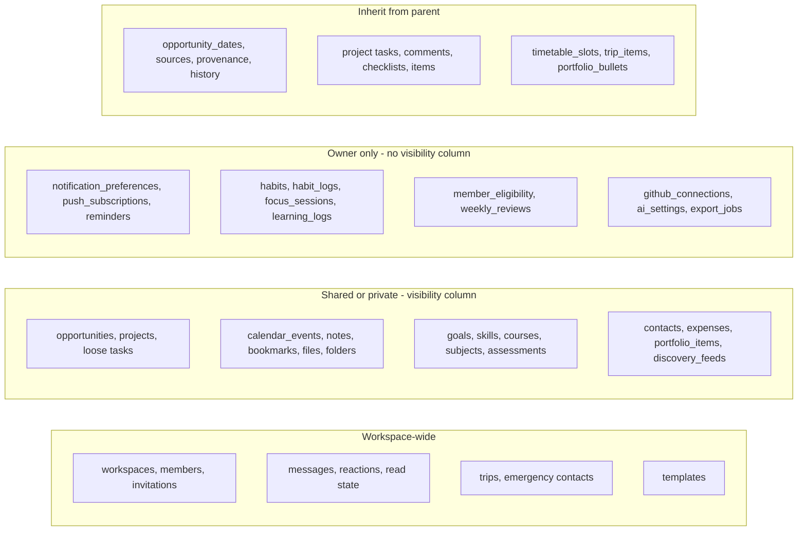

**Defaults** (PRD PRIV-02): opportunities, projects, tasks, events, checklists → `shared`; notes created under "My notes" → `private`, inside a project → `shared`; subjects, assessments, portfolio items → `private`; skills, courses, goals → `private` unless the goal scope is shared.

**Rules**
1. A child never has its own visibility when it belongs to a parent; its access is the parent's.
2. A private folder may contain only private items (trigger `private.enforce_folder_visibility`).
3. Changing `private → shared` is logged in `activity_log` (PRD PRIV-03). Only the owner can change `shared → private` (RLS `with check`).
4. The partner can see that a private record *exists* nowhere — not in counts, search, calendar or constraint errors.
5. **Room-guest audience (R1):** project content additionally carries `guest_visible`. Guests of that room can see a row only if it belongs to their room, is `shared` and `guest_visible = true`. A `private` row can never be `guest_visible` (check constraint). Defaults: tasks, checklists, meetings `true`; notes, bookmarks, files `false`; rows created by guests are forced to `true`.

## 14. Workspace membership model

```sql
create table public.profiles (
  id            uuid primary key references auth.users(id) on delete cascade,
  display_name  text not null check (char_length(display_name) between 1 and 60),
  avatar_path   text,
  timezone      text not null default 'Asia/Kolkata',   -- validated by trigger against pg_timezone_names
  availability  public.availability_status not null default 'available',
  created_at    timestamptz not null default now(),
  updated_at    timestamptz not null default now()
);

create table public.workspaces (
  id          uuid primary key default gen_random_uuid(),
  name        text not null check (char_length(name) between 1 and 60),
  created_by  uuid references public.profiles(id) on delete set null,
  created_at  timestamptz not null default now(),
  updated_at  timestamptz not null default now(),
  deleted_at  timestamptz            -- set when the last member leaves; purged after 30 days
);

create table public.workspace_members (
  workspace_id uuid not null references public.workspaces(id) on delete cascade,
  user_id      uuid not null references public.profiles(id)   on delete cascade,
  seat         smallint not null check (seat in (1, 2)),
  joined_at    timestamptz not null default now(),
  primary key (workspace_id, user_id),
  unique (workspace_id, seat),     -- at most two members per workspace
  unique (user_id)                 -- at most one workspace per user
);

create table public.workspace_invitations (
  id           uuid primary key default gen_random_uuid(),
  workspace_id uuid not null references public.workspaces(id) on delete cascade,
  token_hash   bytea not null unique check (octet_length(token_hash) = 32),  -- sha256(token)
  created_by   uuid references public.profiles(id) on delete set null,
  created_at   timestamptz not null default now(),
  expires_at   timestamptz not null,
  accepted_by  uuid references public.profiles(id) on delete set null,
  accepted_at  timestamptz,
  revoked_at   timestamptz,
  check (expires_at > created_at and expires_at <= created_at + interval '7 days'),
  check (not (accepted_at is not null and revoked_at is not null))
);
create unique index workspace_invitations_one_open
  on public.workspace_invitations (workspace_id)
  where accepted_at is null and revoked_at is null;
-- A column-level REVOKE cannot override a table-level GRANT, so grant only the safe columns:
revoke all on public.workspace_invitations from anon, authenticated;
grant select (id, workspace_id, created_by, created_at, expires_at, accepted_by, accepted_at, revoked_at)
  on public.workspace_invitations to authenticated;

create table public.workspace_member_history (
  id             uuid primary key default gen_random_uuid(),
  workspace_id   uuid not null references public.workspaces(id) on delete cascade,
  user_id        uuid,                       -- kept even after account deletion (no FK)
  seat           smallint not null,
  display_name   text not null,              -- snapshot for "(former member)" labels
  joined_at      timestamptz not null,
  left_at        timestamptz
);
```

**Helper functions** (unexposed `private` schema):

```sql
create schema if not exists private;
grant usage on schema private to authenticated;

-- The caller's workspace (a user has at most one). Used in nearly every RLS policy.
create or replace function private.current_workspace_id()
returns uuid language sql stable security definer set search_path = '' as $$
  select m.workspace_id from public.workspace_members m where m.user_id = (select auth.uid());
$$;

create or replace function private.is_member(ws uuid)
returns boolean language sql stable security definer set search_path = '' as $$
  select exists (select 1 from public.workspace_members m
                 where m.workspace_id = ws and m.user_id = (select auth.uid()));
$$;

grant execute on function private.current_workspace_id(), private.is_member(uuid) to authenticated;
```

`create_workspace(name)` is an RPC (security definer) that checks the caller has no membership, inserts the workspace and seat 1, writes history and activity, all in one transaction.

## 15. Two-member enforcement

The limit is enforced by **constraints**, so it holds no matter which path inserts a row (app, RPC, SQL editor mistake, or a race):

| Threat | Defence |
|---|---|
| Third member inserted directly through the API | No INSERT policy on `workspace_members` for clients → denied by RLS |
| Bug in `invite-accept` tries seat 3 | `check (seat in (1,2))` fails |
| Two invitees accept at the same moment | Both try seat 2 → `unique (workspace_id, seat)` lets exactly one succeed; the other gets "workspace is full" |
| A user joins two workspaces | `unique (user_id)` fails |
| Re-use of invitation | `accepted_at` set in the same transaction; function requires `accepted_at is null and revoked_at is null and expires_at > now()` with `for update` row lock |

```sql
-- inside invite-accept (service role), simplified
begin;
  select * from public.workspace_invitations
   where token_hash = $1 and accepted_at is null and revoked_at is null and expires_at > now()
   for update;                                     -- none → INVITE_INVALID
  insert into public.workspace_members (workspace_id, user_id, seat)
  values ($ws, $uid, (select case when exists (select 1 from public.workspace_members
                                                where workspace_id = $ws and seat = 1) then 2 else 1 end));
                                                   -- unique violation → WORKSPACE_FULL / ALREADY_MEMBER
  update public.workspace_invitations set accepted_at = now(), accepted_by = $uid where id = $inv;
  insert into public.workspace_member_history (...) values (...);
commit;
```

A pgTAP test asserts that a third insert fails with `23514` (check) or `23505` (unique) and that two concurrent accepts produce exactly one member.

## 16. Opportunity data model

```sql
create table public.opportunities (
  id                 uuid primary key default gen_random_uuid(),
  workspace_id       uuid not null references public.workspaces(id) on delete cascade,
  owner_id           uuid references public.profiles(id) on delete set null,
  visibility         public.visibility not null default 'shared',
  type               public.opportunity_type not null,
  title              text not null check (char_length(title) between 1 and 200),
  organizer          text check (char_length(organizer) <= 200),
  description        text check (char_length(description) <= 20000),
  official_url       text check (official_url ~ '^https?://' and char_length(official_url) <= 2048),
  registration_url   text check (registration_url ~ '^https?://' and char_length(registration_url) <= 2048),
  rules_url          text check (rules_url ~ '^https?://' and char_length(rules_url) <= 2048),
  rules_text         text check (char_length(rules_text) <= 20000),
  mode               public.participation_mode not null default 'unknown',
  location           text check (char_length(location) <= 300),
  eligibility_text   text check (char_length(eligibility_text) <= 5000),
  eligibility_criteria jsonb,                           -- R2, JSON schema in §16.2
  team_min           smallint check (team_min >= 1),
  team_max           smallint check (team_max between 1 and 50),
  is_free            boolean,                           -- null = unknown
  fee_amount         numeric(12,2) check (fee_amount >= 0),
  fee_currency       char(3) default 'INR' check (fee_currency ~ '^[A-Z]{3}$'),
  prizes             text check (char_length(prizes) <= 5000),
  benefits           text check (char_length(benefits) <= 5000),
  required_documents text[] not null default '{}',
  tracks             text[] not null default '{}',
  tags               text[] not null default '{}',
  status             public.opportunity_status not null default 'saved',
  search             tsvector generated always as (
                       setweight(to_tsvector('english', coalesce(title,'')), 'A') ||
                       setweight(to_tsvector('english', coalesce(organizer,'')), 'B') ||
                       setweight(to_tsvector('english', coalesce(description,'') || ' ' || coalesce(location,'')), 'C')
                     ) stored,
  created_at         timestamptz not null default now(),
  updated_at         timestamptz not null default now(),
  deleted_at         timestamptz,
  deleted_by         uuid references public.profiles(id) on delete set null,
  unique (id, workspace_id),
  check (visibility = 'shared' or owner_id is not null),
  check (team_min is null or team_max is null or team_min <= team_max),
  check (not (is_free is true and coalesce(fee_amount, 0) > 0))
);
create index on public.opportunities (workspace_id, status, updated_at desc) where deleted_at is null;
create index on public.opportunities using gin (search);
create index on public.opportunities using gin (tags);
create index on public.opportunities using gin (title gin_trgm_ops);

create table public.opportunity_dates (
  id               uuid primary key default gen_random_uuid(),
  workspace_id     uuid not null,
  opportunity_id   uuid not null,
  kind             public.date_kind not null,
  label            text check (char_length(label) <= 100),      -- for kind = 'other'
  all_day          boolean not null,
  on_date          date,                                         -- date-only value
  at_time          timestamptz,                                  -- timed value (instant)
  source_timezone  text,                                         -- e.g. 'Asia/Kolkata' for display
  created_at       timestamptz not null default now(),
  updated_at       timestamptz not null default now(),
  foreign key (opportunity_id, workspace_id)
    references public.opportunities (id, workspace_id) on delete cascade,
  check ( (all_day and on_date is not null and at_time is null)
       or (not all_day and at_time is not null and on_date is null and source_timezone is not null) ),
  check (kind <> 'other' or label is not null)
);
create unique index opportunity_dates_one_per_kind
  on public.opportunity_dates (opportunity_id, kind) where kind <> 'other';
create index on public.opportunity_dates (workspace_id, on_date);
create index on public.opportunity_dates (workspace_id, at_time);

create table public.opportunity_sources (
  id                   uuid primary key default gen_random_uuid(),
  workspace_id         uuid not null,
  opportunity_id       uuid not null,
  url                  text not null check (url ~ '^https?://' and char_length(url) <= 2048),
  normalized_url       text not null,     -- lower-cased host, no fragment, tracking params removed
  domain               text not null,
  is_primary           boolean not null default true,
  credibility          public.credibility_level,               -- R2
  credibility_reason   text,
  credibility_set_by   uuid references public.profiles(id) on delete set null,  -- manual override
  monitor              boolean not null default true,          -- R2 re-checks
  last_checked_at      timestamptz,
  last_check_outcome   text,
  last_content_hash    bytea,
  created_at           timestamptz not null default now(),
  foreign key (opportunity_id, workspace_id)
    references public.opportunities (id, workspace_id) on delete cascade,
  unique (opportunity_id, normalized_url)
);
create unique index opportunity_sources_one_primary on public.opportunity_sources (opportunity_id) where is_primary;
```

### 16.1 Date semantics

| Situation | Stored as | Displayed | Reminder "on the day" |
|---|---|---|---|
| "Register by 15 Dec 2026" | `all_day = true, on_date = 2026-12-15` | "15 Dec 2026" in every zone | 09:00 in each member's zone on 15 Dec |
| "Submit by 6 Dec, 11:59 PM IST" | `all_day = false, at_time = 2026-12-06 18:29:00+00, source_timezone = 'Asia/Kolkata'` | "6 Dec, 23:59 IST" (+ viewer's local time if different) | Exact instant minus offset |
| "Event 5–6 Dec" | two rows: `event_start` and `event_end`, both date-only | "5–6 Dec 2026" | — |

### 16.2 Eligibility criteria JSON (R2)

```json
{
  "degree_levels": ["undergraduate", "postgraduate"],
  "years_of_study": [2, 3, 4],
  "graduation_year": { "min": 2027, "max": 2029 },
  "max_age": null,
  "countries": ["IN"],
  "restricted_to": null,
  "team_size": { "min": 2, "max": 4 },
  "other": "Must be enrolled in an Indian institution"
}
```

Keys are optional; a missing key means "no stated restriction or unknown" and evaluates to **unknown**, never to "meets". Validation happens in the RPC with a JSON schema check.

## 17. Extraction provenance model

```sql
create table public.extraction_runs (
  id                 uuid primary key default gen_random_uuid(),
  workspace_id       uuid not null references public.workspaces(id) on delete cascade,
  requested_by       uuid references public.profiles(id) on delete set null,
  opportunity_id     uuid,                          -- set on save, or for re-checks
  source_url         text not null check (char_length(source_url) <= 2048),
  final_url          text check (char_length(final_url) <= 2048),
  http_status        smallint,
  content_type       text,
  content_hash       bytea,                         -- sha256 of fetched body; body itself never stored
  status             text not null default 'running' check (status in ('running','succeeded','failed')),
  error_code         text,                          -- FETCH_BLOCKED, FETCH_TIMEOUT, UNSUPPORTED_CONTENT, …
  extractor_version  text not null,
  is_recheck         boolean not null default false,
  started_at         timestamptz not null default now(),
  finished_at        timestamptz,
  expires_at         timestamptz not null default now() + interval '7 days',  -- cleared when linked
  foreign key (opportunity_id, workspace_id)
    references public.opportunities (id, workspace_id) on delete set null (opportunity_id)
);

create table public.extraction_fields (
  id            uuid primary key default gen_random_uuid(),
  run_id        uuid not null references public.extraction_runs(id) on delete cascade,
  field_key     text not null check (field_key in (
                  'title','organizer','description','official_url','registration_url','rules_url',
                  'registration_deadline','submission_deadline','event_start','event_end',
                  'mode','location','eligibility_text','team_min','team_max','fee','prizes',
                  'required_documents','tracks')),
  candidate_no  smallint not null default 1 check (candidate_no between 1 and 5),
  status        public.field_status not null,
  value         jsonb,                    -- typed value, e.g. {"all_day":true,"on_date":"2026-12-15"}
  evidence      varchar(500),             -- text span from the page
  rule_id       text,                     -- parser rule that produced the value
  reason        text,                     -- e.g. 'year assumed from extraction date'
  unique (run_id, field_key, candidate_no),
  check (status <> 'missing' or (value is null and candidate_no = 1)),
  check (status = 'missing' or evidence is not null)       -- never a value without evidence
);

create table public.opportunity_field_provenance (
  opportunity_id        uuid not null,
  workspace_id          uuid not null,
  field_key             text not null,
  source                public.provenance_source not null,
  status_at_acceptance  public.field_status,          -- null when source = 'manual'
  extraction_run_id     uuid references public.extraction_runs(id) on delete set null,
  evidence              varchar(500),                  -- copied so it survives run clean-up
  verified_by           uuid references public.profiles(id) on delete set null,
  verified_at           timestamptz not null default now(),
  primary key (opportunity_id, field_key),
  foreign key (opportunity_id, workspace_id)
    references public.opportunities (id, workspace_id) on delete cascade,
  check ((source = 'manual') = (status_at_acceptance is null))
);

create table public.opportunity_field_history (
  id                 bigint generated always as identity primary key,
  workspace_id       uuid not null,
  opportunity_id     uuid not null,
  field_key          text not null,
  old_value          jsonb,
  new_value          jsonb,
  source             public.provenance_source not null,
  extraction_run_id  uuid references public.extraction_runs(id) on delete set null,
  changed_by         uuid references public.profiles(id) on delete set null,
  changed_at         timestamptz not null default now(),
  foreign key (opportunity_id, workspace_id)
    references public.opportunities (id, workspace_id) on delete cascade
);
create index on public.opportunity_field_history (opportunity_id, changed_at desc);
```

**How the pieces work together**

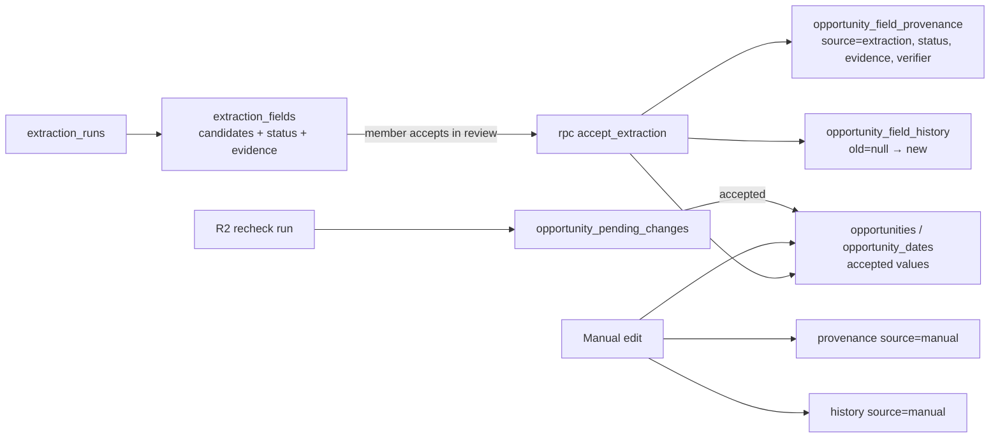

- Field history is written by an `after update` trigger on `opportunities` and `opportunity_dates` for important fields (dates, fees, eligibility, team size, mode, location, status). The trigger reads `app.change_source` and `app.extraction_run_id` from transaction-local settings set by the RPCs (`set_config(..., true)`); default is `manual`.
- `opportunity_pending_changes` (R2): `id`, `workspace_id`, `opportunity_id`, `field_key`, `current_value jsonb`, `proposed_value jsonb`, `evidence varchar(500)`, `extraction_run_id`, `status` (`pending`/`accepted`/`dismissed`), `decided_by`, `decided_at`, `created_at`; partial unique `(opportunity_id, field_key) where status = 'pending'`.
- `member_eligibility` (R2, owner only): `user_id` PK, `degree_level`, `year_of_study smallint`, `graduation_year smallint`, `birth_year smallint` (optional), `country char(2)`, `institution_type`, `interests text[]`, `updated_at`. Evaluated by `check_eligibility(opportunity_id)` (security definer) which returns full details for the caller and only an overall badge for the partner.
- `opportunity_participants` (R2): `(opportunity_id, user_id)` PK, `workspace_id`, `role text`, `result` (`participated`, `finalist`, `won`, `not_selected`, `withdrawn`), `result_note`, `project_id`.
- `discovery_feeds` / `discovery_items` (R3): feeds `[std]` + `url`, `title`, `enabled`, `last_polled_at`; items `id`, `feed_id`, `workspace_id`, `guid`, `url`, `title`, `published_at`, `status` (`new`/`imported`/`dismissed`), `imported_opportunity_id`; `unique (feed_id, guid)`.

## 18. Project and task data model

```sql
create table public.projects (
  id              uuid primary key default gen_random_uuid(),
  workspace_id    uuid not null references public.workspaces(id) on delete cascade,
  owner_id        uuid references public.profiles(id) on delete set null,
  visibility      public.visibility not null default 'shared',
  opportunity_id  uuid,
  name            text not null check (char_length(name) between 1 and 120),
  category        public.project_category not null default 'hackathon',
  summary         text check (char_length(summary) <= 5000),
  stage           public.project_stage not null default 'idea',
  start_date      date,
  end_date        date,
  repo_urls       text[] not null default '{}',
  links           jsonb  not null default '[]',      -- [{label, url}]
  search          tsvector generated always as (
                    setweight(to_tsvector('english', coalesce(name,'')), 'A') ||
                    setweight(to_tsvector('english', coalesce(summary,'')), 'C')) stored,
  created_at timestamptz not null default now(), updated_at timestamptz not null default now(),
  deleted_at timestamptz, deleted_by uuid references public.profiles(id) on delete set null,
  unique (id, workspace_id),
  foreign key (opportunity_id, workspace_id)
    references public.opportunities (id, workspace_id) on delete set null (opportunity_id),
  check (visibility = 'shared' or owner_id is not null),
  check (end_date is null or start_date is null or end_date >= start_date)
);
create unique index projects_one_per_opportunity
  on public.projects (opportunity_id) where opportunity_id is not null and deleted_at is null;

create table public.project_members (
  project_id    uuid not null,
  workspace_id  uuid not null,
  user_id       uuid not null,
  role_label    text check (char_length(role_label) <= 60),
  primary key (project_id, user_id),
  foreign key (project_id, workspace_id) references public.projects (id, workspace_id) on delete cascade,
  foreign key (workspace_id, user_id) references public.workspace_members (workspace_id, user_id) on delete cascade
);

create table public.tasks (
  id              uuid primary key default gen_random_uuid(),
  workspace_id    uuid not null references public.workspaces(id) on delete cascade,
  owner_id        uuid references public.profiles(id) on delete set null,
  visibility      public.visibility not null default 'shared',   -- meaningful only for loose tasks
  project_id      uuid,
  parent_task_id  uuid,
  title           text not null check (char_length(title) between 1 and 300),
  description     text check (char_length(description) <= 20000),
  status          public.task_status not null default 'todo',
  priority        public.task_priority not null default 'medium',
  assignee_id     uuid,
  due_date        date,                      -- date-only due
  due_at          timestamptz,               -- timed due
  due_timezone    text,
  position        double precision not null default 0,   -- order within column; rebalanced by move_task()
  tags            text[] not null default '{}',
  client_id       uuid unique,
  completed_at    timestamptz,
  search          tsvector generated always as (
                    setweight(to_tsvector('english', coalesce(title,'')), 'A') ||
                    setweight(to_tsvector('english', coalesce(description,'')), 'C')) stored,
  created_at timestamptz not null default now(), updated_at timestamptz not null default now(),
  deleted_at timestamptz, deleted_by uuid references public.profiles(id) on delete set null,
  unique (id, workspace_id),
  foreign key (project_id, workspace_id) references public.projects (id, workspace_id) on delete cascade,
  foreign key (parent_task_id, workspace_id) references public.tasks (id, workspace_id) on delete cascade,
  foreign key (assignee_id) references public.profiles (id) on delete set null,
  -- assignee must be a member of the workspace or an active guest of the task's project:
  -- enforced by trigger private.validate_room_person() (§31.4)
  check (visibility = 'shared' or owner_id is not null),
  check (project_id is null or visibility = 'shared'),        -- project tasks follow the project
  check (due_date is null or due_at is null),
  check (due_at is null or due_timezone is not null),
  check (parent_task_id is null or parent_task_id <> id),
  check ((status = 'done') = (completed_at is not null))
);
create index on public.tasks (project_id, status, position) where deleted_at is null;
create index on public.tasks (assignee_id, due_date) where status <> 'done' and deleted_at is null;
create index on public.tasks (parent_task_id);
create index on public.tasks using gin (search);
-- trigger private.enforce_single_subtask_level(): parent must have parent_task_id is null
-- trigger private.set_completed_at(): sets/clears completed_at on status change

create table public.task_comments (
  id            uuid primary key default gen_random_uuid(),
  workspace_id  uuid not null,
  task_id       uuid not null,
  author_id     uuid references public.profiles(id) on delete set null,
  body          text not null check (char_length(body) between 1 and 5000),
  edited_at     timestamptz,
  created_at    timestamptz not null default now(),
  deleted_at    timestamptz,
  foreign key (task_id, workspace_id) references public.tasks (id, workspace_id) on delete cascade
);

create table public.templates (
  id            uuid primary key default gen_random_uuid(),
  workspace_id  uuid references public.workspaces(id) on delete cascade,   -- null = built-in
  kind          text not null check (kind in
                  ('submission_checklist','packing_list','meeting_note','retrospective','pitch','project')),
  title         text not null check (char_length(title) between 1 and 120),
  body          jsonb not null,          -- e.g. {"items":[{"label":"Demo video ≤ 3 min","offset_days":-1}]}
  is_builtin    boolean not null default false,
  created_by    uuid references public.profiles(id) on delete set null,
  created_at    timestamptz not null default now(),
  check (is_builtin = (workspace_id is null))
);

create table public.checklists (
  id            uuid primary key default gen_random_uuid(),
  workspace_id  uuid not null references public.workspaces(id) on delete cascade,
  project_id    uuid,
  trip_id       uuid,                    -- FK added in R3 migration
  template_id   uuid references public.templates(id) on delete set null,
  title         text not null check (char_length(title) between 1 and 120),
  created_by    uuid references public.profiles(id) on delete set null,
  created_at    timestamptz not null default now(),
  deleted_at    timestamptz,
  unique (id, workspace_id),
  foreign key (project_id, workspace_id) references public.projects (id, workspace_id) on delete cascade,
  check (num_nonnulls(project_id, trip_id) = 1)
);

create table public.checklist_items (
  id            uuid primary key default gen_random_uuid(),
  workspace_id  uuid not null,
  checklist_id  uuid not null,
  label         text not null check (char_length(label) between 1 and 300),
  position      double precision not null default 0,
  is_done       boolean not null default false,
  done_by       uuid references public.profiles(id) on delete set null,
  done_at       timestamptz,
  assignee_id   uuid,
  due_date      date,
  for_user_id   uuid references public.profiles(id) on delete set null,   -- packing items per person
  client_id     uuid unique,
  foreign key (checklist_id, workspace_id) references public.checklists (id, workspace_id) on delete cascade,
  foreign key (assignee_id) references public.profiles (id) on delete set null,   -- validated like tasks
  check (is_done = (done_at is not null))
);
```

**R2 collaboration tables (summary)**

| Table | Key columns |
|---|---|
| `ideas` | [std-lite: id, workspace_id, created_at, deleted_at], `project_id`, `author_id`, `title`, `description`, `status` (`open`/`promoted`/`dropped`), `promoted_task_id`, `promoted_decision_id` |
| `idea_votes` | `(idea_id, user_id)` PK, `workspace_id`, `value smallint check (value in (-1,1))` |
| `decisions` | `id`, `workspace_id`, `project_id`, `title`, `context`, `options jsonb`, `decision`, `status` (`proposed`/`approved`/`rejected`/`superseded`), `decided_by`, `decided_at`, `superseded_by`, `created_by` |
| `approval_requests` | `id`, `workspace_id`, `requested_by`, `approver_id` (member FK), `decision_id` / `checklist_item_id` / `expense_id` (exactly one or none with `subject_text`), `note`, `status` (`pending`/`approved`/`declined`/`cancelled`), `response_note`, `responded_at`; `check (approver_id <> requested_by)`; partial unique pending per subject |
| `polls` / `poll_options` / `poll_votes` | poll: `question`, `allow_multiple`, `closes_at`, `project_id`, `message_id`; options: `label`, `position`; votes: `(option_id, user_id)` PK + trigger enforcing single choice when `allow_multiple = false` |

**R3 project tables (summary):** `judge_questions` (`project_id`, `question`, `answer`, `owner_id`, `confidence smallint 1–5`, `position`); `retrospectives` (`project_id unique`, `went_well`, `to_improve`, `action_items jsonb`, `updated_by`); `project_skills` (`project_id`, `skill_id`, `user_id`, PK `(project_id, skill_id)`).

## 19. Calendar and academic data model

```sql
create table public.calendar_events (
  id               uuid primary key default gen_random_uuid(),
  workspace_id     uuid not null references public.workspaces(id) on delete cascade,
  owner_id         uuid references public.profiles(id) on delete set null,
  visibility       public.visibility not null default 'shared',
  kind             public.event_kind not null default 'other',
  title            text not null check (char_length(title) between 1 and 200),
  description      text check (char_length(description) <= 5000),
  location         text check (char_length(location) <= 300),
  all_day          boolean not null default false,
  start_date       date,            -- all-day events
  end_date         date,            -- inclusive
  starts_at        timestamptz,     -- timed events
  ends_at          timestamptz,
  timezone         text,            -- zone the event was created in
  rrule            text,            -- R2, RFC 5545 subset (FREQ=DAILY|WEEKLY|MONTHLY; BYDAY; UNTIL; COUNT)
  exdates          date[] not null default '{}',   -- R2 recurrence exceptions
  reminder_offsets integer[] not null default '{}',-- minutes before (timed) / days*1440 (all-day)
  project_id       uuid,
  opportunity_id   uuid,
  trip_id          uuid,            -- FK added in R3
  created_at timestamptz not null default now(), updated_at timestamptz not null default now(),
  deleted_at timestamptz, deleted_by uuid references public.profiles(id) on delete set null,
  unique (id, workspace_id),
  foreign key (project_id, workspace_id) references public.projects (id, workspace_id) on delete set null (project_id),
  foreign key (opportunity_id, workspace_id) references public.opportunities (id, workspace_id) on delete set null (opportunity_id),
  check (visibility = 'shared' or owner_id is not null),
  check (
    (all_day and start_date is not null and starts_at is null and ends_at is null
             and (end_date is null or end_date >= start_date))
    or
    (not all_day and starts_at is not null and timezone is not null and start_date is null and end_date is null
             and (ends_at is null or ends_at >= starts_at))
  )
);
create index on public.calendar_events (workspace_id, start_date) where deleted_at is null;
create index on public.calendar_events (workspace_id, starts_at) where deleted_at is null;
```

**Calendar feed view** — derived items are read, never copied (DB7):

```sql
create view public.calendar_feed with (security_invoker = true) as
  select 'event'::text as source_type, e.id as source_id, e.workspace_id, e.title, e.kind::text as kind,
         e.all_day, e.start_date, e.end_date, e.starts_at, e.ends_at, e.visibility, e.owner_id
    from public.calendar_events e where e.deleted_at is null
  union all
  select 'opportunity_date', d.id, d.workspace_id, o.title || ' — ' || replace(d.kind::text,'_',' '),
         'deadline', d.all_day, d.on_date, d.on_date, d.at_time, d.at_time, o.visibility, o.owner_id
    from public.opportunity_dates d join public.opportunities o on o.id = d.opportunity_id
   where o.deleted_at is null
  union all
  select 'task', t.id, t.workspace_id, t.title, 'task_due', t.due_at is null, t.due_date, t.due_date,
         t.due_at, t.due_at, t.visibility, t.owner_id
    from public.tasks t
   where t.deleted_at is null and t.status <> 'done' and (t.due_date is not null or t.due_at is not null)
  union all
  select 'project_end', p.id, p.workspace_id, p.name || ' — project end', 'milestone', true, p.end_date,
         p.end_date, null, null, p.visibility, p.owner_id
    from public.projects p where p.deleted_at is null and p.end_date is not null
  union all
  select 'checklist_item', i.id, i.workspace_id, i.label, 'milestone', true, i.due_date, i.due_date,
         null, null, 'shared', null
    from public.checklist_items i where i.due_date is not null and not i.is_done;
```

Because the view is `security_invoker`, each underlying table's RLS applies; the partner never sees private rows. The client queries it with a date range. Timetable slots and assessments (R2) and trip items (R3) are added to the view by later migrations.

**Academic tables (R2)**

```sql
create table public.subjects (
  id uuid primary key default gen_random_uuid(),
  workspace_id uuid not null references public.workspaces(id) on delete cascade,
  owner_id uuid not null references public.profiles(id) on delete cascade,
  visibility public.visibility not null default 'private',
  name text not null check (char_length(name) between 1 and 120),
  code text, instructor text, credits numeric(3,1) check (credits >= 0),
  term_label text, term_start date, term_end date, color text,
  created_at timestamptz not null default now(), updated_at timestamptz not null default now(),
  deleted_at timestamptz, deleted_by uuid,
  unique (id, workspace_id),
  check (term_end is null or term_start is null or term_end >= term_start)
);

create table public.timetable_slots (
  id uuid primary key default gen_random_uuid(),
  workspace_id uuid not null, subject_id uuid not null,
  kind text not null check (kind in ('lecture','lab','tutorial','other')),
  weekday smallint not null check (weekday between 1 and 7),     -- ISO: 1 = Monday
  start_time time not null, end_time time not null,
  timezone text not null default 'Asia/Kolkata',
  location text, valid_from date not null, valid_to date not null,
  foreign key (subject_id, workspace_id) references public.subjects (id, workspace_id) on delete cascade,
  check (end_time > start_time), check (valid_to >= valid_from)
);

create table public.assessments (
  id uuid primary key default gen_random_uuid(),
  workspace_id uuid not null references public.workspaces(id) on delete cascade,
  owner_id uuid not null references public.profiles(id) on delete cascade,
  visibility public.visibility not null default 'private',
  subject_id uuid, project_id uuid,
  kind text not null check (kind in ('assignment','exam','quiz','lab_report','project','other')),
  title text not null check (char_length(title) between 1 and 200),
  due_date date, due_at timestamptz, due_timezone text,
  weight_pct numeric(5,2) check (weight_pct between 0 and 100),
  max_score numeric(7,2) check (max_score > 0), score numeric(7,2) check (score >= 0),
  status text not null default 'pending' check (status in ('pending','submitted','graded','missed')),
  created_at timestamptz not null default now(), updated_at timestamptz not null default now(),
  deleted_at timestamptz, deleted_by uuid,
  foreign key (subject_id, workspace_id) references public.subjects (id, workspace_id) on delete set null (subject_id),
  foreign key (project_id, workspace_id) references public.projects (id, workspace_id) on delete set null (project_id),
  check (due_date is null or due_at is null), check (due_at is null or due_timezone is not null),
  check (score is null or max_score is null or score <= max_score)
);
```

Conflict detection (R2) is a function `detect_conflicts(user_id, from, to)` over `calendar_feed` + timetable + assessments, flagging two deadlines owned by/assigned to the same member within 24 hours, or a deadline on an exam day. Results become notifications with `dedupe_key = 'conflict:' || least(a,b) || ':' || greatest(a,b)`.

## 20. Chat and message data model

```sql
create table public.messages (
  id            uuid primary key default gen_random_uuid(),
  workspace_id  uuid not null references public.workspaces(id) on delete cascade,
  sender_id     uuid references public.profiles(id) on delete set null,
  project_id    uuid,
  reply_to_id   uuid,
  kind          text not null default 'text'
                check (kind in ('text','file','voice','system','command','poll')),
  body          text check (char_length(body) <= 8000),
  metadata      jsonb not null default '{}',       -- e.g. {"created":{"type":"task","id":"…"}}
  client_id     uuid unique,
  edited_at     timestamptz,
  deleted_at    timestamptz,
  created_at    timestamptz not null default now(),
  search        tsvector generated always as (to_tsvector('english', coalesce(body,''))) stored,
  unique (id, workspace_id),
  foreign key (project_id, workspace_id) references public.projects (id, workspace_id) on delete set null (project_id),
  foreign key (reply_to_id, workspace_id) references public.messages (id, workspace_id) on delete set null (reply_to_id),
  check (deleted_at is null or body is null),        -- deleting removes content (AC-21)
  check (kind <> 'text' or deleted_at is not null or char_length(body) >= 1)
);
create index on public.messages (workspace_id, created_at desc, id desc);
create index on public.messages (project_id, created_at desc) where project_id is not null;
create index on public.messages using gin (search);

create table public.message_reactions (
  message_id    uuid not null,
  workspace_id  uuid not null,
  user_id       uuid not null references public.profiles(id) on delete cascade,
  emoji         text not null check (char_length(emoji) between 1 and 16),
  created_at    timestamptz not null default now(),
  primary key (message_id, user_id, emoji),
  foreign key (message_id, workspace_id) references public.messages (id, workspace_id) on delete cascade
);

create table public.chat_read_state (
  workspace_id          uuid not null references public.workspaces(id) on delete cascade,
  user_id               uuid not null references public.profiles(id) on delete cascade,
  last_read_message_id  uuid references public.messages(id) on delete set null,
  last_read_at          timestamptz not null default now(),
  primary key (workspace_id, user_id)
);
```

- **Read receipts** use one row per member instead of one row per message (two-person chat makes this exact and cheap): a message is "Seen" when the partner's `last_read_at ≥ message.created_at`.
- **Deleting** a message sets `deleted_at`, nulls `body` and soft-deletes attached `files` rows (trigger).
- **Voice messages** (R3) are `kind = 'voice'` with one `files` row (`audio/webm` or `audio/ogg`, ≤ 5 MB, duration in `metadata`).
- `call_sessions` (R4): `id`, `workspace_id`, `started_by`, `kind` (`audio`/`video`), `started_at`, `answered_at`, `ended_at`, `end_reason`; no media or content stored.

## 21. Document storage metadata

```sql
create table public.files (
  id            uuid primary key default gen_random_uuid(),
  workspace_id  uuid not null references public.workspaces(id) on delete cascade,
  owner_id      uuid references public.profiles(id) on delete set null,
  visibility    public.visibility not null default 'shared',
  bucket        text not null default 'workspace-files' check (bucket = 'workspace-files'),
  storage_path  text not null unique,      -- '{workspace_id}/{file_id}/{sanitised_name}'
  file_name     text not null check (char_length(file_name) between 1 and 255),
  mime_type     text not null check (mime_type in (
                  'image/png','image/jpeg','image/webp','image/gif','application/pdf','text/plain',
                  'text/markdown','text/csv','application/zip',
                  'application/vnd.openxmlformats-officedocument.wordprocessingml.document',
                  'application/vnd.openxmlformats-officedocument.spreadsheetml.sheet',
                  'application/vnd.openxmlformats-officedocument.presentationml.presentation',
                  'application/vnd.oasis.opendocument.text','audio/webm','audio/ogg','audio/mp4')),
  size_bytes    bigint not null check (size_bytes between 1 and 26214400),     -- 25 MB
  sha256        bytea,
  folder_id     uuid,      -- Vault folder (optional)
  project_id    uuid,      -- project library
  task_id       uuid,      -- task attachment
  message_id    uuid,      -- chat attachment
  trip_id       uuid,      -- R3, FK added later
  upload_state  text not null default 'pending' check (upload_state in ('pending','stored')),
  created_at    timestamptz not null default now(),
  deleted_at    timestamptz,
  deleted_by    uuid references public.profiles(id) on delete set null,
  unique (id, workspace_id),
  check (visibility = 'shared' or owner_id is not null),
  check (num_nonnulls(task_id, message_id) <= 1),
  check (storage_path like workspace_id::text || '/%'),
  check (not (mime_type like 'audio/%') or size_bytes <= 5242880),
  foreign key (project_id, workspace_id) references public.projects (id, workspace_id) on delete set null (project_id),
  foreign key (task_id, workspace_id)    references public.tasks (id, workspace_id) on delete cascade,
  foreign key (message_id, workspace_id) references public.messages (id, workspace_id) on delete cascade
);
```

**File ownership rules**

1. The uploader is the `owner_id`. Shared files can be renamed/moved by either member; only the owner can make a file private.
2. The `files` row is inserted first (`upload_state = 'pending'`); the storage policy allows upload only to a path that has a pending row owned by the caller; after the upload succeeds the client calls `confirm_upload(file_id)`, which sets `stored`. Nightly reconciliation deletes `pending` rows older than 24 hours and orphan objects.
3. Other tables reference files by FK (`expenses.receipt_file_id`, `courses.certificate_file_id`, `portfolio_items.certificate_file_id`) with `on delete set null`.
4. When a member leaves (R3), their **private** files are exported and deleted; their **shared** files remain with `owner_id` set to null and authorship shown from `workspace_member_history`.

## 22. Knowledge Vault model

```sql
create table public.vault_folders (
  id            uuid primary key default gen_random_uuid(),
  workspace_id  uuid not null references public.workspaces(id) on delete cascade,
  owner_id      uuid references public.profiles(id) on delete set null,
  visibility    public.visibility not null default 'shared',
  parent_id     uuid,
  name          text not null check (char_length(name) between 1 and 80),
  depth         smallint not null default 1 check (depth between 1 and 4),
  created_at timestamptz not null default now(), deleted_at timestamptz, deleted_by uuid,
  unique (id, workspace_id),
  unique nulls not distinct (workspace_id, parent_id, name),
  foreign key (parent_id, workspace_id) references public.vault_folders (id, workspace_id) on delete cascade,
  check (visibility = 'shared' or owner_id is not null)
);

create table public.notes (
  id            uuid primary key default gen_random_uuid(),
  workspace_id  uuid not null references public.workspaces(id) on delete cascade,
  owner_id      uuid references public.profiles(id) on delete set null,
  visibility    public.visibility not null default 'shared',
  folder_id     uuid, project_id uuid, subject_id uuid,      -- subject FK added in R2
  kind          text not null default 'note' check (kind in ('note','meeting','research')),
  title         text not null check (char_length(title) between 1 and 200),
  body_md       text not null default '' check (char_length(body_md) <= 200000),
  version       integer not null default 1,                  -- optimistic concurrency
  tags          text[] not null default '{}',
  client_id     uuid unique,
  search        tsvector generated always as (
                  setweight(to_tsvector('english', coalesce(title,'')), 'A') ||
                  setweight(to_tsvector('english', coalesce(body_md,'')), 'D')) stored,
  created_at timestamptz not null default now(), updated_at timestamptz not null default now(),
  deleted_at timestamptz, deleted_by uuid references public.profiles(id) on delete set null,
  unique (id, workspace_id),
  foreign key (folder_id, workspace_id)  references public.vault_folders (id, workspace_id) on delete set null (folder_id),
  foreign key (project_id, workspace_id) references public.projects (id, workspace_id) on delete set null (project_id),
  check (visibility = 'shared' or owner_id is not null)
);

create table public.bookmarks (
  id            uuid primary key default gen_random_uuid(),
  workspace_id  uuid not null references public.workspaces(id) on delete cascade,
  owner_id      uuid references public.profiles(id) on delete set null,
  visibility    public.visibility not null default 'shared',
  kind          text not null default 'bookmark' check (kind in ('bookmark','reference')),
  url           text not null check (url ~ '^https?://' and char_length(url) <= 2048),
  title         text not null check (char_length(title) between 1 and 300),
  description   text check (char_length(description) <= 2000),
  site_name     text,
  folder_id uuid, project_id uuid, subject_id uuid,
  tags          text[] not null default '{}',
  search        tsvector generated always as (
                  setweight(to_tsvector('english', coalesce(title,'')), 'A') ||
                  setweight(to_tsvector('english', coalesce(description,'')), 'C')) stored,
  created_at timestamptz not null default now(), updated_at timestamptz not null default now(),
  deleted_at timestamptz, deleted_by uuid,
  foreign key (folder_id, workspace_id)  references public.vault_folders (id, workspace_id) on delete set null (folder_id),
  foreign key (project_id, workspace_id) references public.projects (id, workspace_id) on delete set null (project_id),
  check (visibility = 'shared' or owner_id is not null)
);
```

- **Notes concurrency:** updates send the `version` they started from: `update notes set body_md = $1, version = version + 1 where id = $2 and version = $3`. Zero rows updated → the UI shows the conflict banner (Flow §12).
- **Snippets (R2):** [std] + `title`, `language` (allow-list), `code text check (char_length(code) <= 50000)`, `description`, `tags`, `folder_id`, `project_id`, `search`.
- **Resource links (R2):** `resource_links(id, workspace_id, from_type, from_id, to_type, to_id, created_by, created_at, unique (from_type, from_id, to_type, to_id))`. This is the one **polymorphic** table in the schema; it trades FK integrity for flexibility. A trigger validates that both ends exist in the same workspace, and the read path joins under RLS so a link to a record the viewer cannot see is never returned. Links are deleted when either end is purged.
- **Search RPC** (security invoker, so RLS applies):

```sql
create or replace function public.search_workspace(q text, max_results int default 30)
returns table (entity_type text, id uuid, title text, snippet text, rank real, updated_at timestamptz)
language sql stable security invoker set search_path = '' as $$
  with query as (select websearch_to_tsquery('english', q) as tsq)
  select 'note', n.id, n.title, left(n.body_md, 160), ts_rank(n.search, query.tsq), n.updated_at
    from public.notes n, query where n.deleted_at is null and n.search @@ query.tsq
  union all
  select 'opportunity', o.id, o.title, o.organizer, ts_rank(o.search, query.tsq), o.updated_at
    from public.opportunities o, query where o.deleted_at is null and o.search @@ query.tsq
  union all
  select 'task', t.id, t.title, left(t.description, 160), ts_rank(t.search, query.tsq), t.updated_at
    from public.tasks t, query where t.deleted_at is null and t.search @@ query.tsq
  union all
  select 'bookmark', b.id, b.title, b.url, ts_rank(b.search, query.tsq), b.updated_at
    from public.bookmarks b, query where b.deleted_at is null and b.search @@ query.tsq
  union all
  select 'message', m.id, left(m.body, 80), null, ts_rank(m.search, query.tsq), m.created_at
    from public.messages m, query where m.deleted_at is null and m.search @@ query.tsq
  union all
  select 'file', f.id, f.file_name, null, 0.1, f.created_at
    from public.files f where f.deleted_at is null and f.file_name ilike '%' || q || '%'
  order by 5 desc, 6 desc
  limit greatest(1, least(max_results, 100));
$$;
```

## 23. Productivity and expenses

| Table | Columns (beyond keys/timestamps) | Visibility | Rel. |
|---|---|---|---|
| `goals` | `owner_id`, `visibility`, `scope` (`individual`/`shared`), `period` (`week`/`month`/`custom`), `period_start date`, `period_end date`, `title`, `target_value numeric`, `current_value numeric`, `unit`, `status` (`active`/`done`/`dropped`); `check (scope = 'individual' or visibility = 'shared')` | Shared/private | <span class="tag r2">R2</span> |
| `habits` | `owner_id`, `name`, `schedule_days smallint[]` (ISO weekdays), `target_per_day smallint default 1`, `archived_at` | Owner only | <span class="tag r2">R2</span> |
| `habit_logs` | `(habit_id, log_date)` PK, `count smallint check (count between 0 and 50)` | Owner only | <span class="tag r2">R2</span> |
| `focus_sessions` | `user_id`, `task_id` (set null), `mode` (`pomodoro`/`free`), `planned_minutes check (1–240)`, `started_at`, `ended_at`, `completed boolean`, `interruptions smallint` | Owner only | <span class="tag r2">R2</span> |
| `skills` | `owner_id`, `visibility`, `name`, `category`, `stage skill_stage`; unique `(owner_id, lower(name))` | Shared/private | <span class="tag r2">R2</span> |
| `skill_stage_history` | identity PK, `skill_id`, `from_stage`, `to_stage`, `evidence_project_id`, `changed_at` | Inherits skill | <span class="tag r2">R2</span> |
| `courses` | `owner_id`, `visibility`, `title`, `provider`, `url`, `status` (`planned`/`in_progress`/`completed`/`dropped`), `progress_pct check (0–100)`, `skill_id`, `certificate_file_id`, `started_on`, `completed_on` | Shared/private | <span class="tag r2">R2</span> |
| `learning_logs` | `owner_id`, `log_date`, `minutes check (1–1440)`, `skill_id`, `course_id`, `note` | Owner only | <span class="tag r2">R2</span> |
| `weekly_reviews` | `user_id`, `week_start date check (extract(isodow from week_start) = 1)`, `summary jsonb` (computed), `reflection text`, `shared_highlight text`, `plan jsonb`; unique `(user_id, week_start)`. Partner reads only `shared_highlight` through `get_partner_highlights(week_start)` | Owner only | <span class="tag r2">R2</span> |

```sql
create table public.expenses (                                   -- R3
  id              uuid primary key default gen_random_uuid(),
  workspace_id    uuid not null references public.workspaces(id) on delete cascade,
  owner_id        uuid references public.profiles(id) on delete set null,   -- who recorded it
  visibility      public.visibility not null default 'shared',
  paid_by         uuid not null,
  amount          numeric(12,2) not null check (amount > 0),
  currency        char(3) not null default 'INR' check (currency ~ '^[A-Z]{3}$'),
  category        text not null check (category in
                    ('travel','accommodation','food','registration','hardware','software','printing','other')),
  spent_on        date not null,
  description     text check (char_length(description) <= 500),
  split_ratio     numeric(5,4) not null default 0.5 check (split_ratio between 0 and 1),
                  -- share owed by the member who did NOT pay: 0 = personal, 0.5 = equal, other = custom
  trip_id uuid, project_id uuid, opportunity_id uuid,
  receipt_file_id uuid references public.files(id) on delete set null,
  created_at timestamptz not null default now(), updated_at timestamptz not null default now(),
  deleted_at timestamptz, deleted_by uuid,
  foreign key (workspace_id, paid_by) references public.workspace_members (workspace_id, user_id),
  check (visibility = 'shared' or (owner_id is not null and split_ratio = 0))
);
-- view expense_balances (security_invoker): per currency, sum(amount * split_ratio) grouped by paid_by
```

Balances are computed per currency; no currency conversion is performed (PRD non-goal: no payments).

## 24. Portfolio and contacts

```sql
create table public.portfolio_items (                            -- R3
  id                   uuid primary key default gen_random_uuid(),
  workspace_id         uuid not null references public.workspaces(id) on delete cascade,
  owner_id             uuid not null references public.profiles(id) on delete cascade,
  visibility           public.visibility not null default 'private',
  kind                 public.portfolio_kind not null,
  title                text not null check (char_length(title) between 1 and 200),
  organization         text, role text,
  start_date           date, end_date date,
  description          text check (char_length(description) <= 5000),
  outcome              text check (char_length(outcome) <= 300),
  url                  text check (url ~ '^https?://'),
  project_id           uuid, opportunity_id uuid,
  certificate_file_id  uuid references public.files(id) on delete set null,
  verified_fields      text[] not null default '{}',   -- fields copied from linked records
  created_at timestamptz not null default now(), updated_at timestamptz not null default now(),
  deleted_at timestamptz,
  foreign key (project_id, workspace_id) references public.projects (id, workspace_id) on delete set null (project_id),
  foreign key (opportunity_id, workspace_id) references public.opportunities (id, workspace_id) on delete set null (opportunity_id),
  check (end_date is null or start_date is null or end_date >= start_date)
);

create table public.portfolio_bullets (                          -- R3
  id             uuid primary key default gen_random_uuid(),
  item_id        uuid not null references public.portfolio_items(id) on delete cascade,
  owner_id       uuid not null references public.profiles(id) on delete cascade,
  text           text not null check (char_length(text) between 1 and 400),
  template_id    text not null,               -- deterministic template used
  source_fields  jsonb not null,              -- e.g. {"outcome":"portfolio_items.outcome","skills":["React"]}
  status         text not null default 'draft' check (status in ('draft','accepted','discarded')),
  created_at     timestamptz not null default now()
);

create table public.contacts (                                   -- R3
  id                 uuid primary key default gen_random_uuid(),
  workspace_id       uuid not null references public.workspaces(id) on delete cascade,
  owner_id           uuid references public.profiles(id) on delete set null,
  visibility         public.visibility not null default 'shared',
  full_name          text not null check (char_length(full_name) between 1 and 120),
  organization       text, role text,
  email              text check (email ~* '^[^@\s]+@[^@\s]+\.[^@\s]+$'),
  phone              text check (phone ~ '^\+?[0-9 ()-]{6,20}$'),
  website            text check (website ~ '^https?://'),
  social_links       jsonb not null default '[]',
  met_at             text, met_on date,
  opportunity_id     uuid, project_id uuid,
  is_mentor          boolean not null default false,
  expertise          text[] not null default '{}',
  notes              text check (char_length(notes) <= 5000),
  next_follow_up_on  date,
  tags               text[] not null default '{}',
  created_at timestamptz not null default now(), updated_at timestamptz not null default now(),
  deleted_at timestamptz, deleted_by uuid,
  check (visibility = 'shared' or owner_id is not null)
);
```

**Truthfulness rule (PRD FR-PORT-05):** the résumé generator only fills template slots from columns listed in `source_fields`; a template that needs `outcome` is skipped when `outcome` is null. Tests assert that no bullet mentions results unless a result is recorded (AC-24).

## 25. Travel and location-sharing tables

```sql
create table public.trips (                                      -- R3
  id uuid primary key default gen_random_uuid(),
  workspace_id uuid not null references public.workspaces(id) on delete cascade,
  created_by uuid references public.profiles(id) on delete set null,
  opportunity_id uuid,
  title text not null check (char_length(title) between 1 and 120),
  destination text, start_date date not null, end_date date not null,
  venue_name text, venue_address text,
  venue_lat numeric(9,6) check (venue_lat between -90 and 90),
  venue_lng numeric(9,6) check (venue_lng between -180 and 180),
  notes text,
  created_at timestamptz not null default now(), updated_at timestamptz not null default now(),
  deleted_at timestamptz, deleted_by uuid,
  unique (id, workspace_id),
  check (end_date >= start_date)
);

create table public.trip_items (
  id uuid primary key default gen_random_uuid(),
  workspace_id uuid not null, trip_id uuid not null,
  kind text not null check (kind in ('transport','accommodation','activity','other')),
  title text not null,
  starts_at timestamptz, ends_at timestamptz, start_timezone text, end_timezone text,
  from_place text, to_place text, address text, confirmation_ref text,
  for_user_id uuid references public.profiles(id) on delete set null,     -- null = both
  details jsonb not null default '{}',
  foreign key (trip_id, workspace_id) references public.trips (id, workspace_id) on delete cascade,
  check (ends_at is null or starts_at is null or ends_at >= starts_at),
  check (starts_at is null or start_timezone is not null)
);

create table public.trip_emergency_contacts (
  id uuid primary key default gen_random_uuid(),
  workspace_id uuid not null, trip_id uuid not null,
  name text not null, relation text, phone text not null check (phone ~ '^\+?[0-9 ()-]{6,20}$'), notes text,
  foreign key (trip_id, workspace_id) references public.trips (id, workspace_id) on delete cascade
);

create table public.location_shares (
  id               uuid primary key default gen_random_uuid(),
  workspace_id     uuid not null references public.workspaces(id) on delete cascade,
  sharer_id        uuid not null references public.profiles(id) on delete cascade,
  trip_id          uuid,
  started_at       timestamptz not null default now(),
  expires_at       timestamptz not null,
  revoked_at       timestamptz,                 -- stopped by the sharer
  cleared_at       timestamptz,                 -- coordinates erased by the clean-up job
  last_lat         numeric(9,6) check (last_lat between -90 and 90),
  last_lng         numeric(9,6) check (last_lng between -180 and 180),
  last_accuracy_m  integer check (last_accuracy_m between 0 and 100000),
  last_recorded_at timestamptz,
  check (expires_at > started_at and expires_at <= started_at + interval '24 hours'),
  check ((last_lat is null) = (last_lng is null)),
  check (cleared_at is null or last_lat is null)
);
create unique index location_shares_one_active
  on public.location_shares (sharer_id) where revoked_at is null and cleared_at is null;
```

**Location-sharing lifecycle**

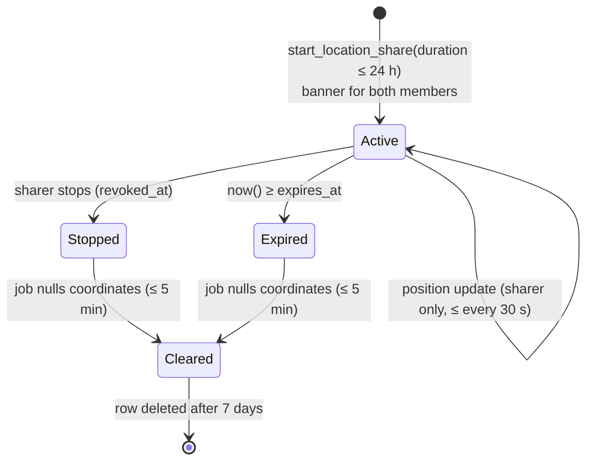

RLS makes coordinates unreadable as soon as `now() >= expires_at` or `revoked_at is not null`, so privacy does not depend on the clean-up job's timing (TR-LOC-02). There is no position history table.

## 26. Notifications and activity logs

```sql
create table public.notification_preferences (
  user_id                 uuid primary key references public.profiles(id) on delete cascade,
  push_enabled            boolean not null default false,
  email_enabled           boolean not null default false,           -- R2
  quiet_start             time not null default '23:00',
  quiet_end               time not null default '07:00',
  lockscreen_details      boolean not null default true,
  deadline_reminder_days  smallint[] not null default '{7,1,0}',    -- date-only deadlines, at 09:00 local
  timed_reminder_minutes  integer[]  not null default '{1440,60}',  -- before timed deadlines/events
  type_settings           jsonb not null default '{}'               -- per-type on/off
);

create table public.push_subscriptions (
  id               uuid primary key default gen_random_uuid(),
  user_id          uuid not null references public.profiles(id) on delete cascade,
  endpoint         text not null unique,
  p256dh           text not null,
  auth             text not null,
  user_agent       text,
  created_at       timestamptz not null default now(),
  last_success_at  timestamptz,
  failure_count    smallint not null default 0
);

create table public.reminders (
  id                   uuid primary key default gen_random_uuid(),
  workspace_id         uuid not null references public.workspaces(id) on delete cascade,
  user_id              uuid not null references public.profiles(id) on delete cascade,
  origin               text not null check (origin in ('default','custom')),
  opportunity_date_id  uuid references public.opportunity_dates(id) on delete cascade,
  task_id              uuid references public.tasks(id)             on delete cascade,
  event_id             uuid references public.calendar_events(id)   on delete cascade,
  checklist_item_id    uuid references public.checklist_items(id)   on delete cascade,
  contact_id           uuid,          -- R3 FK
  assessment_id        uuid,          -- R2 FK
  remind_at            timestamptz not null,
  title                text not null check (char_length(title) <= 200),
  link_path            text not null check (link_path like '/%'),
  status               text not null default 'pending'
                       check (status in ('pending','sending','sent','failed','cancelled')),
  attempts             smallint not null default 0,
  sent_at              timestamptz,
  last_error           text,
  dedupe_key           text not null unique,  -- e.g. 'od:{date_id}:{user_id}:{epoch(remind_at)}'
  created_at           timestamptz not null default now(),
  check (num_nonnulls(opportunity_date_id, task_id, event_id, checklist_item_id, contact_id, assessment_id) <= 1)
);
create index reminders_due on public.reminders (remind_at) where status = 'pending';

create table public.notifications (
  id            uuid primary key default gen_random_uuid(),
  workspace_id  uuid not null references public.workspaces(id) on delete cascade,
  recipient_id  uuid not null references public.profiles(id) on delete cascade,
  type          text not null,              -- 'reminder.due','task.assigned','opportunity.changed',…
  title         text not null check (char_length(title) <= 200),
  body          text check (char_length(body) <= 1000),
  link_path     text check (link_path like '/%'),
  actor_id      uuid references public.profiles(id) on delete set null,
  entity_type   text, entity_id uuid,
  dedupe_key    text not null,
  read_at       timestamptz,
  pushed_at     timestamptz,
  created_at    timestamptz not null default now(),
  unique (recipient_id, dedupe_key)
);
create index on public.notifications (recipient_id, created_at desc);
create index on public.notifications (recipient_id) where read_at is null;

create table public.activity_log (
  id            bigint generated always as identity primary key,
  workspace_id  uuid not null references public.workspaces(id) on delete cascade,
  actor_id      uuid references public.profiles(id) on delete set null,
  category      text not null default 'activity' check (category in ('activity','security')),
  action        text not null,             -- 'task.moved','opportunity.created','invite.accepted',…
  entity_type   text, entity_id uuid,
  project_id    uuid,                      -- for the project Activity tab
  visibility    public.visibility not null default 'shared',
  summary       text not null check (char_length(summary) <= 300),
  metadata      jsonb not null default '{}',
  created_at    timestamptz not null default now()
);
create index on public.activity_log (workspace_id, created_at desc);
create index on public.activity_log (project_id, created_at desc) where project_id is not null;
```

**Reminder generation:** triggers on `opportunity_dates`, `opportunities.status`, `tasks` (due, assignee, status) and `calendar_events` call `private.sync_reminders(target)`, which deletes that target's **pending default** reminders and re-inserts them from preferences with `on conflict (dedupe_key) do nothing`. Custom reminders are untouched. Completed tasks and archived/closed opportunities cancel pending reminders.

**Dispatch:** `dispatch-notifications` claims rows with `for update skip locked`, inserts notifications with `on conflict (recipient_id, dedupe_key) do nothing`, then pushes. Running the job twice cannot duplicate a notification (AC-19).

**Retention (PRD PRIV-13), executed by the nightly `maintenance` job**

| Data | Rule |
|---|---|
| Soft-deleted content (all tables with `deleted_at`) and their storage objects | Purge 30 days after `deleted_at` |
| Read notifications | Delete 90 days after `read_at` |
| Sent/cancelled reminders | Delete 30 days after `remind_at` |
| `activity_log` | Delete after 365 days |
| Unlinked `extraction_runs` | Delete after `expires_at` (7 days); linked runs keep metadata, evidence lives in provenance |
| `export_jobs` and export files | Delete 24 hours after creation |
| `rate_limit_events` | Delete after 2 days |
| `location_shares` | Null coordinates ≤ 5 min after expiry/stop; delete row after 7 days |
| `client_errors` | Delete after 30 days |
| `project_guest_invitations` | Delete 90 days after expiry or revocation |
| `project_guest_memberships` (removed) | Keep 1 year after `removed_at` for audit, then delete |
| `oauth_states` | Delete 10 minutes after creation (and on use) |
| `project_meetings` | Life of the project; purged with it |
| `cron.job_run_details` | Keep 14 days |

## 27. Integration tables

| Table | Columns | Security | Rel. |
|---|---|---|---|
| `github_connections` | `user_id` PK, `github_login`, `token_secret_id uuid` (Supabase Vault secret), `scopes text[]`, `connected_at` | Owner may select `github_login`, `scopes`, `connected_at`; `token_secret_id` column revoked from `authenticated`; tokens read only by Edge Functions | <span class="tag r3">R3</span> |
| `project_repositories` | `id`, `workspace_id`, `project_id`, `owner_login`, `repo_name`, `html_url`, `connected_by`, `last_synced_at`, `cache jsonb check (pg_column_size(cache) <= 51200)` | Inherits project | <span class="tag r3">R3</span> |
| `ai_settings` | `user_id` PK, `provider` (`none`/`byok`/`local`), `model`, `endpoint_url`, `key_secret_id`, `enabled boolean default false`, `consent_at` | Owner only; key column revoked | <span class="tag r4">R4</span> |
| `rate_limit_events` | identity PK, `user_id`, `action`, `created_at`; index `(user_id, action, created_at)` | RLS on, **no policies** (service role only) | <span class="tag r1">R1</span> |
| `export_jobs` | `id`, `user_id`, `scope` (`personal`/`workspace`), `format` (`json`/`zip`), `status`, `storage_path`, `error_code`, `created_at`, `expires_at` | Owner only | <span class="tag r1">R1</span> |
| `app_config` | `key` PK, `value jsonb`, `updated_at` | Select for authenticated; no client writes | <span class="tag r1">R1</span> |
| `client_errors` | `id`, `user_id`, `error_id`, `route`, `message varchar(500)`, `app_version`, `created_at` | Insert via rate-limited RPC; no select for clients | <span class="tag r1">R1</span> |

## 28. Row Level Security strategy

### 28.1 Policy patterns

Every table in `public` has `alter table … enable row level security;`. Policies use one of six patterns:

| Pattern | Used by | Rule |
|---|---|---|
| **P1 Workspace** | workspaces, workspace_members, messages, message_reactions, trips, templates (workspace rows), approval_requests | `workspace_id = (select private.current_workspace_id())` |
| **P2 Visibility** | opportunities, projects, loose tasks, calendar_events, notes, bookmarks, files, folders, goals, skills, courses, subjects, assessments, contacts, expenses | P1 **and** `(visibility = 'shared' or owner_id = (select auth.uid()))` |
| **P3 Inherit** | opportunity_dates/sources/provenance/history, project tasks, comments, checklists, items, timetable_slots, trip_items, portfolio_bullets | `exists (select 1 from <parent> p where p.id = <fk>)` — the parent's own RLS decides |
| **P4 Owner only** | notification_preferences, push_subscriptions, reminders, habits, habit_logs, focus_sessions, learning_logs, member_eligibility, weekly_reviews, export_jobs, github_connections, ai_settings | `user_id = (select auth.uid())` (or `owner_id`) |
| **P5 Recipient** | notifications | select/update `recipient_id = (select auth.uid())`; no insert (server only) |
| **P6 Server only** | rate_limit_events, client_errors (select), cron tables | RLS on with no client policies |
| **P7 Room guest** | projects, tasks, task_comments, checklists, checklist_items, notes, bookmarks, files, activity_log, project_meetings (+ children), project guest tables | Separate permissive policies: row's room has `private.guest_role(project_id)` not null, row `guest_visible` and not deleted; writes need the role/setting in §31 and pass `private.guard_guest_write()` |

`(select auth.uid())` and `(select private.current_workspace_id())` are wrapped in sub-selects so Postgres evaluates them once per statement rather than once per row.

### 28.2 Example policies

```sql
alter table public.notes enable row level security;

create policy notes_select on public.notes for select to authenticated
  using ( workspace_id = (select private.current_workspace_id())
          and (visibility = 'shared' or owner_id = (select auth.uid())) );

create policy notes_insert on public.notes for insert to authenticated
  with check ( workspace_id = (select private.current_workspace_id())
               and owner_id = (select auth.uid()) );

create policy notes_update on public.notes for update to authenticated
  using ( workspace_id = (select private.current_workspace_id())
          and (visibility = 'shared' or owner_id = (select auth.uid())) )
  with check ( workspace_id = (select private.current_workspace_id())
               and (visibility = 'shared' or owner_id = (select auth.uid())) );
-- No DELETE policy: soft delete happens through UPDATE (deleted_at); purge runs as service role.
-- Trigger private.protect_owner() rejects changes to owner_id and workspace_id.

-- Inherit pattern
alter table public.opportunity_dates enable row level security;
create policy od_all on public.opportunity_dates for all to authenticated
  using      ( exists (select 1 from public.opportunities o where o.id = opportunity_id) )
  with check ( exists (select 1 from public.opportunities o where o.id = opportunity_id) );

-- Tasks: inherit from project when present, visibility rule when loose
create policy tasks_select on public.tasks for select to authenticated
  using ( workspace_id = (select private.current_workspace_id()) and (
            (project_id is not null and exists (select 1 from public.projects p where p.id = project_id))
         or (project_id is null and (visibility = 'shared' or owner_id = (select auth.uid()))) ) );

-- Messages: members read; only the sender edits/deletes their own
create policy messages_select on public.messages for select to authenticated
  using ( workspace_id = (select private.current_workspace_id()) );
create policy messages_insert on public.messages for insert to authenticated
  with check ( workspace_id = (select private.current_workspace_id())
               and sender_id = (select auth.uid()) and kind <> 'system' );
create policy messages_update on public.messages for update to authenticated
  using ( sender_id = (select auth.uid()) ) with check ( sender_id = (select auth.uid()) );

-- Location: readable only while active
create policy loc_select on public.location_shares for select to authenticated
  using ( workspace_id = (select private.current_workspace_id())
          and revoked_at is null and now() < expires_at );
create policy loc_update on public.location_shares for update to authenticated
  using ( sharer_id = (select auth.uid()) and revoked_at is null and now() < expires_at )
  with check ( sharer_id = (select auth.uid()) );

-- Membership: readable by members, never writable by clients
create policy members_select on public.workspace_members for select to authenticated
  using ( workspace_id = (select private.current_workspace_id()) );

-- Profiles: self and partner
create policy profiles_select on public.profiles for select to authenticated
  using ( id = (select auth.uid()) or exists (
            select 1 from public.workspace_members m
             where m.user_id = profiles.id and m.workspace_id = (select private.current_workspace_id())) );
create policy profiles_update on public.profiles for update to authenticated
  using ( id = (select auth.uid()) ) with check ( id = (select auth.uid()) );
```

### 28.3 Verification

A CI query fails the build if any `public` table has RLS disabled:

```sql
select c.relname from pg_class c join pg_namespace n on n.oid = c.relnamespace
 where n.nspname = 'public' and c.relkind = 'r' and not c.relrowsecurity;
```

pgTAP suites (`supabase/tests/rls_*.test.sql`) exercise each table as **owner**, **partner**, **outsider** (member of another workspace) and **anonymous** for select/insert/update/delete.

## 29. Storage bucket policies

```sql
insert into storage.buckets (id, name, public, file_size_limit, allowed_mime_types) values
  ('workspace-files', 'workspace-files', false, 26214400, null),   -- MIME enforced by files table check
  ('avatars',         'avatars',         false,  2097152, array['image/png','image/jpeg','image/webp']),
  ('exports',         'exports',         false, 524288000, array['application/json','application/zip']);

-- workspace-files: read if a readable, non-deleted files row exists for the object (files RLS applies)
create policy wf_read on storage.objects for select to authenticated
  using ( bucket_id = 'workspace-files'
          and exists (select 1 from public.files f where f.storage_path = name and f.deleted_at is null) );

-- upload only to a path that has a pending files row owned by the caller
create policy wf_insert on storage.objects for insert to authenticated
  with check ( bucket_id = 'workspace-files'
               and exists (select 1 from public.files f
                            where f.storage_path = name and f.owner_id = (select auth.uid())
                              and f.upload_state = 'pending') );
-- No client update/delete policies: objects are immutable; purge uses the service role.

-- avatars: owner writes own folder; partner reads
create policy av_write on storage.objects for insert to authenticated
  with check ( bucket_id = 'avatars' and (storage.foldername(name))[1] = (select auth.uid())::text );
create policy av_read on storage.objects for select to authenticated
  using ( bucket_id = 'avatars' and exists (
            select 1 from public.profiles p where p.id::text = (storage.foldername(name))[1]) );

-- exports: owner only (objects created by the export-data function)
create policy ex_read on storage.objects for select to authenticated
  using ( bucket_id = 'exports' and (storage.foldername(name))[1] = (select auth.uid())::text );
```

Downloads always use signed URLs (`createSignedUrl`, ≤ 3600 s). No bucket is public.

## 30. Migration sequence

| # | Migration | Contents | Rel. |
|---|---|---|---|
| 0001 | `extensions` | `pgcrypto`, `pg_trgm`, `unaccent`, `pg_cron`, `pg_net`; schema `private` | <span class="tag r1">R1</span> |
| 0002 | `enums` | All enums in §5 (later additions via `alter type … add value`) | <span class="tag r1">R1</span> |
| 0003 | `common_functions` | `private.set_updated_at()`, `private.protect_owner()`, `private.validate_timezone()` | <span class="tag r1">R1</span> |
| 0004 | `platform_identity` | profiles, sign-up trigger, workspaces, workspace_members, invitations, member_history, helper functions, `create_workspace` RPC, RLS | <span class="tag r1">R1</span> |
| 0005 | `platform_audit` | activity_log, `private.log_activity()`, rate_limit_events, app_config, client_errors | <span class="tag r1">R1</span> |
| 0006 | `opportunities` | opportunities, opportunity_dates, opportunity_sources, field provenance, field history, triggers, RLS | <span class="tag r1">R1</span> |
| 0007 | `extraction` | extraction_runs, extraction_fields, `accept_extraction` RPC | <span class="tag r1">R1</span> |
| 0008 | `projects_tasks` | projects, project_members, tasks, task_comments, `move_task`, `convert_opportunity_to_project` RPCs | <span class="tag r1">R1</span> |
| 0009 | `files_storage` | files table, buckets, storage policies | <span class="tag r1">R1</span> |
| 0010 | `templates_checklists` | templates (+ built-in seed rows), checklists, checklist_items | <span class="tag r1">R1</span> |
| 0011 | `calendar` | calendar_events, `calendar_feed`, `dashboard_upcoming` views | <span class="tag r1">R1</span> |
| 0012 | `notifications` | notification_preferences, push_subscriptions, reminders, notifications, reminder triggers, cron schedule for dispatch | <span class="tag r1">R1</span> |
| 0013 | `chat` | messages, message_reactions, chat_read_state, Realtime publication | <span class="tag r1">R1</span> |
| 0014 | `vault_search` | vault_folders, notes, bookmarks, `search_workspace` RPC | <span class="tag r1">R1</span> |
| 0015 | `recycle_export` | `restore_item` RPC, export_jobs, maintenance cron schedule | <span class="tag r1">R1</span> |
| 0016 | `project_guests` | `guest_role` enum, project_guest_invitations, project_guest_memberships, project_guest_settings, `guest_visible` columns + checks, `private.guest_role`, `private.validate_room_person`, `private.guard_guest_write`, guest policies (incl. storage), `project_directory` and guest-management RPCs | <span class="tag r1">R1</span> |
| 0100 | `project_meetings` | project_meetings, meeting_participants, meeting_action_items; `notes.meeting_id`, `reminders.meeting_id`; `calendar_feed` adds meeting rows; guest policies for meetings | <span class="tag r2">R2</span> |
| 0101 | `academics` | subjects, timetable_slots, assessments; FKs from notes/bookmarks/reminders; extend `calendar_feed` | <span class="tag r2">R2</span> |
| 0102 | `recurrence_conflicts` | rrule/exdates handling helpers, `detect_conflicts` | <span class="tag r2">R2</span> |
| 0103 | `productivity` | goals, habits, habit_logs, focus_sessions, skills, skill_stage_history, courses, learning_logs, weekly_reviews | <span class="tag r2">R2</span> |
| 0104 | `opportunity_intelligence` | member_eligibility, eligibility RPC, opportunity_participants, opportunity_pending_changes, credibility columns usage, re-check cron | <span class="tag r2">R2</span> |
| 0105 | `collaboration` | ideas, idea_votes, decisions, approval_requests, polls, poll_options, poll_votes | <span class="tag r2">R2</span> |
| 0106 | `vault_plus` | snippets, resource_links | <span class="tag r2">R2</span> |
| 0201 | `travel` | trips, trip_items, trip_emergency_contacts, location_shares + clean-up cron; FKs for `trip_id` columns | <span class="tag r3">R3</span> |
| 0202 | `expenses` | expenses, expense_balances view; approval_requests.expense_id FK | <span class="tag r3">R3</span> |
| 0203 | `portfolio_contacts` | portfolio_items, portfolio_bullets, contacts; reminders.contact_id FK | <span class="tag r3">R3</span> |
| 0204 | `project_prep` | judge_questions, retrospectives, project_skills | <span class="tag r3">R3</span> |
| 0205 | `integrations` | github_connections, project_repositories, discovery_feeds, discovery_items | <span class="tag r3">R3</span> |
| 0206 | `data_ownership` | `leave_workspace`, `delete_account` RPCs | <span class="tag r3">R3</span> |
| 0207 | `google_integration` | oauth_states (also used by GitHub OAuth), google_connections; `project_meetings` Google reference columns already exist from 0100 | <span class="tag r3">R3</span> |
| 0301 | `calls_ai` | call_sessions, ai_settings, Realtime authorization policies for call channels | <span class="tag r4">R4</span> |

**Rules:** migrations are append-only; destructive changes use expand → migrate data → contract across two releases; each migration ships with its pgTAP tests; seed data lives only in `seed.sql` (never in production migrations), except built-in templates.

### 30.1 Data ownership when a member leaves (R3, `leave_workspace`)

1. Create an export job for the leaving member (personal scope) and wait for completion.
2. Delete the member's **private** rows in every table with `visibility` and every owner-only table (habits, focus sessions, eligibility, reminders, preferences, push subscriptions, weekly reviews, portfolio items they own).
3. Shared rows remain; `owner_id`/`sender_id` keep pointing at the profile (the user still exists) and the UI labels them "(former member)" using `workspace_member_history.left_at`.
4. Clear assignments (`assignee_id`) and pending approvals involving the member; cancel their reminders.
5. Delete the `workspace_members` row (freeing the seat) and set `left_at` in history; log a security activity entry.
6. If no members remain, set `workspaces.deleted_at`; the workspace and all data are purged after 30 days.

## 31. Project guest access model

> **Proposed:** Added in v1.1. Guest access is **room-scoped** and **does not change** `workspace_members` or the two-seat constraint.

### 31.1 Tables

```sql
create type public.guest_role as enum ('viewer', 'collaborator', 'project_admin');   -- ordered

create table public.project_guest_invitations (
  id            uuid primary key default gen_random_uuid(),
  workspace_id  uuid not null,
  project_id    uuid not null,
  token_hash    bytea not null unique check (octet_length(token_hash) = 32),       -- sha256(token)
  role          public.guest_role not null default 'collaborator',
  label         text check (char_length(label) <= 60),
  created_by    uuid references public.profiles(id) on delete set null,
  created_at    timestamptz not null default now(),
  expires_at    timestamptz not null,
  max_uses      smallint check (max_uses between 1 and 25),                         -- null = unlimited until expiry
  use_count     smallint not null default 0 check (use_count >= 0),
  last_used_at  timestamptz,
  revoked_at    timestamptz,
  revoked_by    uuid references public.profiles(id) on delete set null,
  foreign key (project_id, workspace_id) references public.projects (id, workspace_id) on delete cascade,
  check (expires_at > created_at and expires_at <= created_at + interval '30 days'),
  check (max_uses is null or use_count <= max_uses)
);
create index on public.project_guest_invitations (project_id, created_at desc);
revoke select (token_hash) on public.project_guest_invitations from authenticated, anon;

create table public.project_guest_memberships (
  id              uuid primary key default gen_random_uuid(),
  workspace_id    uuid not null,
  project_id      uuid not null,
  user_id         uuid not null references public.profiles(id) on delete cascade,
  role            public.guest_role not null,
  invitation_id   uuid references public.project_guest_invitations(id) on delete set null,
  joined_at       timestamptz not null default now(),
  role_changed_at timestamptz,
  role_changed_by uuid references public.profiles(id) on delete set null,
  removed_at      timestamptz,
  removed_by      uuid references public.profiles(id) on delete set null,
  removal_reason  text check (removal_reason in ('removed','left','became_member','project_deleted')),
  foreign key (project_id, workspace_id) references public.projects (id, workspace_id) on delete cascade,
  check ((removed_at is null) = (removal_reason is null))
);
create unique index project_guest_memberships_one_active
  on public.project_guest_memberships (project_id, user_id) where removed_at is null;
create index on public.project_guest_memberships (user_id) where removed_at is null;
-- trigger private.reject_member_as_guest(): insert fails if user_id is in workspace_members for workspace_id
-- trigger private.enforce_guest_cap(): active guests < project_guest_settings.max_guests (row-locks the project)

create table public.project_guest_settings (
  project_id                       uuid primary key,
  workspace_id                     uuid not null,
  collaborators_can_upload_files   boolean not null default true,
  collaborators_can_create_tasks   boolean not null default true,
  collaborators_can_schedule       boolean not null default true,     -- meetings, R2
  viewers_can_comment              boolean not null default false,
  guests_see_activity              boolean not null default true,
  max_guests                       smallint not null default 10 check (max_guests between 1 and 25),
  updated_at                       timestamptz not null default now(),
  foreign key (project_id, workspace_id) references public.projects (id, workspace_id) on delete cascade
);
```

A `project_guest_settings` row is inserted by an `after insert` trigger on `projects` (and back-filled for existing projects in migration 0016), so the settings lookup never misses. `private.log_activity()` copies `guest_visible` from the affected row, so guests only ever see activity about items they can already read.

### 31.2 Columns added to existing tables (migration 0016)

```sql
alter table public.tasks        add column guest_visible boolean not null default true,
                                add constraint tasks_guest_vis check (not guest_visible or project_id is not null);
alter table public.checklists   add column guest_visible boolean not null default true;
alter table public.notes        add column guest_visible boolean not null default false,
                                add constraint notes_guest_vis
                                check (not guest_visible or (project_id is not null and visibility = 'shared'));
alter table public.bookmarks    add column guest_visible boolean not null default false,
                                add constraint bookmarks_guest_vis
                                check (not guest_visible or (project_id is not null and visibility = 'shared'));
alter table public.files        add column guest_visible boolean not null default false,
                                add constraint files_guest_vis
                                check (not guest_visible or (project_id is not null and visibility = 'shared'));
alter table public.activity_log add column guest_visible boolean not null default false;
```

Notes and bookmarks policies are created when those tables exist (migration 0014 runs before 0016, so 0016 covers them).

### 31.3 Helper functions

```sql
-- Caller's active guest role in a project, or null. Security definer: reads memberships without RLS recursion.
create or replace function private.guest_role(p_project uuid)
returns public.guest_role language sql stable security definer set search_path = '' as $$
  select g.role from public.project_guest_memberships g
   where g.project_id = p_project and g.user_id = (select auth.uid()) and g.removed_at is null;
$$;

-- Room setting lookup used by guest write policies.
create or replace function private.guest_setting(p_project uuid, p_key text)
returns boolean language sql stable security definer set search_path = '' as $$
  select coalesce((to_jsonb(s) ->> p_key)::boolean, false)
    from public.project_guest_settings s where s.project_id = p_project;
$$;

-- People of a room for display: names, avatars, kind and role only (no email, time zone or settings).
create or replace function public.project_directory(p_project uuid)
returns table (user_id uuid, display_name text, avatar_path text, kind text, role text)
language sql stable security definer set search_path = '' as $$
  select m.user_id, p.display_name, p.avatar_path, 'member', null
    from public.projects pr
    join public.workspace_members m on m.workspace_id = pr.workspace_id
    join public.profiles p on p.id = m.user_id
   where pr.id = p_project
     and (pr.workspace_id = private.current_workspace_id() or private.guest_role(p_project) is not null)
  union all
  select g.user_id, p.display_name, p.avatar_path, 'guest', g.role::text
    from public.project_guest_memberships g join public.profiles p on p.id = g.user_id
   where g.project_id = p_project and g.removed_at is null
     and (exists (select 1 from public.projects pr where pr.id = p_project
                   and pr.workspace_id = private.current_workspace_id())
          or private.guest_role(p_project) is not null);
$$;

grant execute on function private.guest_role(uuid), private.guest_setting(uuid, text) to authenticated;
```

### 31.4 Integrity triggers

| Trigger | On | Rule |
|---|---|---|
| `private.validate_room_person()` | tasks, checklist_items, meeting_action_items (`assignee_id`); meeting_participants (`user_id`) | Person must be a member of the row's workspace or an active guest of the row's project; a guest may only be attached to a `guest_visible` row |
| `private.guard_guest_write()` | projects, tasks, task_comments, checklists, checklist_items, notes, bookmarks, files, project_meetings, meeting_action_items | If the caller is **not** a member of the row's workspace: `workspace_id`, `project_id`, `owner_id`/`created_by`, `visibility` cannot change; `guest_visible` cannot become false; inserts are forced `guest_visible = true` and `owner_id = auth.uid()`; `deleted_at` may be set only on rows the caller created (Project Admin: any guest-created row); on `projects` only `name`, `summary`, `stage` (not `archived`), `start_date`, `end_date`, `links`, `repo_urls` may change, and only by a Project Admin |
| `private.on_guest_removed()` | project_guest_memberships (`removed_at` set) | Clear the guest's `assignee_id` on the room's tasks, checklist items and action items; delete their future `meeting_participants` rows; cancel their pending reminders; insert activity and notification |
| `private.end_guest_on_membership()` | workspace_members (insert) | End any active guest memberships of that user in the same workspace with reason `became_member` |
| `private.reject_member_as_guest()`, `private.enforce_guest_cap()` | project_guest_memberships (insert) | See §31.1 |

### 31.5 Guest RLS policies (examples)

```sql
-- Rooms
create policy projects_guest_select on public.projects for select to authenticated
  using ( deleted_at is null and private.guest_role(id) is not null );
create policy projects_guest_admin_update on public.projects for update to authenticated
  using ( private.guest_role(id) = 'project_admin' )
  with check ( private.guest_role(id) = 'project_admin' );          -- columns limited by guard trigger

-- Tasks
create policy tasks_guest_select on public.tasks for select to authenticated
  using ( project_id is not null and guest_visible and deleted_at is null
          and private.guest_role(project_id) is not null );
create policy tasks_guest_insert on public.tasks for insert to authenticated
  with check ( project_id is not null and guest_visible and owner_id = (select auth.uid())
               and private.guest_role(project_id) >= 'collaborator'
               and private.guest_setting(project_id, 'collaborators_can_create_tasks') );
create policy tasks_guest_update on public.tasks for update to authenticated
  using      ( project_id is not null and guest_visible and private.guest_role(project_id) >= 'collaborator' )
  with check ( project_id is not null and guest_visible and private.guest_role(project_id) >= 'collaborator' );

-- Notes (bookmarks identical; files add the upload setting)
create policy notes_guest_select on public.notes for select to authenticated
  using ( project_id is not null and guest_visible and visibility = 'shared' and deleted_at is null
          and private.guest_role(project_id) is not null );
create policy notes_guest_write on public.notes for insert to authenticated
  with check ( project_id is not null and guest_visible and visibility = 'shared'
               and owner_id = (select auth.uid()) and private.guest_role(project_id) >= 'collaborator' );

-- Activity
create policy activity_guest_select on public.activity_log for select to authenticated
  using ( project_id is not null and guest_visible
          and private.guest_role(project_id) is not null
          and private.guest_setting(project_id, 'guests_see_activity') );

-- Guest tables: own membership, and room lists for members / Project Admins
create policy pgm_select on public.project_guest_memberships for select to authenticated
  using ( user_id = (select auth.uid())
          or workspace_id = (select private.current_workspace_id())
          or private.guest_role(project_id) = 'project_admin' );
-- No client INSERT/UPDATE/DELETE on project_guest_memberships or project_guest_invitations:
-- changes go through project-invite-* Edge Functions and security-definer RPCs
-- (revoke_project_invitation, set_guest_role, remove_project_guest, leave_project) that check the caller.
```

`guest_role` comparisons use the enum order (`viewer` < `collaborator` < `project_admin`); a `null` role makes every comparison false, so non-guests never match a guest policy. Storage needs no new policy: `storage.objects` read/insert policies already require a matching `files` row readable/owned under RLS (§29).

**Tables deliberately without guest policies:** workspaces, workspace_members, workspace_invitations, profiles (except via `project_directory`), opportunities and all opportunity children, calendar_events, reminders of others, notifications of others, messages and chat tables, vault_folders, all productivity, academic, travel, portfolio, contact and integration tables. Guests therefore read zero rows from them (AC-29).

### 31.6 Tests (pgTAP guest matrix)

For each guest-reachable table: {member, guest viewer, guest collaborator, guest project admin, removed guest, guest of another room, outsider, anon} × {select, insert, update, soft-delete}, plus: private row cannot be `guest_visible`; guest cannot un-hide or move rows; two concurrent accepts for the last invitation use produce one membership; 26th guest rejected at cap 25; `workspace_members` count unchanged after guests join.

## 32. Meetings and Google integration model

### 32.1 Meeting tables (R2, migration 0100)

```sql
create table public.project_meetings (
  id                 uuid primary key default gen_random_uuid(),
  workspace_id       uuid not null,
  project_id         uuid not null,
  title              text not null check (char_length(title) between 1 and 200),
  agenda             text check (char_length(agenda) <= 5000),
  starts_at          timestamptz not null,
  ends_at            timestamptz not null,
  timezone           text not null,                                    -- organizer's IANA zone for display
  status             text not null default 'scheduled' check (status in ('scheduled','cancelled','completed')),
  meet_url           text check (meet_url ~ '^https://meet\.google\.com/[a-z0-9-]{3,64}$'),  -- no query or fragment
  link_source        text not null default 'none'
                     check (link_source in ('none','manual','google_calendar','google_meet_api')),
  google_event_id    text,                                             -- R3, Option A reference only
  google_space_name  text,                                             -- R3, Option B reference only
  organizer_id       uuid references public.profiles(id) on delete set null,
  guest_visible      boolean not null default true,
  reminder_minutes   integer[] not null default '{1440,15}',
  created_at timestamptz not null default now(), updated_at timestamptz not null default now(),
  cancelled_at timestamptz, deleted_at timestamptz, deleted_by uuid references public.profiles(id) on delete set null,
  unique (id, workspace_id),
  foreign key (project_id, workspace_id) references public.projects (id, workspace_id) on delete cascade,
  check (ends_at > starts_at and ends_at <= starts_at + interval '24 hours'),
  check ((link_source = 'none') = (meet_url is null)),
  check (google_event_id is null or link_source = 'google_calendar'),
  check (google_space_name is null or link_source = 'google_meet_api'),
  check ((status = 'cancelled') = (cancelled_at is not null))
);
create index on public.project_meetings (project_id, starts_at) where deleted_at is null;
create index on public.project_meetings (workspace_id, starts_at) where deleted_at is null and status <> 'cancelled';

create table public.meeting_participants (
  meeting_id    uuid not null,
  workspace_id  uuid not null,
  user_id       uuid not null references public.profiles(id) on delete cascade,
  response      text not null default 'invited' check (response in ('invited','going','maybe','not_going')),
  is_organizer  boolean not null default false,
  added_at      timestamptz not null default now(),
  primary key (meeting_id, user_id),
  foreign key (meeting_id, workspace_id) references public.project_meetings (id, workspace_id) on delete cascade
);   -- user validated by private.validate_room_person()

create table public.meeting_action_items (
  id            uuid primary key default gen_random_uuid(),
  workspace_id  uuid not null,
  meeting_id    uuid not null,
  text          text not null check (char_length(text) between 1 and 300),
  assignee_id   uuid references public.profiles(id) on delete set null,   -- validated like task assignees
  due_date      date,
  status        text not null default 'open' check (status in ('open','converted','dropped')),
  task_id       uuid references public.tasks(id) on delete set null,
  created_by    uuid references public.profiles(id) on delete set null,
  created_at    timestamptz not null default now(),
  foreign key (meeting_id, workspace_id) references public.project_meetings (id, workspace_id) on delete cascade
);

alter table public.notes     add column meeting_id uuid references public.project_meetings(id) on delete set null;
alter table public.reminders add column meeting_id uuid references public.project_meetings(id) on delete cascade;
-- reminders' "at most one target" check is replaced to include meeting_id; dedupe key 'mt:{meeting}:{user}:{epoch}'
-- decisions (migration 0105) gets meeting_id uuid references project_meetings(id) on delete set null
```

- **Calendar:** `calendar_feed` gains a branch `select 'meeting', m.id, m.workspace_id, m.title, 'meeting', false, null, null, m.starts_at, m.ends_at, 'shared', m.organizer_id from project_meetings m where m.deleted_at is null and m.status <> 'cancelled'`. Being `security_invoker`, members see all room meetings and guests only guest-visible ones of their rooms.
- **Policies:** members — inherit project (EXISTS on `projects`); guests — select when `guest_visible` and `guest_role(project_id)` not null; insert/update when role ≥ collaborator and `collaborators_can_schedule`, with `link_source in ('none','manual')` (guard trigger); participants and action items inherit the meeting.
- **Not stored:** recordings, transcripts, Meet chat, attendance, Google attendee lists, participants' emails.

### 32.2 Google connection tables (R3, migration 0207)

```sql
create table public.google_connections (
  user_id                  uuid primary key references public.profiles(id) on delete cascade,
  google_subject           text not null,                    -- Google account id ("sub")
  account_label            text,                             -- e.g. masked email shown to the owner only
  refresh_token_secret_id  uuid not null,                    -- Supabase Vault secret id
  scopes                   text[] not null,
  status                   text not null default 'active' check (status in ('active','reauth_required')),
  connected_at             timestamptz not null default now(),
  last_used_at             timestamptz
);
revoke select (refresh_token_secret_id) on public.google_connections from authenticated, anon;

create table public.oauth_states (                           -- shared by GitHub and Google OAuth
  id                        uuid primary key default gen_random_uuid(),
  user_id                   uuid not null references public.profiles(id) on delete cascade,
  provider                  text not null check (provider in ('github','google')),
  state_hash                bytea not null unique check (octet_length(state_hash) = 32),
  code_verifier_secret_id   uuid,                            -- PKCE verifier in Vault
  created_at                timestamptz not null default now(),
  expires_at                timestamptz not null default now() + interval '10 minutes'
);   -- RLS on, no client policies
```

RLS: `google_connections` owner-only select/delete (delete triggers token revocation through the `google-oauth` function, not directly); writes only by `google-oauth`. `oauth_states` server-only.

## Glossary

| Term | Meaning |
|---|---|
| Composite foreign key | A foreign key over two columns, here `(id, workspace_id)`, guaranteeing parent and child are in the same workspace. |
| RLS | Row Level Security — per-row access rules evaluated by Postgres for every query. |
| Security definer / invoker | Function runs with the owner's / caller's privileges. |
| Soft delete | Marking a row deleted (`deleted_at`) instead of removing it. |
| Dedupe key | Unique string preventing duplicate reminders/notifications. |
| `tsvector` / GIN | Postgres full-text search document type and the index type used for it. |
| pgTAP | Unit-testing framework for PostgreSQL. |
| Expand–contract | Migration technique: add new structure, migrate, then remove the old structure later. |
| Guest-visible | Flag on project content allowing that room's guests to read it. |
| Guest matrix | The set of RLS tests run for every guest role against every guest-reachable table. |
